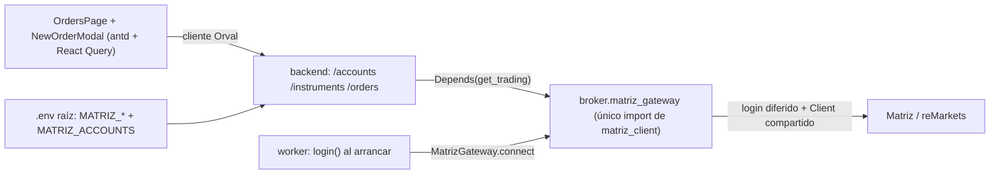

# Plan: `/orders` — listar, crear y cancelar órdenes contra Matriz

> **Objetivo:** convertir `/orders` en una pantalla operativa (listado con refresco condicional, cancelación con confirmación y modal de alta) servida por endpoints síncronos del backend sobre un nuevo paquete `matriz-broker`, único importador de `matriz_client`. **Appetite:** ~4–5 días (1 persona). **Riesgo:** medio — mueve la única dependencia de `matriz-client` entre paquetes y el backend pasa a hablar con un sistema externo con credenciales.

## Approach



Se crea `matriz-broker` (`broker/src/broker/matriz_gateway.py`), que absorbe el gateway actual del worker y suma `list_orders`, `new_order`, `cancel_order` y `list_instruments` con tipos propios del repo; `matriz-backend` y `matriz-worker` dependen de él y `matriz-client==0.3.0` se declara solo ahí. El backend expone cinco endpoints síncronos (`GET /accounts`, `GET /instruments`, `GET /orders`, `POST /orders`, `POST /orders/cancel`) con una instancia de gateway por proceso y login al primer uso; la UI los consume solo por Orval y hace polling por query con `refetchInterval` condicionado a la clasificación de estados (única, en `orderStatus.ts`). **Alternativas descartadas:** la cola en Postgres ejecutada por el worker se descarta porque no entrega los errores inmediatos que exigen EB-16 y EB-32; dejar el gateway en el worker y que el backend importe `worker` se descarta porque acopla el proceso HTTP al proceso long-running; streaming por WebSocket (PA-9) queda fuera de alcance porque el polling cubre EB-7/EB-8 sin infraestructura nueva.

## Affected files

| File | Change |
|---|---|
| `pyproject.toml:5` | Agregar `matriz-broker` a `dependencies` |
| `pyproject.toml:20` | Agregar `"broker"` a `members` |
| `pyproject.toml:22-26` | Agregar `matriz-broker = { workspace = true }` |
| `pyproject.toml:37` | Agregar `"broker"` a `include` de Pyright |
| `uv.lock` | Regenerado por `uv sync` (nunca a mano) |
| `broker/pyproject.toml` (nuevo) | Distribución `matriz-broker`; única declaración de `matriz-client==0.3.0` y su fuente wheel |
| `broker/src/broker/__init__.py`, `broker/src/broker/py.typed` (nuevos) | Paquete tipado |
| `broker/src/broker/matriz_gateway.py` (nuevo) | Único import de `matriz_client` (EB-37) |
| `broker/tests/test_matriz_gateway.py` (nuevo) | Mapeo de modelos y errores con `Client` falso |
| `broker/CLAUDE.md` (nuevo) | Documenta la regla de acceso único |
| `worker/pyproject.toml:7` | Quitar `matriz-client==0.3.0`; agregar `matriz-broker` |
| `worker/pyproject.toml:22` | Quitar la fuente de `matriz-client`; agregar `matriz-broker = { workspace = true }` |
| `worker/src/worker/matriz_gateway.py:1-44` | **Eliminar** (absorbido por `broker`) |
| `worker/src/worker/runner.py:9` | `from broker.matriz_gateway import GatewayError, MatrizGateway` |
| `worker/src/worker/__main__.py:12` | `from broker.matriz_gateway import MatrizClientGateway, MatrizCredentials` |
| `worker/src/worker/__main__.py:38` | Construir `MatrizClientGateway(MatrizCredentials(...))` desde `WorkerSettings` |
| `worker/tests/test_runner.py:13` | Import desde `broker.matriz_gateway` |
| `worker/Dockerfile:19-27` | `COPY broker/pyproject.toml broker/` y `COPY broker/ broker/` |
| `worker/CLAUDE.md:5,30` | Apuntar a `broker` como dueño de `matriz-client` |
| `backend/pyproject.toml:5-10` | Agregar `matriz-broker` |
| `backend/pyproject.toml:19-20` | Agregar `matriz-broker = { workspace = true }` |
| `backend/src/backend/settings.py:16-18` | Campos `matriz_*` opcionales y `matriz_accounts` (EB-38) |
| `backend/src/backend/main.py:31-44` | `create_app(settings, trading=None)`; `app.state.trading`; nuevos routers |
| `backend/src/backend/main.py:40` | `allow_methods=["GET", "POST"]` (EB-36) |
| `backend/src/backend/matriz.py` (nuevo) | Provider por proceso, caché de instrumentos, traducción de errores (EB-35) |
| `backend/src/backend/trading.py` (nuevo) | Routers `/accounts`, `/instruments`, `/orders`, `/orders/cancel` (EB-34) |
| `backend/tests/fake_trading.py` (nuevo) | `FakeTrading` en memoria (EB-39) |
| `backend/tests/test_trading.py` (nuevo) | Tests de endpoints con el fake |
| `backend/tests/test_settings.py` | Casos de `MATRIZ_ACCOUNTS` |
| `backend/Dockerfile:14-22` | `COPY broker/pyproject.toml broker/` y `COPY broker/ broker/` |
| `backend/CLAUDE.md` | Documentar endpoints y variables |
| `docker-compose.yml:23` | Sin cambio: `env_file: .env` ya entrega `MATRIZ_*` y `MATRIZ_ACCOUNTS` al `backend` (verificado) |
| `.env.example:29-34` | Renombrar sección a «Matriz (backend + worker)» y agregar `MATRIZ_ACCOUNTS=` |
| `scripts/check.sh:30` | `for project in model broker backend worker` |
| `CLAUDE.md:7,23` | Agregar `broker/` a Estructura y la regla «único acceso a Matriz: `broker/src/broker/matriz_gateway.py`» |
| `README.md:9,21` | Tabla de paquetes y origen de `matriz-client` |
| `frontend/openapi.json` | Regenerado con `uv run python -m backend.export_openapi` (EB-34) |
| `frontend/src/pages/OrdersPage.tsx:1-9` | Reescribir: título (UB-1) + toolbar + tabla + modal |
| `frontend/src/pages/orders/orderStatus.ts` (nuevo) | Clasificación final/no final y cancelabilidad (EB-6) |
| `frontend/src/pages/orders/format.ts` (nuevo) | `—` para vacíos, formato numérico, `describeApiError` |
| `frontend/src/pages/orders/OrdersTable.tsx` (nuevo) | Tabla + acción «Cancelar» |
| `frontend/src/pages/orders/NewOrderModal.tsx` (nuevo) | Modal de alta |
| `frontend/src/pages/orders/*.test.ts(x)` (nuevos) | Vitest |
| `frontend/src/pages/OrdersPage.test.tsx` (nuevo) | Vitest con router en memoria |
| `frontend/CLAUDE.md` (tabla `data-testid`) | Nuevos `data-testid` de `/orders` |
| `frontend/src/layout/AppLayout.test.tsx` | **Sin cambios** (UB-2); se agrega `fetch` stub solo si el test lo exigiera — ver Key details |
| `frontend/src/queryClient.ts:6` | **Sin cambios** (UB-11) |

## Broker changes

Paquete nuevo `matriz-broker` (`import broker`, layout `src/`, `py.typed`).

```toml
# broker/pyproject.toml
[project]
name = "matriz-broker"
version = "0.1.0"
requires-python = ">=3.13,<3.14"
dependencies = ["matriz-client==0.3.0", "httpx>=0.27"]

[build-system]
requires = ["hatchling"]
build-backend = "hatchling.build"

[tool.hatch.build.targets.wheel]
packages = ["src/broker"]

[tool.uv.sources]
matriz-client = { url = "https://github.com/gravity-quant/market-libs/releases/download/matriz-client-v0.3.0/matriz_client-0.3.0-py3-none-any.whl" }

[tool.pytest.ini_options]
testpaths = ["tests"]
addopts = "--import-mode=importlib"
```

```python
# broker/src/broker/matriz_gateway.py — único módulo que importa matriz_client (EB-37)
from dataclasses import dataclass
from typing import Literal, Protocol

Side = Literal["BUY", "SELL"]
OrderKind = Literal["MARKET", "LIMIT"]          # EB-25: solo estos dos


class GatewayError(Exception):
    """Fallo de Matriz (MatrizClientError | httpx.HTTPError) con mensaje sin secretos."""


@dataclass(frozen=True)
class MatrizCredentials:
    base_url: str
    username: str
    password: str


@dataclass(frozen=True)
class InstrumentRef:
    symbol: str
    market_id: str


@dataclass(frozen=True)
class OrderRecord:
    cl_ord_id: str | None
    proprietary: str | None
    account_id: str | None
    symbol: str | None
    market_id: str | None
    side: str | None
    ord_type: str | None
    order_qty: float | None
    price: float | None
    cum_qty: float | None
    leaves_qty: float | None
    status: str | None          # str libre: valores fuera del enum se muestran tal cual (EB-6)
    transact_time: str | None
    text: str | None


@dataclass(frozen=True)
class NewOrder:
    account_id: str
    symbol: str
    market_id: str
    side: Side
    order_type: OrderKind
    quantity: int
    price: float | None         # None si MARKET (EB-27)


@dataclass(frozen=True)
class OrderAck:
    cl_ord_id: str
    proprietary: str


class MatrizGateway(Protocol):          # sesión — lo usa el worker (UB-7)
    def connect(self) -> None: ...
    def close(self) -> None: ...


class MatrizTrading(Protocol):          # operación — lo usa el backend
    def list_orders(self, account_id: str) -> list[OrderRecord]: ...
    def new_order(self, order: NewOrder) -> OrderAck: ...
    def cancel_order(self, cl_ord_id: str, proprietary: str) -> OrderAck: ...
    def list_instruments(self) -> list[InstrumentRef]: ...


class MatrizClientGateway:              # implementa ambos Protocol
    def __init__(self, credentials: MatrizCredentials) -> None: ...
```

- `MatrizClientGateway.__init__` solo construye `Client(base_url=…, username=…, password=…)` (no hay red). Credenciales siempre explícitas (se conserva el comentario de `worker/src/worker/matriz_gateway.py:29`).
- `_ensure_session()` hace `login()` una vez, protegido por `threading.Lock`; si una operación levanta `AuthenticationError`, marca la sesión como no iniciada para que el próximo request reintente el login.
- `new_order` llama `client.new_order(symbol, side, qty, account, price, order_type=…, market_id=…)` **sin** pasar `time_in_force`, `iceberg`, `display_qty`, `cancel_previous` ni `expire_date` (defaults de la librería, EB-29).
- `list_orders` usa `get_all_orders(account_id)` (decisión resuelta).
- `list_instruments` descarta instrumentos con `symbol` o `marketId` nulos y ordena por `symbol`.
- `NewOrderResponse` con `clientId` o `proprietary` nulos → `GatewayError("Matriz no devolvió el identificador de la orden")`.
- Todo `MatrizClientError | httpx.HTTPError` → `GatewayError(mensaje)` con `password` reemplazado por `***`.

## Worker changes

- Se elimina `worker/src/worker/matriz_gateway.py`; `runner.py` y `__main__.py` importan de `broker.matriz_gateway`. `runner.run()` sigue tipado contra `MatrizGateway` (solo `connect`/`close`), así que los fakes de `worker/tests/test_runner.py` no cambian salvo el import (UB-7).
- `WorkerSettings` no cambia (sigue exigiendo `MATRIZ_*` → código 2 si faltan, UB-7).
- `market_data_gateway.py` intacto (UB-6).

```python
# worker/src/worker/__main__.py:38
credentials = MatrizCredentials(
    base_url=settings.matriz_base_url,
    username=settings.matriz_username,
    password=settings.matriz_password.get_secret_value(),
)
return asyncio.run(serve(MatrizClientGateway(credentials), MarketDataClientGateway(settings), settings))
```

## Backend changes

### Settings (EB-38)

```python
# backend/src/backend/settings.py
DEFAULT_MATRIZ_BASE_URL = "https://api.remarkets.primary.com.ar"

class BackendSettings(BaseSettings):
    database_url: str
    cors_origins: str = ""
    log_level: str = "INFO"
    matriz_base_url: str = DEFAULT_MATRIZ_BASE_URL
    matriz_username: str | None = None
    matriz_password: SecretStr | None = None
    matriz_accounts: str = ""          # MATRIZ_ACCOUNTS=REM1234,REM5678

    @property
    def matriz_account_list(self) -> list[str]:
        # strip, descarta vacíos, deduplica preservando el orden
        ...

    @property
    def matriz_credentials(self) -> MatrizCredentials | None:
        # None si falta username o password
        ...
```

Las `MATRIZ_*` son **opcionales** en el backend: `GET /health` y `export_openapi` (`backend/src/backend/export_openapi.py:19`) siguen funcionando sin ellas (UB-4).

### Provider y errores (`backend/src/backend/matriz.py`)

```python
INSTRUMENTS_TTL_SECONDS = 3600.0

class InstrumentCache:
    def __init__(self, trading: MatrizTrading, ttl_seconds: float = INSTRUMENTS_TTL_SECONDS,
                 clock: Callable[[], float] = time.monotonic) -> None: ...
    def get(self) -> list[InstrumentRef]: ...   # no cachea fallos

def get_trading(request: Request) -> MatrizTrading: ...           # 503 si app.state.trading es None
def get_instrument_cache(request: Request) -> InstrumentCache: ...
def get_accounts(request: Request) -> list[str]: ...
```

`create_app(settings, trading: MatrizTrading | None = None)`: si `trading` es `None` y `settings.matriz_credentials` existe, construye **una** `MatrizClientGateway` por proceso (sin login: login diferido al primer uso). Los tests pasan `FakeTrading`.

Traducción de errores (EB-35) — todos con cuerpo `{"detail": "<texto>"}`:

| Situación | HTTP | `detail` |
|---|---|---|
| `GatewayError` | `502` | `"Matriz: <mensaje sin secretos>"` |
| Backend sin `MATRIZ_USERNAME`/`MATRIZ_PASSWORD` | `503` | `"Matriz no está configurado (MATRIZ_USERNAME/MATRIZ_PASSWORD)"` |
| `account_id` fuera de `MATRIZ_ACCOUNTS` | `422` | `"Cuenta no configurada: <id>"` |
| Validación Pydantic | `422` | formato estándar de FastAPI |

### Endpoints (`backend/src/backend/trading.py`, EB-34)

Todos son `def` (sync → threadpool de FastAPI), con `operation_id` explícito para nombres estables en Orval.

| Método y path | `operation_id` | Request | Response |
|---|---|---|---|
| `GET /accounts` | `listAccounts` | — | `200 AccountsResponse` |
| `GET /instruments` | `listInstruments` | — | `200 list[InstrumentOut]` |
| `GET /orders?account_id=` | `listOrders` | query `account_id: str` (obligatorio) | `200 list[OrderOut]` |
| `POST /orders` | `createOrder` | `NewOrderRequest` | `201 OrderAckOut` |
| `POST /orders/cancel` | `cancelOrder` | `CancelOrderRequest` | `200 OrderAckOut` |

```python
class AccountsResponse(BaseModel):
    accounts: list[str]                       # orden de MATRIZ_ACCOUNTS; [] si vacío (EB-21)

class InstrumentOut(BaseModel):
    symbol: str
    market_id: str

class OrderOut(BaseModel):
    cl_ord_id: str | None
    proprietary: str | None
    account_id: str | None
    symbol: str | None
    market_id: str | None
    side: str | None
    ord_type: str | None
    order_qty: float | None
    price: float | None
    cum_qty: float | None
    leaves_qty: float | None
    status: str | None
    transact_time: str | None
    text: str | None

class NewOrderRequest(BaseModel):
    model_config = ConfigDict(extra="forbid")
    account_id: str = Field(min_length=1)
    symbol: str = Field(min_length=1)
    market_id: Literal["ROFX"]                # único MarketId de la librería
    side: Literal["BUY", "SELL"]              # EB-24
    order_type: Literal["MARKET", "LIMIT"]    # EB-25
    quantity: StrictInt = Field(gt=0)         # EB-28: 1.5, 0, -1, "3" → 422
    price: float | None = Field(default=None, gt=0)

    @model_validator(mode="after")
    def _price_matches_type(self) -> Self:
        # LIMIT sin price → 422 "El precio es obligatorio para órdenes LIMIT" (EB-26)
        # MARKET con price → 422 "Las órdenes MARKET no llevan precio" (EB-27)
        ...

class CancelOrderRequest(BaseModel):
    cl_ord_id: str = Field(min_length=1)
    proprietary: str = Field(min_length=1)

class OrderAckOut(BaseModel):
    cl_ord_id: str
    proprietary: str
```

- `GET /orders` ordena por `transact_time` descendente (comparación de string; `None` al final).
- `POST /orders` valida `account_id ∈ MATRIZ_ACCOUNTS` antes de llamar a Matriz.
- CORS: `allow_methods=["GET", "POST"]` (EB-36). La cancelación es `POST`, no `DELETE`.
- `/health` y su router no se tocan (UB-4).

## Frontend changes

Sin dependencias npm nuevas (UB-10). Sin cambios en `queryClient.ts` (UB-11). Toda llamada vía hooks Orval generados (UB-5): `useListAccounts`, `useListInstruments`, `useListOrders`, `useCreateOrder`, `useCancelOrder`.

### Clasificación de estados (única, EB-6)

```ts
// frontend/src/pages/orders/orderStatus.ts
export const FINAL_STATUSES = ['REJECTED', 'CANCELLED', 'REPLACED', 'FILLED'] as const;
export const NON_FINAL_STATUSES = [
  'NEW', 'PENDING_NEW', 'PENDING_REPLACE', 'PENDING_CANCEL', 'PENDING_APPROVAL', 'PARTIALLY_FILLED',
] as const;
export function isFinalStatus(status: string | null | undefined): boolean; // null/desconocido → false
export function isCancelable(status: string | null | undefined): boolean; // !final && !== 'PENDING_CANCEL'
export function hasNonFinal(statuses: readonly (string | null | undefined)[]): boolean;
export function effectiveStatus(apiStatus: string | null | undefined, pendingCancel: boolean): string | null | undefined;
```

### Formato y errores

```ts
// frontend/src/pages/orders/format.ts
export const EMPTY = '—';
export function formatNumber(value: number | null | undefined): string; // null/undefined/NaN → '—'; Intl es-AR, máx. 6 decimales
export function formatText(value: string | null | undefined): string;   // null/undefined/'' → '—'
export function describeApiError(error: unknown): string;
// ApiError con body.detail string → detail; detail array (422) → msgs unidos por '; ';
// ApiError sin detail → `HTTP <status>`; otro error → 'El backend no responde'
```

### Componentes

```ts
// OrdersTable.tsx
type OrdersTableProps = {
  orders: OrderOut[];
  pendingCancel: ReadonlySet<string>;          // claves `${cl_ord_id}|${proprietary}`
  cancelingKey: string | null;                 // fila con cancelación en curso
  onCancel: (order: OrderOut) => void;         // se invoca solo tras confirmar el Popconfirm
};

// NewOrderModal.tsx
type NewOrderModalProps = {
  open: boolean;
  accounts: string[];
  defaultAccount: string | undefined;
  onClose: () => void;                          // Cancelar, cruz, Escape (EB-19)
  onCreated: () => void;                        // éxito (EB-33)
};

type NewOrderFormValues = {
  account_id: string;
  instrument: string;                           // `${market_id}|${symbol}`
  side: 'BUY' | 'SELL';
  order_type: 'MARKET' | 'LIMIT';
  quantity: number;
  price?: number;
};
```

Estado local de `OrdersPage`: `accountId: string | undefined` (default: primera cuenta), `modalOpen: boolean`, `pendingCancel: Set<string>`.

### Contrato de `data-testid` nuevo

| `data-testid` | Elemento |
|---|---|
| `page-ordenes` | título «Órdenes» (se conserva, UB-1) |
| `orders-account-select` | `Select` de cuenta sobre la tabla |
| `orders-refresh` | botón «Actualizar» |
| `orders-new` | botón «Nueva orden» |
| `orders-loading` | indicador de carga inicial |
| `orders-table` | `Table` |
| `orders-empty` | estado vacío «No hay órdenes» |
| `orders-error` | `Alert` de error del listado (con botón «Reintentar») |
| `orders-no-accounts` | `Alert` de caché de cuentas vacío |
| `orders-action-error` | `Alert` de error de cancelación |
| `order-cancel-<cl_ord_id>` | botón «Cancelar» de la fila |
| `new-order-modal` | `Modal` de alta |
| `new-order-account` / `new-order-instrument` / `new-order-side` / `new-order-type` / `new-order-price` / `new-order-quantity` | campos |
| `new-order-submit` | botón «Enviar orden» |
| `new-order-error` | `Alert` de error de la API dentro del modal |

## Key implementation details

- **Intervalo de refresco:** constante `ORDERS_REFRESH_MS = 5000` en `OrdersPage.tsx`, fija en código (PA-4: se elige «fijo» para no sumar config build-time). `refetchInterval: (query) => hasNonFinal(statusesOf(query.state.data)) ? ORDERS_REFRESH_MS : false` — con lista vacía o todo final devuelve `false` (EB-7, EB-8). Los estados evaluados son los **efectivos** (incluye el override `PENDING_CANCEL`).
- **«Actualizar»** siempre habilitado (deshabilitado solo sin cuenta elegida); llama `refetch()`; si la respuesta trae no finales, el `refetchInterval` reactiva el polling solo (EB-9). Muestra `loading` mientras `isFetching`.
- **Carga inicial:** `isPending` → `Spin` con `orders-loading` (EB-1). La query se habilita solo con `accountId` definido (`enabled: accountId !== undefined`).
- **Error con datos previos (EB-10):** React Query conserva `data`; se renderiza la tabla y, arriba, `orders-error`. Error sin datos (EB-5): solo `orders-error` con `describeApiError` y botón «Reintentar» (`refetch`). «Nueva orden» sigue habilitado en ambos casos y en vacío (EB-4, EB-5).
- **Vacío (EB-4):** `Table` con `locale.emptyText` = `<Empty data-testid="orders-empty" description="No hay órdenes" />`.
- **Sin cuentas (EB-21):** `GET /accounts` → `[]` ⇒ `orders-no-accounts`: «No hay cuentas configuradas. Cargá `MATRIZ_ACCOUNTS` en el `.env` raíz (separadas por coma) y reiniciá el backend.» No se pide el listado; en el modal el `Select` de cuenta muestra el mismo texto como `notFoundContent` y `new-order-submit` queda deshabilitado.
- **Columnas (EB-2) en este orden:** Cuenta, Símbolo, Lado (`BUY`→«Compra», `SELL`→«Venta», otro→tal cual), Tipo, Cantidad, Precio, Ejecutada, Remanente, Estado (`Tag`: azul no final, verde `FILLED`, rojo `REJECTED`, gris `CANCELLED`/`REPLACED`, sin color si desconocido), Hora (`transact_time` crudo — no se reformatea porque el repo no fija su formato), Acciones. Vacíos → `—` (EB-3). `rowKey`: `${cl_ord_id}|${proprietary}`; si alguno es nulo, `row-<índice>` y la fila no ofrece «Cancelar».
- **Cancelabilidad (EB-11, EB-12):** el botón se renderiza solo si `isCancelable(effectiveStatus)` y la fila tiene `cl_ord_id` y `proprietary`; en `PENDING_CANCEL` se renderiza deshabilitado.
- **Cancelación:** `Popconfirm` título «¿Cancelar la orden de <símbolo>?», `okText` «Sí, cancelar», `cancelText` «No» (EB-13). Descartar no llama a la API (EB-17). Al confirmar: `useCancelOrder().mutate({ data: { cl_ord_id, proprietary } })`; botón `loading` y deshabilitado mientras la mutación de esa fila esté pendiente (EB-14). Éxito: agregar la clave a `pendingCancel` e `invalidateQueries({ queryKey: getListOrdersQueryKey({ account_id }) })` (EB-15). Error: `orders-action-error` con `describeApiError`, no se toca `pendingCancel` (EB-16).
- **Override `PENDING_CANCEL` (EB-15):** `effectiveStatus(api, pending)` devuelve `'PENDING_CANCEL'` si `pending && !isFinalStatus(api)`; si no, `api`. La clave se quita de `pendingCancel` cuando la API informa un estado final para esa fila (en el `useEffect` sobre `data`). Así el polling sigue activo mientras la orden no sea final.
- **Modal (EB-18…EB-33):** `Modal` antd con `keyboard` (Escape) y `maskClosable={false}`; abrir no cambia la ruta. `Form` con `initialValues = { account_id: defaultAccount, side: 'BUY', order_type: 'LIMIT' }`. Cuenta e Instrumento: `Select showSearch` con `optionFilterProp="label"`, sin modo `tags` (no texto libre, EB-20, EB-22). Instrumentos: `useListInstruments` con `enabled: open` y `staleTime: 3_600_000`, sin `refetchInterval`; cargando → `loading` y placeholder «Cargando instrumentos…»; error → `notFoundContent` con `describeApiError` y submit deshabilitado (EB-23). Lado: `Radio.Group` Compra/Venta. Tipo: `Radio.Group` Market/Limit. Precio: `Form.Item` renderizado **solo** si `Form.useWatch('order_type') === 'LIMIT'`, `InputNumber` `min` > 0, regla `required` + validator `> 0` (EB-26); con `MARKET` no se renderiza ni se envía (`price` omitido del body, EB-27). Cantidad: `InputNumber precision={0}`, reglas `required` + validator `Number.isInteger(v) && v > 0` (EB-28).
- **Envío:** `form.validateFields()` antes de mutar; inválido ⇒ no se llama a la API (EB-30). `okButtonProps={{ loading: isPending, disabled: … }}` y guard `if (isPending) return` (EB-31). El body se arma separando `instrument` en `market_id` y `symbol`. Error: modal abierto, valores intactos, `new-order-error` con `describeApiError` (EB-32). Éxito: `form.resetFields()`, limpiar error, `onCreated()` ⇒ cierra el modal e invalida `listOrders` de la cuenta actual (EB-33); si la orden se creó en otra cuenta, la página cambia `accountId` a esa cuenta para que aparezca.
- **Sin confirmación al emitir** (PA-6 por defecto).
- **Timeout:** `REQUEST_TIMEOUT_MS` (5 s, `frontend/src/api/http.ts:15`) no cambia; ver Riesgos.
- **`AppLayout.test.tsx` sin cambios (UB-2):** sin `fetch` stub las queries de `/orders` fallan en jsdom tras el primer render, pero el título `page-ordenes` se renderiza de forma síncrona, así que las aserciones actuales siguen valiendo. Si aparece ruido de `act()` que rompa el test, se resuelve en `frontend/src/test/setup.ts`, no en `AppLayout.test.tsx`.

## Risks & rollback

| Risk | Mitigation | How to revert |
|---|---|---|
| Mover `matriz-client` rompe el build Docker del worker | T4 actualiza `worker/Dockerfile:19-27`; `docker compose build worker` en Verification | `git revert` del commit de T4 (restaura `worker/src/worker/matriz_gateway.py`) |
| Primer request tras arrancar (login diferido + `get_all_instruments`) supera los 5 s de `REQUEST_TIMEOUT_MS` | Instrumentos cacheados 1 h; el error se muestra y «Reintentar»/«Actualizar» lo resuelven; ver Open Questions | Subir `REQUEST_TIMEOUT_MS` (afecta AC-8 de `/health`) o precalentar la sesión en lifespan |
| Credenciales de Matriz en mensajes de error | `GatewayError` redacta `password`; test que lo verifica | — (defecto a corregir) |
| `Client` de `matriz-client` no thread-safe bajo el threadpool de FastAPI | Login protegido por `Lock`; si aparece corrupción, serializar todas las llamadas con el mismo lock | Envolver cada método del gateway con el lock |
| Backend sin `MATRIZ_*` en algún entorno | Campos opcionales: `/health` sigue en 200 (UB-4) y los endpoints de trading responden 503 legible | — |
| Ruta real de órdenes en sandbox emite órdenes de verdad | Tests solo con `FakeTrading`; e2e no crea órdenes | — |
| `openapi.json` desincronizado | `backend/tests/test_openapi_snapshot.py` falla en `check.sh` | Regenerar con `uv run python -m backend.export_openapi` |

Rollback total: revertir los commits del cambio; no hay migraciones ni datos persistidos nuevos.

## Verification

| Criterio | Cómo se prueba |
|---|---|
| EB-1 | `OrdersPage.test.tsx`: `fetch` pendiente ⇒ `orders-loading` visible |
| EB-2 | `OrdersPage.test.tsx`: respuesta con 1 orden ⇒ los 10 encabezados y valores en la fila |
| EB-3 | `format.test.ts` (`null`/`undefined`/`NaN` → `—`) + fila MARKET con `price: null` muestra `—` |
| EB-4 | `[]` ⇒ `orders-empty` «No hay órdenes» y `orders-new` habilitado |
| EB-5 | `502 {detail}` ⇒ `orders-error` con el detail; «Reintentar» vuelve a llamar a `fetch`; `orders-new` habilitado |
| EB-6 | `orderStatus.test.ts`: tabla completa de los 10 estados + `null` + `'FOO'` |
| EB-7 | Fake timers: orden `NEW` ⇒ segundo `fetch` a los 5 s |
| EB-8 | Todas `FILLED` (y caso `[]`) ⇒ no hay segundo `fetch` tras 15 s |
| EB-9 | Polling detenido + clic `orders-refresh` devuelve `NEW` ⇒ se reanuda a los 5 s |
| EB-10 | Primer `fetch` OK, segundo 502 ⇒ tabla sigue visible + `orders-error` |
| EB-11 / EB-12 | `OrdersTable.test.tsx`: botón presente en `NEW`/`PARTIALLY_FILLED`; ausente en finales; deshabilitado en `PENDING_CANCEL` |
| EB-13 / EB-17 | Clic «Cancelar» ⇒ Popconfirm; «No» ⇒ `fetch` a `/orders/cancel` nunca llamado |
| EB-14 | «Sí, cancelar» ⇒ `POST /orders/cancel` con `{cl_ord_id, proprietary}` de la fila; botón `loading`; doble clic no duplica |
| EB-15 | Éxito + listado aún `NEW` ⇒ fila muestra `PENDING_CANCEL` y botón deshabilitado; polling sigue |
| EB-16 | Cancel 502 ⇒ `orders-action-error` y estado original |
| EB-18 / EB-19 | `NewOrderModal.test.tsx`: abre sin cambiar `location`; Cancelar, cruz y Escape cierran sin `POST /orders` |
| EB-20 / EB-22 | Selects sin opción de texto libre: escribir un valor inexistente no lo selecciona; opción elegida envía `symbol` + `market_id` |
| EB-21 | `GET /accounts` ⇒ `{accounts: []}` ⇒ `orders-no-accounts` y submit deshabilitado |
| EB-23 | Instrumentos pendientes ⇒ loading y submit deshabilitado; 502 ⇒ error y submit deshabilitado |
| EB-24 / EB-25 | Solo dos opciones en Lado y Tipo |
| EB-26 / EB-27 | LIMIT sin precio ⇒ error de campo y sin `POST`; MARKET ⇒ campo ausente y body sin `price`; backend: `test_trading.py` 422 en ambos casos inversos; `test_matriz_gateway.py` verifica `price=None` |
| EB-28 | Front: 1.5, 0, -1, vacío bloquean; back: `quantity` 1.5/0/-1/"3" ⇒ 422 |
| EB-29 | `test_matriz_gateway.py`: `new_order` del `Client` falso recibe solo `order_type` y `market_id` como kwargs |
| EB-30 / EB-31 | Inválido ⇒ 0 llamadas; envío ⇒ botón `loading`, segundo clic no genera segundo `POST` |
| EB-32 | `POST` 502 ⇒ modal abierto, valores intactos, `new-order-error` |
| EB-33 | `POST` 201 ⇒ modal cerrado, `GET /orders` vuelve a llamarse, reabrir muestra el form reiniciado |
| EB-34 | `test_openapi_snapshot.py` pasa; `openapi.json` contiene los 5 `operation_id` |
| EB-35 | `test_trading.py`: `GatewayError` ⇒ 502 `{detail}` sin password; sin credenciales ⇒ 503 |
| EB-36 | `test_trading.py`: preflight `OPTIONS /orders` con `Access-Control-Request-Method: POST` ⇒ permitido |
| EB-37 | `rg -l "matriz_client" --glob '*.py' backend worker broker model e2e` ⇒ solo `broker/src/broker/matriz_gateway.py` |
| EB-38 | `test_settings.py`: `MATRIZ_ACCOUNTS=" A, ,B,A "` ⇒ `["A","B"]`; `.env.example` documenta la variable |
| EB-39 | `scripts/check.sh` corre `pytest broker/backend/worker` y Vitest sin red |
| UB-1 / UB-2 / UB-3 | `AppLayout.test.tsx` pasa sin diff; `git diff --stat frontend/src/layout` vacío |
| UB-4 | `test_health.py` sin cambios pasa; backend sin `MATRIZ_*` responde `/health` 200 |
| UB-5 | `rg "fetch\(" frontend/src --glob '!*.test.*'` ⇒ solo `api/http.ts` |
| UB-6 | `rg -l market_data_client` ⇒ solo `worker/src/worker/market_data_gateway.py` |
| UB-7 | `worker/tests/test_runner.py` y `test_settings.py` pasan; `uv run python -m worker` sin `MATRIZ_PASSWORD` ⇒ exit 2 |
| UB-8 | `scripts/check.sh` termina en «Todos los gates pasaron» |
| UB-9 | No hay `.env*` nuevos fuera de la raíz |
| UB-10 | `git diff frontend/package.json frontend/package-lock.json` vacío |
| UB-11 | `git diff frontend/src/queryClient.ts` vacío |
| Docker | `docker compose build backend worker` OK; `docker compose up --build` y `/health` 200 |

## Tasks

### Wave 1

- [ ] T1: Crear el paquete `matriz-broker` (`broker/pyproject.toml`, `src/broker/{__init__,py.typed,matriz_gateway}.py`, `tests/test_matriz_gateway.py`), registrarlo en `pyproject.toml:5,20,22-26,37`, sumarlo a `scripts/check.sh:30`, recablear dependencias (`worker/pyproject.toml:7,22` quita `matriz-client` y suma `matriz-broker`; `backend/pyproject.toml:5-10,19-20` suma `matriz-broker`) y correr `uv sync` una sola vez (T1 es la única tarea que toca `uv.lock`) — _outcome: `cd broker && uv run pytest` pasa con un `Client` falso cubriendo mapeo de `Order`, `new_order` con `price=None` en MARKET y solo `order_type`/`market_id` como kwargs, redacción de password y login único (EB-27, EB-29, EB-35, EB-37)_
- [ ] T2: Crear `frontend/src/pages/orders/orderStatus.ts` y `format.ts` con sus tests — _outcome: `npm test -- orders/` pasa con la clasificación de los 10 estados + nulo/desconocido, `—` para vacíos y `describeApiError` (EB-3, EB-6)_
- [ ] T3: Agregar `MATRIZ_ACCOUNTS=` y renombrar la sección Matriz en `.env.example:29-34` — _outcome: `.env.example` documenta `MATRIZ_ACCOUNTS` como lista separada por comas usada por el backend (EB-38, UB-9)_

### Wave 2 (depends on T1)

- [ ] T4: Migrar el worker a `broker` (eliminar `worker/src/worker/matriz_gateway.py`, actualizar `runner.py:9`, `__main__.py:12,38`, `tests/test_runner.py:13`, `worker/Dockerfile:19-27`) — _outcome: `cd worker && uv run pytest` pasa y `docker compose build worker` termina OK (UB-7, EB-37)_
- [ ] T5: Agregar campos `matriz_*` y `matriz_accounts` en `settings.py`, `backend/src/backend/matriz.py` (provider, `InstrumentCache`, errores) y `backend/Dockerfile:14-22` — _outcome: `backend/tests/test_settings.py` pasa con parseo de `MATRIZ_ACCOUNTS` y con `MATRIZ_*` ausentes sin fallar la carga (EB-38, UB-4)_

### Wave 3 (depends on T5)

- [ ] T6: Crear `backend/src/backend/trading.py` con los 5 endpoints, `tests/fake_trading.py`, `tests/test_trading.py`, y cablear en `main.py:31-44` con `allow_methods=["GET","POST"]` — _outcome: `cd backend && uv run pytest tests/test_trading.py tests/test_health.py` pasa cubriendo 200/201/422/502/503, caché de instrumentos y preflight POST (EB-26, EB-27, EB-28, EB-34, EB-35, EB-36, UB-4)_

### Wave 4 (depends on T6)

- [ ] T7: Regenerar `frontend/openapi.json` con `uv run python -m backend.export_openapi` y el cliente con `npm run generate:api` — _outcome: `test_openapi_snapshot.py` pasa y `src/api/generated/matriz.ts` exporta `useListAccounts`, `useListInstruments`, `useListOrders`, `useCreateOrder`, `useCancelOrder` (EB-34, UB-5)_

### Wave 5 (depends on T2, T7)

- [ ] T8: Implementar `frontend/src/pages/orders/OrdersTable.tsx` (columnas, `—`, `Tag` de estado, «Cancelar» con `Popconfirm`) y `OrdersTable.test.tsx` — _outcome: los tests verifican columnas, cancelabilidad por estado y que descartar no dispara `onCancel` (EB-2, EB-3, EB-11, EB-12, EB-13, EB-17)_
- [ ] T9: Implementar `frontend/src/pages/orders/NewOrderModal.tsx` y `NewOrderModal.test.tsx` — _outcome: los tests verifican validación, Market vs Limit, selects sin texto libre, estados de instrumentos, loading anti-doble-envío, error que conserva valores, éxito que resetea y Escape que cierra sin `POST` (EB-18…EB-33)_

### Wave 6 (depends on T8, T9)

- [ ] T10: Reescribir `frontend/src/pages/OrdersPage.tsx` (título conservado, selector de cuenta, «Actualizar», «Nueva orden», polling condicional, override `PENDING_CANCEL`) y crear `OrdersPage.test.tsx` con router en memoria — _outcome: `npm test` pasa cubriendo carga, vacío, sin cuentas, error, error con datos previos, polling que arranca/se detiene/se reanuda, cancelación (éxito, error, descartada) y alta exitosa que refresca, con `AppLayout.test.tsx` sin cambios (EB-1, EB-4, EB-5, EB-7, EB-8, EB-9, EB-10, EB-14, EB-15, EB-16, EB-21, EB-33, UB-1, UB-2, UB-3, UB-10, UB-11)_

### Wave 7 (depends on T4, T10)

- [ ] T11: Actualizar `CLAUDE.md:7,23`, `worker/CLAUDE.md:5,30`, `backend/CLAUDE.md`, `frontend/CLAUDE.md` (tabla `data-testid`), crear `broker/CLAUDE.md` y ajustar `README.md:9,21` — _outcome: la documentación nombra `broker/src/broker/matriz_gateway.py` como único acceso a Matriz y lista los endpoints, `MATRIZ_ACCOUNTS` y los `data-testid` nuevos (EB-37, EB-38)_
- [ ] T12: Correr `scripts/check.sh` y `docker compose up --build` — _outcome: «Todos los gates pasaron» y `/health` responde 200 con el stack levantado (UB-4, UB-6, UB-8, EB-39)_

## Open Questions

- **Intervalo de refresco fijo (5 s en código).** Se eligió no agregar `VITE_ORDERS_REFRESH_MS` (PA-4). Revisar si se quiere configurable.
- **Timeout de 5 s del frontend** (`frontend/src/api/http.ts:15`) vs. el primer request que incluye el login diferido y `get_all_instruments`. Si en sandbox supera 5 s, decidir entre subir el timeout solo para estas queries (requiere un segundo mutator o `signal` propio) o precalentar la sesión en el `lifespan` del backend (sin bloquear `/health`).
- **Formato de `transact_time`.** Se muestra crudo; si Matriz devuelve un formato estable conviene formatearlo a hora local.
- **Thread-safety de `matriz_client.Client`.** Se asume que soporta llamadas concurrentes tras el login; si no, serializar todas las llamadas del gateway.
- **Override visual `PENDING_CANCEL`.** Se mantiene hasta que la API informe un estado final; si Matriz rechaza la cancelación sin cambiar de estado, la fila quedaría mostrando `PENDING_CANCEL`. Evaluar consultar `get_order_status` tras N refrescos.
- **`market_id` fijo en `Literal["ROFX"]`.** Si la librería suma mercados, ampliar el `Literal` en `NewOrderRequest`.
- **Alias de cuentas.** `MATRIZ_ACCOUNTS` no admite alias (decisión resuelta); revisar si hace falta un formato `ID:alias`.

## Critical Decisions

### Critical Decision — T1: el `Client` falso se inyecta con `monkeypatch` sobre `broker.matriz_gateway.Client`
**Qué:** `MatrizClientGateway` mantiene la firma `__init__(credentials)` sin parámetro de inyección; los tests reemplazan el símbolo `Client` del módulo y usan dataclasses propias (`FakeOrder`, `FakeInstrument`, `FakeResponse`) y `httpx.ConnectError` para los errores.
**Por qué:** así los tests no importan `matriz_client` y la verificación de EB-37 (`rg -l "matriz_client" … broker`) devuelve solo `broker/src/broker/matriz_gateway.py`; además no se ensucia la API pública con un factory solo para tests.
**Afecta:** `broker/tests/test_matriz_gateway.py`; `backend/tests/fake_trading.py` (T6) debe falsear el Protocol `MatrizTrading`, no el `Client`. El reintento de login tras `AuthenticationError` queda implementado pero sin test (requeriría importar la excepción de la librería).

### Critical Decision — T1: `new_order` fuerza `price=None` en MARKET y valida `market_id`
**Qué:** el gateway envía `price=None` siempre que `order_type == "MARKET"` (aunque `NewOrder.price` venga cargado) y convierte `market_id` al `Literal["ROFX"]` de la librería, lanzando `GatewayError("Mercado no soportado: …")` para otro valor.
**Por qué:** defensa en profundidad de EB-27 y estrechamiento de tipos para Pyright strict sin `cast`.
**Afecta:** `broker/src/broker/matriz_gateway.py`; el `422` por MARKET con precio sigue siendo responsabilidad de `NewOrderRequest` (T6).

### Critical Decision — T5: `install_matriz` concentra el cableado de Matriz en `app.state`
- **Qué:** `backend/src/backend/matriz.py` expone `install_matriz(app, settings, trading=None)`, que guarda `app.state.trading`, `app.state.instrument_cache` (`None` sin credenciales) y `app.state.matriz_accounts`, y registra el handler `GatewayError` → `502 {"detail": "Matriz: …"}`; además `build_trading(settings)` y `require_configured_account(account_id, accounts)` (→ 422 `Cuenta no configurada: <id>`). `matriz_credentials` trata `MATRIZ_USERNAME`/`MATRIZ_PASSWORD` vacíos o en blanco como ausentes.
- **Por qué:** el plan define los providers y la tabla de errores pero no dónde se arma el estado ni cómo se traduce `GatewayError`; un único punto evita duplicar lógica en `main.py` y en los tests. Tratar vacíos como ausentes evita intentar login con `MATRIZ_USERNAME=` vacío.
- **Afecta:** T6 (`create_app` solo llama `install_matriz(app, settings, trading)`; los endpoints usan `get_trading`, `get_instrument_cache`, `get_accounts` y `require_configured_account`).

### Critical Decision — T4: test de errores del gateway construye `MatrizCredentials`
- **Qué:** `worker/tests/test_runner.py::test_client_gateway_wraps_library_errors` deja de pasar `WorkerSettings` a `MatrizClientGateway` y construye `MatrizCredentials` desde `make_settings(password="")`; no es solo un cambio de import como preveía el plan.
- **Por qué:** el constructor de `broker.MatrizClientGateway` recibe `MatrizCredentials`, no `WorkerSettings`; el test sigue verificando que `connect()` traduce el error de la librería a `GatewayError`.
- **Afecta:** `worker/tests/test_runner.py` únicamente.

### Critical Decision — T6: `fake_trading` importable vía `pythonpath` de pytest
- **Qué:** `backend/pyproject.toml` suma `pythonpath = ["tests"]` en `[tool.pytest.ini_options]` para que `test_trading.py` haga `from fake_trading import FakeTrading, make_order`.
- **Por qué:** con `--import-mode=importlib` el directorio `tests/` no queda en `sys.path`, así que un módulo hermano no se puede importar; Pyright lo resuelve por el directorio del archivo.
- **Afecta:** `backend/pyproject.toml`, `backend/tests/fake_trading.py`, `backend/tests/test_trading.py`.

### Critical Decision — T6: `GET /orders` también valida la cuenta contra `MATRIZ_ACCOUNTS`
- **Qué:** además de `POST /orders`, `GET /orders?account_id=` responde `422 "Cuenta no configurada: <id>"` sin llamar a Matriz si la cuenta no está en `MATRIZ_ACCOUNTS`.
- **Por qué:** la tabla de errores del plan lista ese `422` sin restringirlo al alta; evita consultar en Matriz cuentas que el backend no administra.
- **Afecta:** `backend/src/backend/trading.py`; T10 (el frontend solo pide cuentas que obtuvo de `GET /accounts`).

### Critical Decision — T6: tests de trading con settings sin `.env`
- **Qué:** `test_trading.py` construye `BackendSettings(_env_file=None, …)` con `MATRIZ_*` explícitos.
- **Por qué:** el `.env` raíz local puede tener credenciales reales; sin esto el caso «sin credenciales ⇒ 503» dependía del entorno del desarrollador.
- **Afecta:** `backend/tests/test_trading.py` únicamente.

### Critical Decision — T8: estado vacío y `orders-table` dentro de `OrdersTable`
- **Qué:** `OrdersTable` renderiza el `Table` con `data-testid="orders-table"` y `locale.emptyText` = `<Empty data-testid="orders-empty" description="No hay órdenes" />` (EB-4).
- **Por qué:** el `Table` vive en `OrdersTable`, no en `OrdersPage`; así T10 no necesita pasar el estado vacío como prop.
- **Afecta:** `frontend/src/pages/orders/OrdersTable.tsx`; T10 solo usa `<OrdersTable …/>`.

### Critical Decision — T8: clave de fila privada y stub de `ResizeObserver`
- **Qué:** `orderKey()` (`${cl_ord_id}|${proprietary}` o `null`) queda **sin exportar** en `OrdersTable.tsx`, y `frontend/src/test/setup.ts` agrega un stub de `ResizeObserver`.
- **Por qué:** exportar una función desde un archivo de componentes dispara `react-refresh/only-export-components`. Además, `Popconfirm` de antd usa `ResizeObserver`, que jsdom no implementa.
- **Afecta:** T10 debe armar la misma clave para `pendingCancel` y `cancelingKey` (o mover `orderKey` a un `.ts` compartido). El stub también sirve para los tests de T9 y T10.

### Critical Decision — T9: `onCreated(accountId)`, cantidad sin `precision={0}` y errores visibles en el campo
- **Qué:** `NewOrderModal` llama `onCreated(accountId: string)` (no `() => void`). `InputNumber` de Cantidad usa `step={1}` sin `precision={0}`. El error de instrumentos y el aviso de «sin cuentas» se muestran como `help` del `Form.Item` (además del `notFoundContent`). El `Modal` usa `forceRender` y el `data-testid="new-order-modal"` va en un `div` que envuelve el contenido.
- **Por qué:** con la cuenta usada, la página puede cambiar `accountId` cuando la orden se creó en otra cuenta, como pide el plan. `precision={0}` redondea 1.5 a 2 en silencio, así que el decimal nunca llegaría a bloquearse (EB-28). El `notFoundContent` solo se ve con el desplegable abierto (EB-21, EB-23). `Modal` no reenvía `data-*`, y `forceRender` mantiene conectado el `Form.useForm`.
- **Afecta:** T10 (`OrdersPage` recibe la cuenta en `onCreated`) y T11 (tabla de `data-testid` de `frontend/CLAUDE.md`).

### Critical Decision — T10: un caso de `AppLayout.test.tsx` se ajusta porque contradice EB-1
- **Qué:** el caso `it.each` «`%s` muestra su título sin llamar al backend» se partió en dos: `/orders` solo verifica el título y `/strategies` mantiene la verificación de que no se llama al backend. El resto de `AppLayout.test.tsx` no cambia. Además, `OrdersPage` muestra `orders-error` (con «Reintentar») si falla `GET /accounts`, y el override `PENDING_CANCEL` se limpia en un `useEffect` sobre los datos del listado.
- **Por qué:** EB-1 exige pedir datos al entrar a `/orders`, así que `expect(fetchMock).not.toHaveBeenCalled()` no puede seguir valiendo. El plan suponía que el título síncrono alcanzaba, pero esa aserción falla en cuanto se renderiza la página. Diferir el fetch solo para pasar el test habría ocultado el conflicto en vez de resolverlo. Por eso UB-2 se cumple para el layout y el menú, pero no a nivel de «archivo sin diff».
- **Afecta:** `frontend/src/layout/AppLayout.test.tsx`; la verificación de UB-2 del plan (`git diff --stat frontend/src/layout` ya no queda vacío) y T12.
