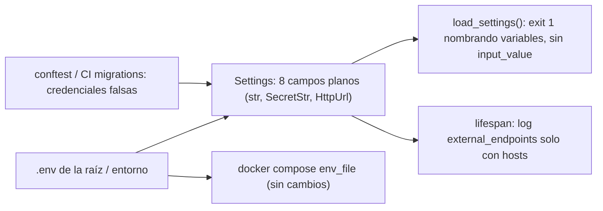

# Plan: variables de configuración de `market-data-client` y `matriz-client` en el `.env`

> Exponer las ocho variables de `matriz-client` y `market-data-client` en `.env.example` y en `Settings`, con las credenciales obligatorias, URLs validadas, secretos enmascarados y el host efectivo en el log. Appetite: S. Risk: medium.

## Approach



Agrego a `Settings` (`backend/app/core/config.py`) ocho campos planos con el mismo nombre que leen las librerías: las seis credenciales sin default y no vacías, los dos `*_BASE_URL` con el default de cada librería y las tres URLs tipadas como `HttpUrl`. Como todas las credenciales son obligatorias (Resolved Decision 1), la regla «todo o nada» por librería (Resolved Decision 2) se cumple sola: pydantic reporta por nombre cada variable faltante del grupo, así que no hace falta un `@model_validator` extra. `load_settings()` deja de volcar `str(exc)` (incluye `input_value` y, en los errores `missing`, el dict completo de entrada con secretos) y pasa a imprimir solo `loc` + `msg`. El `lifespan` registra los hosts efectivos (Resolved Decision 4). Los tests y el job `migrations` de CI definen credenciales falsas. Alternativas descartadas: submodelos anidados (`settings.matriz.user`), porque obligan a alias o a renombrar variables (Resolved Decision 3); separar un `DatabaseSettings` para que Alembic no exija credenciales, porque suma una clase y un refactor de `load_settings` solo para el job `migrations`, que se resuelve con tres líneas de `env:` en CI; validar hosts por `APP_ENV`, porque se decidió solo loguearlos.

## Affected files

| File | Change |
|---|---|
| `.env.example:31` | Nuevas secciones `matriz-client` y `market-data-client` (antes del bloque Frontend) con las 8 variables comentadas (AC-1, AC-2, AC-3, AC-4) |
| `backend/app/core/config.py:24` | 8 campos nuevos en `Settings`, tipos `NonEmptyStr` / `SecretStr` / `HttpUrl`, validador de secretos no vacíos (AC-5, AC-6, AC-7, AC-8, AC-9) |
| `backend/app/core/config.py:32` | `_invalid_variables` y `load_settings()` formatean errores sin `input_value` (AC-7, AC-10) |
| `backend/app/main.py:23` | `lifespan` loguea `external_endpoints` con los hosts efectivos, sin secretos (Resolved Decision 4, AC-9) |
| `backend/tests/conftest.py:16` | `test_env` define las 6 credenciales falsas además de `DATABASE_URL` (AC-12) |
| `backend/tests/test_config.py:1` | Tests nuevos: carga, defaults, URLs inválidas, faltantes, vacíos, enmascarado, stderr sin secretos (AC-5 a AC-10) |
| `backend/tests/test_deps.py:36` | Test del log `external_endpoints` del `lifespan` (Resolved Decision 4, AC-9) |
| `.github/workflows/ci.yml:163` | Job `migrations`: credenciales falsas en `env:` porque `migrations/env.py:31` llama a `load_settings()` (AC-12) |
| `backend/CLAUDE.md:99` | Documenta que `test_env` también define las credenciales falsas |
| `README.md:59` | Menciona las credenciales de Matriz y market data como variables a completar en el `.env` (AC-1) |
| `docker-compose.dev.yml:11` / `docker-compose.prod.yml:12` | Sin cambios: el ancla `x-root-env` (`env_file: .env`) ya entrega todas las variables al backend (AC-11) |

## Backend changes

### `Settings` (`backend/app/core/config.py`)

```python
from typing import Annotated, Final, Literal

from pydantic import Field, HttpUrl, PostgresDsn, SecretStr, StringConstraints, ValidationError, field_validator

PRIMARY_BASE_URL_DEFAULT: Final = HttpUrl("https://api.remarkets.primary.com.ar")
MARKET_DATA_BASE_URL_DEFAULT: Final = HttpUrl("https://market-data-develop.bbsa.com.ar/api")

NonEmptyStr = Annotated[str, StringConstraints(strip_whitespace=True, min_length=1)]


class Settings(BaseSettings):
    ...  # campos existentes sin cambios

    # --- matriz-client (nombres exactos que lee la librería) ---
    primary_user: NonEmptyStr
    primary_password: SecretStr
    primary_base_url: HttpUrl = PRIMARY_BASE_URL_DEFAULT

    # --- market-data-client ---
    market_data_client_id: NonEmptyStr
    market_data_client_secret: SecretStr
    market_data_audience: NonEmptyStr
    market_data_auth0_token_url: HttpUrl
    market_data_base_url: HttpUrl = MARKET_DATA_BASE_URL_DEFAULT

    @field_validator("primary_password", "market_data_client_secret")
    @classmethod
    def _secret_not_blank(cls, value: SecretStr) -> SecretStr:
        if not value.get_secret_value().strip():
            raise ValueError("no puede estar vacía")
        return value
```

### `load_settings()` (`backend/app/core/config.py`)

```python
def _format_errors(exc: ValidationError) -> str:
    """Una línea por error, `VARIABLE: mensaje`. Nunca incluye `input_value` (puede tener secretos)."""
    lines = []
    for error in exc.errors(include_input=False, include_url=False):
        loc = error["loc"]
        name = str(loc[0]).upper() if loc else "<desconocida>"
        lines.append(f"  - {name}: {error['msg']}")
    return "\n".join(lines)


def load_settings() -> Settings:
    try:
        return Settings()
    except ValidationError as exc:
        names = ", ".join(_invalid_variables(exc))
        sys.stderr.write(f"Configuración inválida: {names}\n{_format_errors(exc)}\n")
        raise SystemExit(1) from None  # `from None`: el traceback encadenado repetiría el input
```

Salida esperada en stderr ante una URL inválida y una credencial faltante:

```text
Configuración inválida: PRIMARY_BASE_URL, MARKET_DATA_CLIENT_SECRET
  - PRIMARY_BASE_URL: URL scheme should be 'http' or 'https'
  - MARKET_DATA_CLIENT_SECRET: Field required
```

### Log de arranque (`backend/app/main.py`, `lifespan`)

```python
logger = structlog.get_logger(__name__)

# dentro de lifespan, después de configure_logging(...)
logger.info(
    "external_endpoints",
    primary_host=settings.primary_base_url.host,
    market_data_host=settings.market_data_base_url.host,
    market_data_auth_host=settings.market_data_auth0_token_url.host,
)
```

Solo hosts (`str | None`), nunca usuario, secretos ni URL completa.

### `.env.example`

```dotenv
# --- matriz-client (API de Primary / Matriz) ---
# Usuario de la API de Primary. Obligatoria: el backend no arranca sin ella.
PRIMARY_USER=change-me-user
# Contraseña de ese usuario. Obligatoria y secreta: nunca la commitees.
PRIMARY_PASSWORD=change-me-local-only
# URL base de la API de Primary. Opcional; default de la librería: https://api.remarkets.primary.com.ar (sandbox reMarkets).
PRIMARY_BASE_URL=https://api.remarkets.primary.com.ar

# --- market-data-client (API de market data, autenticación con Auth0) ---
# Client ID de Auth0 para market data. Obligatoria.
MARKET_DATA_CLIENT_ID=change-me-client-id
# Client secret de Auth0. Obligatoria y secreta: nunca la commitees.
MARKET_DATA_CLIENT_SECRET=change-me-local-only
# Audience del token de Auth0. Obligatoria.
MARKET_DATA_AUDIENCE=change-me-audience
# URL absoluta del endpoint de token de Auth0. Obligatoria, sin default.
MARKET_DATA_AUTH0_TOKEN_URL=https://change-me.auth0.com/oauth/token
# URL base de la API de market data. Opcional; default de la librería: https://market-data-develop.bbsa.com.ar/api.
MARKET_DATA_BASE_URL=https://market-data-develop.bbsa.com.ar/api
```

### Tests (`backend/tests/conftest.py`)

```python
TEST_CREDENTIALS: Final = {
    "PRIMARY_USER": "test-user",
    "PRIMARY_PASSWORD": "test-primary-password",
    "MARKET_DATA_CLIENT_ID": "test-client-id",
    "MARKET_DATA_CLIENT_SECRET": "test-market-data-secret",
    "MARKET_DATA_AUDIENCE": "test-audience",
    "MARKET_DATA_AUTH0_TOKEN_URL": "https://auth.test/oauth/token",
}

@pytest.fixture(autouse=True)
def test_env(monkeypatch: pytest.MonkeyPatch) -> None:
    monkeypatch.setenv("DATABASE_URL", TEST_DATABASE_URL)
    for name, value in TEST_CREDENTIALS.items():
        monkeypatch.setenv(name, value)
    monkeypatch.delenv("PRIMARY_BASE_URL", raising=False)
    monkeypatch.delenv("MARKET_DATA_BASE_URL", raising=False)
```

Los `delenv` evitan que un valor del shell del desarrollador cambie el resultado de AC-6; los tests que necesitan aislarse del `.env` local pasan `_env_file=None` (o un `tmp_path`).

## CI changes

```yaml
# .github/workflows/ci.yml, job migrations, bloque env:
env:
  DATABASE_URL: postgresql+psycopg://ci:ci@localhost:5432/ci
  # Ficticias: `migrations/env.py` valida Settings completas (credenciales obligatorias).
  PRIMARY_USER: ci
  PRIMARY_PASSWORD: ci-not-a-secret
  MARKET_DATA_CLIENT_ID: ci
  MARKET_DATA_CLIENT_SECRET: ci-not-a-secret
  MARKET_DATA_AUDIENCE: ci
  MARKET_DATA_AUTH0_TOKEN_URL: https://auth.ci.invalid/oauth/token
```

El job `backend` no necesita cambios: `conftest.py` define las credenciales. El job `e2e` solo levanta `vp dev` (`frontend/playwright.config.ts:17`), no el backend.

## Key implementation details

- **Nombres**: `case_sensitive=False` + campos en minúscula = las variables en mayúscula que leen las librerías; sin `env_prefix`, sin alias (NFR de nombres exactos).
- **Obligatorias**: las seis credenciales no tienen default. Si falta cualquiera, `load_settings()` sale con `1` y nombra cada una (Resolved Decisions 1 y 2). Esto reemplaza el comportamiento del AC-8 original (ver Open Questions).
- **Vacíos** (`PRIMARY_USER=`): `env_ignore_empty` queda en `False` (default), así que el string vacío llega al validador; `NonEmptyStr` (con `strip_whitespace`) y `_secret_not_blank` lo rechazan, y `HttpUrl` rechaza `""`. Un valor solo con espacios también es error (Resolved Decision 5).
- **URLs**: `HttpUrl` exige esquema `http`/`https` y host; rechaza `ftp://…`, `api.remarkets…` sin esquema y rutas relativas (AC-7). `HttpUrl` normaliza: `str(HttpUrl("https://api.remarkets.primary.com.ar"))` agrega `/` final. Los tests de AC-5/AC-6 comparan contra `HttpUrl(valor)` o por `.host`/`.path`, no contra el string crudo. El código futuro que construya los clientes debe pasar `str(url).rstrip("/")`.
- **No construir clientes**: no se importa `matriz_client` ni `market_data_client` en ningún lado (Out of Scope); import-linter sigue igual.
- **stderr (AC-10)**: `str(ValidationError)` imprime `input_value`; en un error `missing` ese valor es el dict completo de entrada, con `primary_password` y `market_data_client_secret` en claro. Por eso se usa `exc.errors(include_input=False)` y `raise ... from None`.
- **Enmascarado (AC-9)**: `SecretStr` muestra `'**********'` en `repr()`/`str()` de `Settings`; `redact_sensitive` (`backend/app/core/logging.py:39`) ya reemplaza `SecretStr` y claves con `password|secret` por `"***"`, también en `settings.model_dump()`.
- **Docker (AC-11)**: no se toca `environment:`; `env_file: .env` del ancla `x-root-env` entrega las 8 variables. Un `.env` viejo sin credenciales hace que el backend del contenedor salga con `1` nombrándolas.
- **Orden en `Settings`**: los campos nuevos van después de `log_level`, agrupados por librería con un comentario, igual que en `.env.example`.

## Risks & rollback

| Risk | Mitigation | How to revert |
|---|---|---|
| Desarrolladores con un `.env` previo ya no pueden arrancar el backend ni correr `alembic` | El mensaje de stderr nombra cada variable faltante; `.env.example` trae placeholders que permiten arrancar; README lo menciona | Revertir el commit de `config.py` |
| `str(exc)` u otro camino filtra un secreto en stderr | `_format_errors` con `include_input=False` y `from None`; test que define secretos con valor centinela y verifica que no aparezcan (AC-10) | — (es la mitigación) |
| gitleaks marca los placeholders de `.env.example` o de CI | Valores con el mismo patrón ya aceptado (`change-me-local-only`, igual que `POSTGRES_PASSWORD`) y `ci-not-a-secret` | Cambiar el placeholder |
| La normalización de `HttpUrl` (slash final) confunde a quien construya los clientes | Documentado en Key implementation details; tests comparan contra `HttpUrl` | — |
| El job `migrations` de CI falla por credenciales faltantes | `env:` del job define las 6 credenciales ficticias | Quitar las líneas o revertir |
| Un test hereda variables del shell o del `.env` local y no es determinista | `test_env` setea/borra las 8 variables; tests de Settings usan `_env_file` explícito | — |

## Verification

| AC | Cómo se prueba |
|---|---|
| AC-1 | `test_env_example_lists_library_variables`: parsea `.env.example` y verifica las 8 claves en las dos secciones |
| AC-2 | Mismo test: la línea anterior a cada una de las 8 variables empieza con `#`; revisión del texto en el PR |
| AC-3 | Test: `PRIMARY_PASSWORD` y `MARKET_DATA_CLIENT_SECRET` valen `change-me-local-only`; job `security` (gitleaks) en verde |
| AC-4 | Test: los valores de ejemplo de `PRIMARY_BASE_URL` y `MARKET_DATA_BASE_URL` coinciden con `PRIMARY_BASE_URL_DEFAULT` y `MARKET_DATA_BASE_URL_DEFAULT` |
| AC-5 | `test_settings_reads_library_variables`: `Settings(_env_file=tmp)` con las 8 variables; compara cada campo (`get_secret_value()` para secretos, `HttpUrl(...)` para URLs) |
| AC-6 | `test_base_urls_default_to_library_values`: sin las dos `*_BASE_URL`, los campos son los defaults |
| AC-7 | `test_app_exits_when_url_is_invalid` parametrizado por las 3 URLs con `ftp://x`, `no-scheme` y `/relativa`: `_run_app` → exit `1` y el nombre en stderr |
| AC-8 (reinterpretado por Resolved Decisions 1, 2 y 5) | `test_app_exits_when_credential_missing` y `..._is_blank` parametrizados por las 6 credenciales: exit `1`, nombre en stderr; con todas definidas, `test_health.py` sigue respondiendo `200` |
| AC-9 | `test_settings_repr_masks_secrets` (`repr`/`str` sin el valor centinela) y `test_structlog_redacts_settings` (loguea `settings.model_dump()` con `configure_logging` y verifica la salida con `capsys`) |
| AC-10 | `test_load_settings_stderr_has_no_secrets`: secretos con valor centinela + otra variable inválida (y otro caso con una credencial faltante) → el centinela no aparece en stderr |
| AC-11 | Manual: `docker compose -f docker-compose.dev.yml config backend` y `-f docker-compose.prod.yml` con un `.env` de prueba muestran las 8 variables en `environment` |
| AC-12 | `scripts/gate.sh backend full` sin `.env` en la raíz sale con `0` (credenciales de `conftest.py`); job `backend` y `migrations` en verde |
| Resolved Decision 4 | `test_lifespan_logs_external_hosts` en `test_deps.py`: la salida incluye los tres hosts y no los secretos |

## Tasks

### Wave 1
- [ ] T1 @docs-expert: agregar las secciones `matriz-client` y `market-data-client` a `.env.example` con las 8 variables, comentarios en español y placeholders no secretos, y mencionarlas en `README.md:59` — _outcome: `.env.example` lista las 8 variables comentadas con defaults de reMarkets/develop y valores `change-me-*` (AC-1, AC-2, AC-3, AC-4)_
- [ ] T2 @backend-expert: agregar los 8 campos, `NonEmptyStr`, `_secret_not_blank`, las constantes de default y `_format_errors` a `backend/app/core/config.py`; definir las 6 credenciales falsas en `test_env` de `backend/tests/conftest.py` y actualizar `backend/CLAUDE.md:99` — _outcome: `Settings` expone los 8 campos tipados, `load_settings()` sale con `1` nombrando la variable sin volcar `input_value`, y la suite existente pasa sin `.env` (AC-5, AC-6, AC-7, AC-8, AC-9, AC-10, AC-12)_
- [ ] T3: agregar las 6 credenciales ficticias al `env:` del job `migrations` en `.github/workflows/ci.yml:163` — _outcome: `alembic upgrade head --sql` del job `migrations` valida `Settings` sin `.env`; actionlint y zizmor pasan (AC-12)_

### Wave 2 (depends on T1, T2)
- [ ] T4 @test-generator: agregar a `backend/tests/test_config.py` los tests de la tabla de Verification (carga, defaults, URLs inválidas, credenciales faltantes y vacías, enmascarado en `repr` y structlog, stderr sin secretos, contenido de `.env.example`) — _outcome: cada AC-1 a AC-10 tiene al menos un test que falla si se rompe el comportamiento y la cobertura del backend sigue ≥ 85 % (AC-1, AC-2, AC-3, AC-4, AC-5, AC-6, AC-7, AC-8, AC-9, AC-10)_
- [ ] T5 @backend-expert: loguear `external_endpoints` con los hosts efectivos en el `lifespan` de `backend/app/main.py` y agregar `test_lifespan_logs_external_hosts` en `backend/tests/test_deps.py` — _outcome: al arrancar se ve en el log contra qué hosts opera el backend, sin secretos (AC-9)_

### Wave 3 (depends on T3, T4, T5)
- [ ] T6: correr `scripts/gate.sh changed full` sin `.env` en la raíz y `docker compose -f docker-compose.dev.yml config backend` / `-f docker-compose.prod.yml config backend` con un `.env` de prueba — _outcome: el gate sale con `0` y ambos compose muestran las 8 variables en el `environment` del backend (AC-11, AC-12)_

## Open Questions

- [ ] AC-8 y AC-12 de `requirements.md` siguen escritos para credenciales opcionales («arrancar igual y `/api/health` responde `200`»). Este plan aplica las Resolved Decisions 1, 2 y 5 (credenciales obligatorias, no vacías, abortar con exit `1`) y cumple AC-12 con credenciales falsas en `conftest.py` y CI. Conviene reescribir AC-8 en `requirements.md` para que coincida.
- [ ] La regla «todo o nada» por librería (Resolved Decision 2) queda cubierta por la obligatoriedad de cada campo, sin `@model_validator` aparte. Si más adelante una librería pasa a ser opcional (por ejemplo, correr sin market data), ahí sí hará falta el validador de grupo.
- [ ] `MARKET_DATA_AUDIENCE` y `MARKET_DATA_AUTH0_TOKEN_URL` usan placeholders (`change-me-audience`, `https://change-me.auth0.com/oauth/token`) porque no conocemos los valores del entorno develop. Si son públicos, conviene poner los reales en `.env.example`.
- [ ] Alembic (`backend/migrations/env.py:31`) ahora exige las credenciales aunque no las use. Se eligió resolverlo con variables ficticias en CI; si molesta en local, se puede separar un `DatabaseSettings` en una iteración futura.

## Critical Decisions

### Critical Decision — T4: aislar los tests de `Settings` del `.env` local sin subprocess
- **What**: los tests de credenciales faltantes/vacías, URLs inválidas, enmascarado y stderr llaman a `load_settings()` en proceso con la fixture `no_env_file` (`monkeypatch.setitem(Settings.model_config, "env_file", None)`); solo AC-7 y AC-10 tienen además un test por `python -m app` (subprocess), con valores que el entorno pisa sobre cualquier `.env`. El test de AC-10 con credencial faltante también exige `__cause__ is None` y `__suppress_context__`.
- **Why**: un subprocess lee el `.env` de la raíz del desarrollador, así que un test de «credencial faltante» por subprocess no sería determinista; y pydantic trunca `input_value` en `str(exc)`, por lo que un centinela no siempre aparece al volver a volcar `str(exc)`: la verificación de `from None` es la que detecta esa regresión.
- **Affects**: `backend/tests/test_config.py`.
