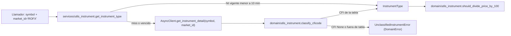

# Plan: utils_instrument — tipo de instrumento y división de precio por 100

> Agregar `InstrumentType` + `should_divide_price_by_100` (dominio puro) y `get_instrument_type` (servicio sobre `matriz-client`, con caché de 10 minutos), sin tocar la API HTTP. Appetite: S. Risk: low.

## Approach



La regla pura (enum `InstrumentType`, tabla CFI → tipo por igualdad exacta y `should_divide_price_by_100` con `match` exhaustivo + `assert_never`) vive en `app/domain/utils_instrument.py`, y la consulta a Matriz vive en `app/services/utils_instrument.py`: el servicio pide **un solo instrumento** con `get_instrument_detail(symbol, market_id)` (Resolved Decision: «pasar el symbol completo») y guarda en memoria el tipo resuelto durante 10 minutos, medido con el `Clock` inyectable. La fuente se recibe como un `Protocol` (mismo patrón que `MarketDataSource` en `backend/app/services/market_data.py:31`), así los tests usan un doble sin red. Alternativas descartadas: un solo archivo en `app/services/` (el dominio no podría reutilizar el enum ni la regla de división, y la regla pura quedaría fuera del contrato «Dominio puro» de import-linter); traer `get_instruments_details()` en cada llamada (trae todo el catálogo por consulta, descartado por la Resolved Decision); recibir la lista ya obtenida (traslada el costo y el caché a cada llamador).

## Affected files

| File | Change |
|---|---|
| `backend/app/domain/utils_instrument.py` | **Nuevo.** `InstrumentType` (`StrEnum`), `CFI_TO_INSTRUMENT_TYPE`, `classify_cficode`, `should_divide_price_by_100` (AC-1, AC-4, AC-8, AC-9, AC-10, AC-11) |
| `backend/app/domain/errors.py:17` | Agrega `InstrumentNotFoundError` y `UnclassifiedInstrumentError`, subclases de `DomainError` (AC-5, AC-6) |
| `backend/app/services/utils_instrument.py` | **Nuevo.** `InstrumentDetailSource` (Protocol), `InstrumentTypeCache`, `get_instrument_type` (AC-2, AC-3, AC-5, AC-6, AC-7) |
| `backend/app/services/market_data.py:31` | Solo referencia: patrón `Protocol` + doble de prueba que se replica; no cambia |
| `backend/app/core/clock.py:7` | Solo referencia: `Clock` / `SystemClock` para medir la vigencia del caché; no cambia |
| `backend/pyproject.toml:130` | Solo referencia: contrato «Dominio puro» que garantiza que `app/domain/utils_instrument.py` no importa `matriz_client` (AC-10); no cambia |
| `backend/tests/test_utils_instrument_domain.py` | **Nuevo.** Tests de la tabla CFI, la regla de división y la exhaustividad (AC-1, AC-4, AC-8–AC-11) |
| `backend/tests/test_utils_instrument_service.py` | **Nuevo.** Tests de `get_instrument_type` con fuente fake y reloj fijo (AC-2, AC-3, AC-5, AC-6, AC-7, caché) |

No cambian `backend/openapi.json`, `frontend/src/api/generated/`, modelos ORM, migraciones ni `.env.example`.

## Backend changes

### `app/domain/utils_instrument.py` (puro, sin `matriz_client`)

```python
"""Tipo de instrumento a partir del código CFI (ISO 10962) y regla de división del precio."""

from enum import StrEnum, unique
from types import MappingProxyType
from typing import Final, assert_never


@unique
class InstrumentType(StrEnum):
    """Nombres estables: renombrar un miembro es un cambio incompatible."""

    ACCION = "ACCION"
    CEDEAR = "CEDEAR"
    BONO = "BONO"
    OBLIGACION_NEGOCIABLE = "OBLIGACION_NEGOCIABLE"
    LETRA = "LETRA"
    FUTURO = "FUTURO"
    OPCION_SOBRE_ACCION = "OPCION_SOBRE_ACCION"
    OPCION_SOBRE_FUTURO = "OPCION_SOBRE_FUTURO"


CFI_TO_INSTRUMENT_TYPE: Final[MappingProxyType[str, InstrumentType]] = MappingProxyType({
    "ESXXXX": InstrumentType.ACCION,
    "EMXXXX": InstrumentType.CEDEAR,
    "DBXXXX": InstrumentType.BONO,
    "DBXXFR": InstrumentType.OBLIGACION_NEGOCIABLE,
    "DYXTXR": InstrumentType.LETRA,
    "FXXXSX": InstrumentType.FUTURO,
    "OCASPS": InstrumentType.OPCION_SOBRE_ACCION,
    "OPASPS": InstrumentType.OPCION_SOBRE_ACCION,
    "OCAFXS": InstrumentType.OPCION_SOBRE_FUTURO,
    "OPAFXS": InstrumentType.OPCION_SOBRE_FUTURO,
})


def classify_cficode(cficode: str | None) -> InstrumentType | None:
    """Igualdad exacta contra la tabla; `None` si el código es `None` o no está (AC-1, AC-5)."""


def should_divide_price_by_100(instrument_type: InstrumentType) -> bool:
    """`True` para BONO, OBLIGACION_NEGOCIABLE y LETRA; `False` para el resto (AC-8, AC-9).

    `match` sobre cada miembro con `case _: assert_never(instrument_type)`: un miembro
    nuevo sin rama hace fallar mypy strict (AC-11).
    """
```

### `app/domain/errors.py`

```python
class InstrumentNotFoundError(DomainError):
    """Matriz no devolvió un instrumento con ese `symbol` y `market_id` (AC-6)."""

    status: ClassVar[int] = 404
    title: ClassVar[str] = "Instrumento no encontrado"


class UnclassifiedInstrumentError(DomainError):
    """El instrumento existe pero su `cficode` es `None` o no está en la tabla (AC-5)."""

    status: ClassVar[int] = 422
    title: ClassVar[str] = "Tipo de instrumento desconocido"
```

`detail` literal:

- `InstrumentNotFoundError(f"No existe el instrumento {symbol!r} en el mercado {market_id!r}.")`
- `UnclassifiedInstrumentError(f"El instrumento {symbol!r} del mercado {market_id!r} tiene un CFI sin clasificar: {cficode!r}.")`

### `app/services/utils_instrument.py`

```python
from dataclasses import dataclass
from datetime import datetime, timedelta
from typing import Final, Protocol

import structlog
from matriz_client import InstrumentDetail, MarketId

from app.core.clock import Clock, SystemClock
from app.domain.errors import InstrumentNotFoundError, UnclassifiedInstrumentError
from app.domain.utils_instrument import InstrumentType, classify_cficode

CACHE_TTL: Final = timedelta(minutes=10)
DEFAULT_MARKET_ID: Final[MarketId] = "ROFX"  # mismo default que matriz-client (AC-3)


class InstrumentDetailSource(Protocol):
    """Lo que el servicio usa de `matriz_client.AsyncClient`; se reemplaza en tests."""

    async def get_instrument_detail(
        self, symbol: str, market_id: MarketId = "ROFX"
    ) -> InstrumentDetail: ...


@dataclass(frozen=True, slots=True)
class _CacheEntry:
    instrument_type: InstrumentType
    expires_at: datetime  # UTC, con tzinfo


class InstrumentTypeCache:
    """Caché en memoria por `(market_id, symbol)`; solo guarda resoluciones exitosas."""

    def __init__(self, clock: Clock, ttl: timedelta = CACHE_TTL) -> None: ...
    def get(self, symbol: str, market_id: str) -> InstrumentType | None: ...
    def put(self, symbol: str, market_id: str, instrument_type: InstrumentType) -> None: ...
    def clear(self) -> None: ...


_default_cache: Final = InstrumentTypeCache(SystemClock())


async def get_instrument_type(
    source: InstrumentDetailSource,
    symbol: str,
    market_id: MarketId = DEFAULT_MARKET_ID,
    *,
    cache: InstrumentTypeCache = _default_cache,
) -> InstrumentType: ...
```

## Key implementation details

- **Flujo de `get_instrument_type`:** (1) `cache.get(symbol, market_id)` → si hay entrada con `clock.now() < expires_at`, la devuelve sin llamar a la fuente. (2) `detail = await source.get_instrument_detail(symbol, market_id)` sin `try/except`: cualquier `MatrizClientError` (`PrimaryAPIError`, `AuthenticationError`, `MatrizDecodeError`) o `httpx.HTTPError` se propaga intacta (Resolved Decision, AC-7). (3) Si `detail.instrumentId.symbol != symbol` o `detail.instrumentId.marketId != market_id` (igualdad exacta, sin normalizar mayúsculas ni espacios) → `InstrumentNotFoundError` (AC-2, AC-6). (4) `classify_cficode(detail.cficode)`; si da `None` → log `warning` y `UnclassifiedInstrumentError` (AC-5). (5) `cache.put(...)` y devuelve el miembro (AC-4).
- **AC-2 reinterpretado por la Resolved Decision:** el requisito decía buscar dentro de `get_instruments_details()`; la decisión resuelta pide consultar un solo símbolo, así que se usa `get_instrument_detail` y la comparación exacta de `instrumentId.symbol` / `instrumentId.marketId` se aplica sobre la respuesta, como defensa ante un detalle vacío (`InstrumentId.empty()`) o de otro instrumento.
- **AC-5 reinterpretado por la Resolved Decision:** se elimina `DESCONOCIDO` del enum; CFI `None` o fuera de la tabla lanza `UnclassifiedInstrumentError` en vez de devolver un tipo. Se mantiene el log del requisito: `logger.warning("instrument_type_unclassified", symbol=symbol, market_id=market_id, cficode=detail.cficode)`.
- **Tabla de división (Resolved Decision):** dividen por 100 los CFI `DBXXXX`, `DBXXFR` y `DYXTXR` → `BONO`, `OBLIGACION_NEGOCIABLE` y `LETRA`. El nombre `LETRA` para `DYXTXR` (deuda de corto plazo, ISO 10962 «DY») es un default de este plan.
- **`DYXTXR` no está en `matriz_client.types.CFICode`:** por eso `classify_cficode` recibe `str | None` y la tabla es `Mapping[str, InstrumentType]`, no `Mapping[CFICode, ...]`; mypy acepta pasar `CFICode | None` como `str | None`.
- **Símbolo inexistente según Matriz:** si Primary responde `status: "ERROR"`, `matriz-client` lanza `PrimaryAPIError` y se propaga (AC-7); solo una respuesta exitosa con `instrumentId` vacío o distinto produce `InstrumentNotFoundError`.
- **Caché:** clave `(market_id, symbol)`; vigencia `CACHE_TTL = 10 min`; vencida cuando `clock.now() >= expires_at`; no guarda errores (un `InstrumentNotFoundError`, `UnclassifiedInstrumentError` o excepción de la librería se reintenta en la próxima llamada). Sin límite de tamaño (el universo de símbolos es acotado) y sin lock: en asyncio dos misses simultáneos pueden hacer dos consultas, aceptado. `clear()` existe para los tests.
- **Estado de módulo:** `_default_cache` es global por proceso; los tests siempre pasan su propio `InstrumentTypeCache(FixedClock())` y nunca usan el default.
- **Sin cambio de contrato HTTP ni de configuración:** el llamador crea y cierra el `matriz_client.AsyncClient` (credenciales `PRIMARY_*` ya definidas en `backend/app/core/config.py:45`); este plan no agrega dependencia de FastAPI ni ruta.

## Risks & rollback

| Risk | Mitigation | How to revert |
|---|---|---|
| Un CFI real distinto a los de la tabla (p. ej. una variante de atributo) frena el uso con `UnclassifiedInstrumentError` | Es el comportamiento elegido (falla visible); el log `instrument_type_unclassified` trae el `cficode` para sumarlo a la tabla | Agregar la entrada a `CFI_TO_INSTRUMENT_TYPE` y su rama en `should_divide_price_by_100` |
| Un tipo se clasifica mal y un precio se escala ×100 | Test parametrizado con cada fila de la tabla y con cada miembro del enum; `assert_never` obliga a decidir la regla de cada miembro nuevo | Revertir el commit; ningún llamador existe todavía |
| Caché con tipo desactualizado si Matriz cambia el CFI de un símbolo | Vigencia de 10 minutos; `clear()` disponible | Bajar `CACHE_TTL` o llamar `clear()` |
| `InstrumentDetail.instrumentId` llega vacío en un decode lenient y se toma como «no encontrado» | Error explícito con símbolo y mercado en lugar de clasificar a ciegas | — (comportamiento deseado) |
| Import cíclico o violación de capas | `lint-imports` en el gate (`app.services` → `app.domain` → `app.core`) | Revertir los archivos nuevos |

## Verification

| Criterio | Cómo se prueba |
|---|---|
| AC-1 | `test_utils_instrument_domain.py`: `classify_cficode` parametrizado con las 10 filas de la tabla; `test_utils_instrument_service.py`: fuente fake con `cficode="DBXXFR"` → `OBLIGACION_NEGOCIABLE` |
| AC-2 | Servicio: fake que registra `(symbol, market_id)` recibidos; respuesta con `instrumentId` de otro símbolo o `marketId=None` → `InstrumentNotFoundError` |
| AC-3 | Servicio: llamada sin `market_id` → el fake recibe `"ROFX"` |
| AC-4 | Servicio y dominio: `type(result) is InstrumentType` para cada fila; `isinstance` + no `None` |
| AC-5 | Servicio: `cficode=None` y `cficode="LRXXXX"` → `UnclassifiedInstrumentError` cuyo `detail` nombra símbolo, mercado y CFI; `structlog.testing.capture_logs` registra un `warning` `instrument_type_unclassified` con `symbol`, `market_id`, `cficode`; no se cachea |
| AC-6 | Servicio: detalle vacío (`InstrumentDetail()`) → `InstrumentNotFoundError` subclase de `DomainError`, `detail` con símbolo y mercado |
| AC-7 | Servicio: fake que lanza `PrimaryAPIError("ERROR", "not found")` y `httpx.ConnectError` → `pytest.raises` de la misma excepción (identidad), sin cachear |
| AC-8 | Dominio: `should_divide_price_by_100` → `True` para `BONO`, `OBLIGACION_NEGOCIABLE`, `LETRA` |
| AC-9 | Dominio: `False` para `ACCION`, `CEDEAR`, `FUTURO`, `OPCION_SOBRE_ACCION`, `OPCION_SOBRE_FUTURO` (la variante `DESCONOCIDO` ya no existe) |
| AC-10 | `lint-imports` (contrato «Dominio puro»: `app.domain` no importa `matriz_client`, `httpx`, `fastapi`, `sqlalchemy`); test Hypothesis `sampled_from(InstrumentType)` llamado dos veces → mismo resultado |
| AC-11 | mypy strict sobre `assert_never` en `should_divide_price_by_100`; test que recorre `list(InstrumentType)` y exige que cada miembro tenga resultado definido y que el conjunto `True` sea exactamente `{BONO, OBLIGACION_NEGOCIABLE, LETRA}` |
| Caché | Servicio: dos llamadas dentro de 10 min → 1 consulta al fake; reloj avanzado a `+10 min` → 2 consultas |
| Gate | `scripts/gate.sh changed full` sale con `0` (cobertura ≥ 85 %) |

## Tasks

### Wave 1
- [ ] T1 @backend-expert: Crear `backend/app/domain/utils_instrument.py` con `InstrumentType`, `CFI_TO_INSTRUMENT_TYPE`, `classify_cficode` y `should_divide_price_by_100` (match exhaustivo con `assert_never`), más `backend/tests/test_utils_instrument_domain.py` — _outcome: tabla CFI y regla de división probadas, mypy detecta un miembro sin regla (AC-1, AC-4, AC-8, AC-9, AC-10, AC-11)_
- [ ] T2 @backend-expert: Agregar `InstrumentNotFoundError` y `UnclassifiedInstrumentError` en `backend/app/domain/errors.py` — _outcome: dos subclases de `DomainError` con `status`/`title` del plan, importables desde `app.domain.errors` (AC-5, AC-6)_

### Wave 2 (depends on T1, T2)
- [ ] T3 @backend-expert: Crear `backend/app/services/utils_instrument.py` con `InstrumentDetailSource`, `InstrumentTypeCache` (TTL 10 min con `Clock`) y `get_instrument_type`, más `backend/tests/test_utils_instrument_service.py` con fuente fake y reloj fijo — _outcome: `get_instrument_type` resuelve por símbolo, usa `ROFX` por defecto, lanza los errores tipados, propaga las excepciones de `matriz-client` y cachea 10 minutos (AC-2, AC-3, AC-4, AC-5, AC-6, AC-7)_

### Wave 3 (depends on T3)
- [ ] T4: Correr `scripts/gate.sh changed full` y corregir lo que falle — _outcome: el gate del backend sale con `0`, cobertura ≥ 85 % y `lint-imports` en verde (AC-10, AC-11)_

## Open Questions

- [ ] Nombre del miembro para `DYXTXR`: el plan usa `LETRA`. ¿Preferís otro (p. ej. `LETRA_DEL_TESORO`)? Renombrarlo después es un cambio incompatible.
- [ ] Ubicación: el plan separa `app/domain/utils_instrument.py` (enum + regla pura) y `app/services/utils_instrument.py` (consulta a Matriz). Si preferís un solo archivo en `app/services/`, el dominio pierde acceso al enum.
- [ ] Símbolo inexistente: si Primary responde `status: "ERROR"`, hoy se propaga `PrimaryAPIError` (decisión de AC-7) en vez de `InstrumentNotFoundError` (AC-6). ¿Querés traducir ese caso puntual a `InstrumentNotFoundError`?
- [ ] AC-2 y AC-5 del requirements.md quedaron desactualizados por las Resolved Decisions (consulta de un solo símbolo; sin `DESCONOCIDO`). Conviene reescribirlos para que la trazabilidad coincida con el plan.

## Critical Decisions
