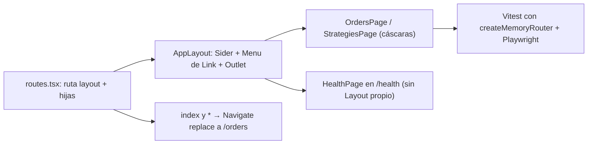

# Plan — Layout base con navegación (Órdenes, Estrategias y Estado)

> **Objetivo:** envolver todas las rutas del frontend en un `AppLayout` de antd (logo «Matriz Trader» + `Sider` con `Menu` de `<Link>`s + `Outlet`) con rutas `/orders`, `/strategies` y `/health`, redirigiendo `/` y lo desconocido a `/orders`. **Appetite:** pequeño (≤ 1 día, solo `frontend/` y `e2e/`). **Riesgo:** bajo — sin backend, sin dependencias nuevas; el único punto delicado es mover `HealthPage` de `/` a `/health` sin romper el e2e existente.

## Approach



Se define un único array `routes: RouteObject[]` en `src/routes.tsx` con una ruta *layout* sin `path` (elemento `AppLayout`) y rutas hijas `/orders`, `/strategies`, `/health`, más `index` y `*` que renderizan `<Navigate to="/orders" replace />`; `router.tsx` lo pasa a `createBrowserRouter` y los tests a `createMemoryRouter`, así producción y tests comparten exactamente la misma tabla de rutas. El `Menu` de antd recibe `selectedKeys` derivados de `useLocation().pathname` y cada `label` es un `<Link>` real (decisión resuelta). Alternativas descartadas: `onClick` + `navigate()` en el `Menu` — descartado en Resolved Decisions porque los ítems no serían anchors reales; redirección con `loader: () => redirect('/orders')` — funciona pero agrega una capa de loaders que hoy el proyecto no usa y es más incómoda de testear que un `<Navigate replace>`; definir las rutas inline en `router.tsx` — obligaría a los tests a importar un módulo que instancia un `BrowserRouter` como efecto secundario.

**Decisiones resueltas aplicadas** (no se reabren): paths en inglés (`/orders`, `/strategies`); `HealthPage` en `/health` **como tercer ítem del menú** (etiqueta «Estado»), lo que reemplaza el «exactamente dos ítems» de AC-4 por **tres ítems: «Órdenes», «Estrategias», «Estado»** y el «ningún ítem seleccionado» de AC-10 por **«solo Estado seleccionado»**; labels del `Menu` como `<Link>`. En todo el plan, las menciones a `/ordenes` y `/estrategias` de los AC se leen como `/orders` y `/strategies`. Los `data-testid` de página se mantienen literalmente como en los AC (`page-ordenes`, `page-estrategias`).

## Affected files

| File | Change |
|------|--------|
| `frontend/src/router.tsx:1-4` | Reemplaza la ruta única `{ path: '/', element: <HealthPage /> }` por `createBrowserRouter(routes)` importando `routes` de `./routes` (AC-1, AC-11, AC-12, NFR-1). |
| `frontend/src/routes.tsx` (nuevo) | Tabla de rutas compartida: layout + `/orders`, `/strategies`, `/health`, `index`/`*` → `Navigate replace` (AC-1, AC-6, AC-7, AC-11, AC-12, AC-18). |
| `frontend/src/layout/AppLayout.tsx` (nuevo) | `Layout` + `Layout.Sider` (logo + `Menu` inline) + `Layout.Content` con `<Outlet />` (AC-1–AC-5, AC-8–AC-10, AC-13). |
| `frontend/src/pages/OrdersPage.tsx` (nuevo) | Título «Órdenes», `data-testid="page-ordenes"` (AC-15, AC-17). |
| `frontend/src/pages/StrategiesPage.tsx` (nuevo) | Título «Estrategias», `data-testid="page-estrategias"` (AC-16, AC-17). |
| `frontend/src/pages/HealthPage.tsx:58-67` | Quita el `Layout`/`Layout.Content` propio y el título «Matriz Trader»; renderiza título «Estado» + `HealthContent`. Los `data-testid` de las líneas 20, 32, 45 y 50 no cambian (AC-18). |
| `frontend/src/pages/HealthPage.test.tsx:1-62` | Sin cambios; debe seguir pasando (renderiza `HealthPage` sin router, y la página no usa hooks de router) (AC-18). |
| `frontend/src/layout/AppLayout.test.tsx` (nuevo) | Tests Vitest + Testing Library con `createMemoryRouter(routes, …)` (AC-20). |
| `frontend/src/main.tsx:14-22` | Sin cambios (`ConfigProvider` > `QueryClientProvider` > `RouterProvider` ya envuelve todo). |
| `frontend/src/test/setup.ts:10-22` | Sin cambios; el mock de `matchMedia` ya cubre `Layout.Sider` (usa responsive observers). |
| `frontend/nginx.conf:21-24` | Sin cambios; `try_files $uri /index.html` ya cubre la recarga directa de `/orders` y `/strategies` (AC-14). |
| `e2e/tests/test_health_page.py:5` | `page.goto(base_url + "/")` → `page.goto(base_url + "/health")` (AC-19). |
| `e2e/tests/test_navigation.py` (nuevo) | Redirección `/` → `/orders`, clic en «Estrategias» sin recarga, recarga directa de `/strategies` (AC-21, AC-14, NFR-1). |
| `frontend/CLAUDE.md:9` | Actualiza la línea de `HealthPage` (ahora `/health`) y documenta rutas, `AppLayout` y los `data-testid` nuevos (NFR-5). |
| `e2e/CLAUDE.md:3-6` | «página raíz» → `/health`; agrega `tests/test_navigation.py` (NFR-2). |

## Frontend changes

### Tabla de rutas — `frontend/src/routes.tsx` (nuevo)

```tsx
import { Navigate, type RouteObject } from 'react-router';
import { AppLayout } from './layout/AppLayout';
import { HealthPage } from './pages/HealthPage';
import { OrdersPage } from './pages/OrdersPage';
import { StrategiesPage } from './pages/StrategiesPage';

export const DEFAULT_PATH = '/orders';

export const routes: RouteObject[] = [
  {
    element: <AppLayout />,
    children: [
      { index: true, element: <Navigate to={DEFAULT_PATH} replace /> },   // AC-11
      { path: 'orders', element: <OrdersPage /> },                         // AC-6, AC-15
      { path: 'strategies', element: <StrategiesPage /> },                 // AC-7, AC-16
      { path: 'health', element: <HealthPage /> },                         // AC-18
      { path: '*', element: <Navigate to={DEFAULT_PATH} replace /> },      // AC-12
    ],
  },
];
```

### Router — `frontend/src/router.tsx`

```tsx
import { createBrowserRouter } from 'react-router';
import { routes } from './routes';

export const router = createBrowserRouter(routes);
```

### Layout — `frontend/src/layout/AppLayout.tsx` (nuevo)

```tsx
import { Layout, Menu, type MenuProps } from 'antd';
import { Link, Outlet, useLocation } from 'react-router';

type NavItem = { path: '/orders' | '/strategies' | '/health'; label: string; testId: string };

const NAV_ITEMS: readonly NavItem[] = [
  { path: '/orders', label: 'Órdenes', testId: 'menu-orders' },
  { path: '/strategies', label: 'Estrategias', testId: 'menu-strategies' },
  { path: '/health', label: 'Estado', testId: 'menu-health' },
];

const MENU_ITEMS: MenuProps['items'] = NAV_ITEMS.map((item) => ({
  key: item.path,
  label: (
    <Link to={item.path} data-testid={item.testId}>
      {item.label}
    </Link>
  ),
}));

function selectedKeysFor(pathname: string): string[] {
  const normalized = pathname.length > 1 ? pathname.replace(/\/+$/, '') : pathname;
  return NAV_ITEMS.some((item) => item.path === normalized) ? [normalized] : [];
}

export function AppLayout() {
  const { pathname } = useLocation();
  return (
    <Layout style={{ minHeight: '100vh' }}>
      <Layout.Sider width={220} theme="dark">
        <Link to="/orders" data-testid="app-logo" style={LOGO_STYLE}>Matriz Trader</Link>
        <Menu
          data-testid="app-menu"
          mode="inline"
          theme="dark"
          items={MENU_ITEMS}
          selectedKeys={selectedKeysFor(pathname)}
        />
      </Layout.Sider>
      <Layout.Content style={{ padding: 24 }}>
        <Outlet />
      </Layout.Content>
    </Layout>
  );
}
```

`LOGO_STYLE` (constante del módulo, no exportada):

```ts
const LOGO_STYLE: React.CSSProperties = {
  display: 'block',
  padding: '16px 24px',
  color: '#fff',
  fontSize: 18,
  fontWeight: 600,
  lineHeight: '32px',
  whiteSpace: 'nowrap',
};
```

El módulo exporta **solo** `AppLayout` (regla `react-refresh/only-export-components`).

### Páginas cáscara — `frontend/src/pages/OrdersPage.tsx` y `StrategiesPage.tsx` (nuevos)

```tsx
import { Typography } from 'antd';

export function OrdersPage() {
  return (
    <Typography.Title level={2} data-testid="page-ordenes">
      Órdenes
    </Typography.Title>
  );
}
```

```tsx
import { Typography } from 'antd';

export function StrategiesPage() {
  return (
    <Typography.Title level={2} data-testid="page-estrategias">
      Estrategias
    </Typography.Title>
  );
}
```

Ninguna de las dos importa `src/api/*` ni usa hooks de react-query (AC-17).

### `HealthPage` — `frontend/src/pages/HealthPage.tsx:58-67`

```tsx
export function HealthPage() {
  return (
    <>
      <Typography.Title level={2}>Estado</Typography.Title>
      <HealthContent />
    </>
  );
}
```

Se elimina `Layout` del import de la línea 1 (queda `Alert, Descriptions, Spin, Tag, Typography`). `HealthContent` (líneas 15-56) no cambia.

### Contrato de `data-testid`

| `data-testid` | Elemento | Archivo |
|---|---|---|
| `app-logo` | `<Link to="/orders">` con el texto «Matriz Trader» | `layout/AppLayout.tsx` |
| `app-menu` | `<ul>` raíz del `Menu` | `layout/AppLayout.tsx` |
| `menu-orders` / `menu-strategies` / `menu-health` | `<Link>` dentro de cada ítem | `layout/AppLayout.tsx` |
| `page-ordenes` | `<h2>` «Órdenes» | `pages/OrdersPage.tsx` |
| `page-estrategias` | `<h2>` «Estrategias» | `pages/StrategiesPage.tsx` |
| `health-loading`, `health-status`, `health-database`, `health-error` | sin cambios | `pages/HealthPage.tsx` |

### Persisted state / API / stores

Ninguno. No hay estado persistido, no cambia `openapi.json`, no se tocan backend ni worker. El único "estado" de navegación es la URL.

## E2E changes

### `e2e/tests/test_health_page.py:5`

```python
page.goto(base_url + "/health")
```

### `e2e/tests/test_navigation.py` (nuevo)

```python
import re

from playwright.sync_api import Page, expect


def test_root_redirects_and_menu_navigates_without_reload(page: Page, base_url: str) -> None:
    page.goto(base_url + "/")
    expect(page).to_have_url(re.compile(r"/orders$"))
    expect(page.get_by_test_id("page-ordenes")).to_be_visible()

    page.evaluate("() => { window.__noReload = true }")
    page.get_by_test_id("menu-strategies").click()

    expect(page).to_have_url(re.compile(r"/strategies$"))
    expect(page.get_by_test_id("page-estrategias")).to_be_visible()
    assert page.evaluate("() => window.__noReload === true")


def test_direct_load_of_strategies(page: Page, base_url: str) -> None:
    response = page.goto(base_url + "/strategies")
    assert response is not None and response.status == 200
    expect(page.get_by_test_id("page-estrategias")).to_be_visible()
    expect(page.get_by_test_id("app-menu")).to_be_visible()
```
## Key implementation details

- **Clave del `Menu`** = path absoluto (`'/orders'`, `'/strategies'`, `'/health'`); `selectedKeys` se calcula en cada render desde `useLocation().pathname`, nunca con estado local → atrás/adelante actualiza la selección sin código extra (AC-8, AC-9, AC-10, AC-13).
- **Trailing slash:** `/orders/` matchea la ruta `orders` en react-router; `selectedKeysFor` normaliza quitando `/` finales para que también marque «Órdenes». Paths con mayúsculas (`/Orders`) los matchea react-router (case-insensitive por defecto) pero no marcan ítem; se acepta (no es un AC).
- **Rutas desconocidas** (incluidas las viejas `/ordenes` y `/estrategias`) caen en `path: '*'` **dentro** del layout → `Navigate replace` a `/orders` (AC-12). `/` usa `index: true` (AC-11). Ambos con `replace`, así «atrás» no vuelve a la URL redirigida.
- **Orden de los ítems:** Órdenes, Estrategias, Estado — fijo, definido por `NAV_ITEMS` (AC-4 ajustado por la decisión resuelta).
- **Logo:** `<Link>` (anchor real) a `/orders`; clic → navegación client-side (AC-3). Va arriba del `Menu`, dentro del `Sider` (AC-2).
- **Montaje persistente:** el `Sider` vive en la ruta layout; solo el `<Outlet />` cambia entre hijas (AC-5).
- **Tema:** tema por defecto de antd; `Sider` y `Menu` en `theme="dark"` (el default de `Sider`), logo blanco, `Content` con `padding: 24`. Sin `collapsible`, sin `breakpoint` (fuera de alcance).
- **`HealthPage` dentro del layout:** pierde su `Layout` y el título «Matriz Trader» (ahora en el logo) para no anidar layouts; mantiene el `Descriptions` «Estado del sistema» y todos sus estados (loading/error/ok). La request a `/health` solo ocurre al montar `/health` (AC-17 aplica a Órdenes y Estrategias).
- **Tests unitarios** (`AppLayout.test.tsx`): helper `renderAt(path: string)` que crea `createMemoryRouter(routes, { initialEntries: [path] })` envuelto en `QueryClientProvider` (retry: false) y devuelve `{ router }`; `vi.stubGlobal('fetch', vi.fn(...))` en cada test y `vi.unstubAllGlobals()` en `afterEach`. Selección verificada con `closest('li')` del `menu-*` teniendo la clase `ant-menu-item-selected`. Ruta verificada con `router.state.location.pathname`. Clicks con `@testing-library/react` `fireEvent.click` (no se agrega `user-event`, NFR-3).
- **Casos de test unitarios** (todos en `AppLayout.test.tsx`):
  1. `/orders` → 3 ítems en orden «Órdenes», «Estrategias», «Estado» dentro de `app-menu`; `app-logo` con texto «Matriz Trader» (AC-2, AC-4).
  2. `/orders` → clic `menu-strategies` → pathname `/strategies`, `page-estrategias` visible, solo `menu-strategies` seleccionado, mismo nodo `app-logo` (AC-5, AC-7, AC-9).
  3. `/strategies` → clic `menu-orders` → pathname `/orders`, `page-ordenes`, solo `menu-orders` seleccionado (AC-6, AC-8).
  4. `/strategies` → clic `app-logo` → pathname `/orders` (AC-3).
  5. `/` → pathname `/orders` (AC-11). `/no-existe` → `/orders` (AC-12).
  6. `/orders` y `/strategies` → título correcto y `fetch` no llamado (AC-15, AC-16, AC-17).
  7. `/health` con fetch `{status:'ok',database:'ok'}` → `health-status` = ok, solo `menu-health` seleccionado (AC-10 ajustado, AC-18).
  8. `router.navigate('/strategies')` y luego `router.navigate(-1)` → `page-ordenes` y `menu-orders` seleccionado (AC-13).
- **NFR-6 (<100 ms):** default elegido = no se asserta el tiempo; queda cubierto por NFR-1 (sin recarga) en `test_navigation.py`. Ver Open Questions.
- **Errores:** no hay estados de error nuevos; `HealthPage` conserva los suyos (`health-error`).

## Risks & rollback

| Risk | Mitigation | How to revert |
|------|------------|---------------|
| `Menu` de antd no propaga `data-testid` al `<ul>` raíz | Verificarlo en el test 1; si no se propaga, envolver el `Menu` en `<nav data-testid="app-menu">` y documentarlo | Cambio local en `AppLayout.tsx` |
| El e2e existente falla porque `/` ya no muestra `HealthPage` | T5 cambia el `goto` a `/health` en la misma entrega | `git revert` del commit |
| Bookmarks/enlaces viejos a `/` esperando `HealthPage` | `/` redirige a `/orders` y «Estado» está en el menú | Volver a `{ path: '/', element: <HealthPage /> }` en `router.tsx` |
| `react-refresh/only-export-components` falla por exports no-componente | `AppLayout.tsx` solo exporta `AppLayout`; `routes.tsx` no exporta componentes | Ajuste de exports |
| Clic en `<Link>` dentro del `li` no navega en jsdom (el `Menu` intercepta) | Disparar el click sobre el `<a>` (`menu-*`), no sobre el `li` | — |
| `Sider` usa `matchMedia` en tests | Ya mockeado en `src/test/setup.ts:10-22` | — |
| Recarga directa de `/strategies` da 404 en nginx | `try_files $uri /index.html` (`nginx.conf:22-24`) ya existe; lo prueba `test_direct_load_of_strategies` | — |

Rollback global: `git revert <commit>` — no hay migraciones, datos ni cambios de contrato.

## Verification

| AC / NFR | Cómo se prueba |
|---|---|
| AC-1 | Test unitario 1 y 7 (logo + menú + contenido en `/orders` y `/health`); e2e `test_direct_load_of_strategies` (`app-menu` visible) |
| AC-2 | Test unitario 1: `app-logo` con texto «Matriz Trader» dentro del `Sider` |
| AC-3 | Test unitario 4 (clic logo → `/orders`) |
| AC-4 (ajustado: 3 ítems) | Test unitario 1: ítems en orden «Órdenes», «Estrategias», «Estado» |
| AC-5 | Test unitario 2 (mismo nodo `app-logo` antes/después); e2e marca `__noReload` |
| AC-6 | Test unitario 3 |
| AC-7 | Test unitario 2; e2e `test_root_redirects_and_menu_navigates_without_reload` |
| AC-8 | Test unitario 3 (solo `menu-orders` seleccionado) |
| AC-9 | Test unitario 2 (solo `menu-strategies` seleccionado) |
| AC-10 (ajustado: solo «Estado») | Test unitario 7 |
| AC-11 | Test unitario 5; e2e `to_have_url(/orders$)` partiendo de `/` |
| AC-12 | Test unitario 5 (`/no-existe` → `/orders`) |
| AC-13 | Test unitario 8 (`router.navigate(-1)`) |
| AC-14 | e2e `test_direct_load_of_strategies` (status 200 + `page-estrategias`) |
| AC-15 | Test unitario 6 |
| AC-16 | Test unitario 6 |
| AC-17 | Test unitario 6 (`fetch` mock con 0 llamadas) |
| AC-18 | Test unitario 7 + `HealthPage.test.tsx` sin cambios en verde |
| AC-19 | `uv run pytest e2e` con `test_health_page.py` abriendo `/health` |
| AC-20 | `npm test` en `frontend/` en verde con `AppLayout.test.tsx` |
| AC-21 | `test_navigation.py` en verde contra `http://localhost:8080` |
| NFR-1 | e2e: `window.__noReload === true` tras el clic |
| NFR-2 | `git diff --stat` solo toca `frontend/` y `e2e/` (+ spec) |
| NFR-3 | `git diff frontend/package.json frontend/package-lock.json` vacío |
| NFR-4 | `scripts/check.sh` exit 0 |
| NFR-5 | Revisión de `frontend/CLAUDE.md` (tabla de `data-testid`) |
| NFR-6 | No asertado (default); cubierto indirectamente por NFR-1 — ver Open Questions |

## Tasks

### Wave 1

- [ ] T1: Crear `frontend/src/pages/OrdersPage.tsx` con título «Órdenes» y `data-testid="page-ordenes"`, sin imports de API — _outcome: el componente `OrdersPage` existe y compila con `npm run typecheck` (AC-15, AC-17)_
- [ ] T2: Crear `frontend/src/pages/StrategiesPage.tsx` con título «Estrategias» y `data-testid="page-estrategias"`, sin imports de API — _outcome: el componente `StrategiesPage` existe y compila con `npm run typecheck` (AC-16, AC-17)_
- [ ] T3: Quitar de `HealthPage` (`frontend/src/pages/HealthPage.tsx:58-67`) el `Layout` propio y el título «Matriz Trader», reemplazándolo por el título «Estado» — _outcome: `npm test -- HealthPage` sigue pasando sin cambios en el test (AC-18)_
- [ ] T4: Crear `frontend/src/layout/AppLayout.tsx` con `Sider` (logo `app-logo` como `<Link to="/orders">`, `Menu` `app-menu` inline con 3 ítems `<Link>` y `selectedKeys` desde `useLocation`) y `Content` con `<Outlet />` — _outcome: `AppLayout` compila y pasa `npm run lint` (AC-1, AC-2, AC-3, AC-4, AC-5, AC-8, AC-9, AC-10)_
- [ ] T5: Cambiar `e2e/tests/test_health_page.py:5` a `page.goto(base_url + "/health")` — _outcome: el test de salud apunta a `/health` y pasa `uv run ruff check e2e` (AC-19)_

### Wave 2 (depends on T1, T2, T3, T4)

- [ ] T6: Crear `frontend/src/routes.tsx` (ruta layout + `orders`, `strategies`, `health`, `index`/`*` → `<Navigate to="/orders" replace />`) y reescribir `frontend/src/router.tsx` para usar `createBrowserRouter(routes)` — _outcome: `npm run build` termina OK y en `npm run dev` abrir `/` lleva a `/orders` dentro del layout (AC-1, AC-6, AC-7, AC-11, AC-12, AC-18)_

### Wave 3 (depends on T6)

- [ ] T7: Escribir `frontend/src/layout/AppLayout.test.tsx` con los 8 casos de «Key implementation details» usando `createMemoryRouter(routes, …)` — _outcome: `npm test` en `frontend/` pasa incluyendo los nuevos tests (AC-2, AC-3, AC-4, AC-5, AC-6, AC-7, AC-8, AC-9, AC-10, AC-11, AC-12, AC-13, AC-15, AC-16, AC-17, AC-18, AC-20)_
- [ ] T8: Crear `e2e/tests/test_navigation.py` con `test_root_redirects_and_menu_navigates_without_reload` y `test_direct_load_of_strategies` — _outcome: el archivo pasa `uv run ruff check e2e` y `uv run pyright` (AC-14, AC-21, NFR-1)_
- [ ] T9: Actualizar `frontend/CLAUDE.md:9` (rutas, `AppLayout`, tabla de `data-testid`) y `e2e/CLAUDE.md:3-6` (`/health`, `test_navigation.py`) — _outcome: ambos `CLAUDE.md` documentan las rutas `/orders`, `/strategies`, `/health` y los `data-testid` nuevos (NFR-2, NFR-5)_

### Wave 4 (depends on T7, T8, T9)

- [ ] T10: Correr `scripts/check.sh` y, con `docker compose up --build -d`, `uv run pytest e2e` — _outcome: `scripts/check.sh` sale con exit 0 y la suite e2e pasa completa (AC-14, AC-19, AC-21, NFR-4)_

## Open Questions

- [ ] **NFR-6 (<100 ms):** se eligió por defecto **no asertar el tiempo** y cubrirlo con NFR-1 (sin recarga). Si se quiere una guarda, agregar en `test_navigation.py` un assert con umbral holgado (500 ms).
- [ ] **AC-4 y AC-10 quedaron desactualizados** por la decisión «`HealthPage` como tercer ítem»: conviene reescribirlos en `requirements.md` (3 ítems; en `/health` solo «Estado» seleccionado). El plan ya implementa la versión ajustada.
- [ ] **Paths en los AC:** AC-3, AC-6–AC-9, AC-11–AC-16 y AC-21 siguen diciendo `/ordenes` y `/estrategias`; el plan usa `/orders` y `/strategies` según la decisión resuelta. Actualizar los AC.
- [ ] **`data-testid` de página:** se mantienen `page-ordenes` / `page-estrategias` como dicen los AC; ¿renombrarlos a `page-orders` / `page-strategies` para alinear con los paths en inglés?
- [ ] **Etiqueta del tercer ítem:** se eligió «Estado» (coincide con «Estado del sistema» de `HealthPage`); confirmar o cambiar (p. ej. «Salud»).

## Critical Decisions
