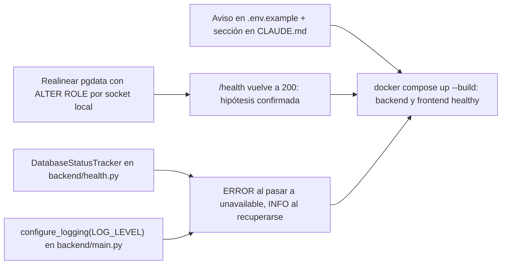

> **Objetivo:** que el backend deje en sus propios logs la causa de un fallo de conexión a Postgres (sin filtrar secretos), documentar que `POSTGRES_PASSWORD` no se reaplica a un volumen ya inicializado y realinear el volumen local con `ALTER ROLE` para que `docker compose up --build` vuelva a arrancar sano. **Appetite:** pequeño (½ día). **Riesgo:** bajo (no cambia la API, el contrato OpenAPI ni la orquestación de compose).

## Approach



La estrategia es la acordada en *Resolved Decisions*: (1) realinear el entorno local afectado con `ALTER ROLE CURRENT_USER WITH PASSWORD :'pw'` ejecutado por socket local dentro del contenedor `postgres`, tomando la contraseña de la variable de entorno del propio contenedor (no pasa por el historial del shell), lo que a la vez confirma la hipótesis y preserva los datos; (2) envolver el sondeo de base en un `DatabaseStatusTracker` por proceso que loguea solo en las transiciones de estado (`ERROR` ok/desconocido→unavailable con tipo de excepción + mensaje del driver sanitizado; `INFO` unavailable→ok), y hacer que el logger `backend` efectivamente emita según `LOG_LEVEL` (hoy esa setting existe pero no se aplica, y uvicorn no configura el logger raíz, así que un `INFO` de `backend.*` se perdería); (3) documentar el problema donde se edita la variable y en el `CLAUDE.md` raíz. Alternativas descartadas: validar credenciales en el healthcheck de `postgres` con `PGPASSWORD` por TCP — descartada por el usuario para no tocar la orquestación; loguear un `WARNING` por sondeo — descartada porque produce una línea cada 5 s; recrear el volumen con `down -v` — descartada porque pierde datos.

## Affected files

| File | Change |
|------|--------|
| `backend/src/backend/health.py:21-27` | `ping_database` pasa a delegar en una nueva `probe_database(engine) -> SQLAlchemyError \| None`; se agregan `describe_db_error()` y `DatabaseStatusTracker` (AC-2, AC-3) |
| `backend/src/backend/health.py:30-32` | `get_db_probe` devuelve el tracker guardado en `app.state.db_probe` en vez de una lambda nueva por request (AC-2, AC-6) |
| `backend/src/backend/main.py:16` | `create_app` crea `app.state.db_probe = DatabaseStatusTracker(app.state.engine)` (AC-2, AC-7) |
| `backend/src/backend/main.py:28-30` | `_default_app` llama a `configure_logging(settings.log_level)` antes de `create_app` (AC-2) |
| `backend/src/backend/main.py` (nuevo, junto a `create_app`) | función `configure_logging(level: str) -> None` (AC-2) |
| `backend/tests/test_health.py:47-52` | se mantiene `test_ping_database_fails_fast_when_unreachable`; se agregan tests del tracker, de la sanitización y de `configure_logging` (AC-2, AC-3, AC-6, AC-7, AC-14) |
| `.env.example:6-7` | comentario sobre que `POSTGRES_PASSWORD` solo se aplica al inicializar un volumen vacío, con puntero al `CLAUDE.md` (AC-4, AC-16) |
| `CLAUDE.md:16-23` (tras `## Convenciones`, antes de `## Comandos`) | nueva sección `## Credenciales de Postgres y el volumen pgdata` con `ALTER ROLE` y `down -v` (AC-4, AC-13) |
| `backend/CLAUDE.md:9` | la línea de `health.py` menciona el log por transición de estado (AC-2) |
| `frontend/openapi.json` | **sin cambios** (el modelo `HealthResponse` y el `operation_id` no cambian; `test_openapi_snapshot.py` lo garantiza) (AC-6) |
| `docker-compose.yml:12-38` | **sin cambios** (decisión de alcance) (AC-9, AC-10, AC-11) |
| volumen `matriz-trader_pgdata` (entorno local) | `ALTER ROLE` operativo, no es código (AC-5, AC-13) |

> Numeración de criterios (derivada de `bugfix.md`, en orden): **Expected** — AC-1 stack sano con credenciales coincidentes; AC-2 el backend loguea la causa del `SQLAlchemyError`; AC-3 el log no incluye contraseña ni `DATABASE_URL` completo; AC-4 documentación del cambio de `POSTGRES_PASSWORD` y cómo realinear; AC-5 tras realinear, `backend`/`frontend` healthy y `/health` 200. **Unchanged** — AC-6 contrato de `/health` y cuerpo sin detalles del error; AC-7 backend arranca con Postgres caído y se recupera sin reinicio; AC-8 volumen vacío se inicializa con el `.env`; AC-9 `docker compose up postgres` para dev; AC-10 `DATABASE_URL` local vs. override de compose; AC-11 worker depende solo de `postgres` y recibe el mismo `DATABASE_URL`; AC-12 `load_settings()` sale con código 2; AC-13 datos de `pgdata` preservados; AC-14 `scripts/check.sh` pasa; AC-15 `uv run pytest e2e` pasa; AC-16 un único `.env`, sin secretos commiteados.

## Backend changes

Todo en `backend/src/backend/`. No cambia la respuesta HTTP: el diagnóstico va solo a logs (AC-6).

### `health.py` — contratos

```python
import logging
import threading

from sqlalchemy import URL, Engine, text
from sqlalchemy.exc import DBAPIError, SQLAlchemyError

logger = logging.getLogger(__name__)  # "backend.health"

DbProbe = Callable[[], bool]          # sin cambios: los tests siguen overrideando get_db_probe


def probe_database(engine: Engine) -> SQLAlchemyError | None:
    """Ejecuta SELECT 1; devuelve la excepción capturada o None si la base responde."""


def ping_database(engine: Engine) -> bool:          # firma pública conservada
    return probe_database(engine) is None


def describe_db_error(exc: SQLAlchemyError, url: URL) -> str:
    """Una línea: '<modulo.Tipo>: <mensaje del driver>' sin contraseña ni URL."""


class DatabaseStatusTracker:
    """Sondea la base y loguea solo cuando cambia el estado (por proceso)."""

    def __init__(self, engine: Engine) -> None:
        self._engine = engine
        self._last_ok: bool | None = None   # None = todavía no se sondeó
        self._lock = threading.Lock()

    def __call__(self) -> bool: ...


def get_db_probe(request: Request) -> DbProbe:
    tracker: DatabaseStatusTracker = request.app.state.db_probe
    return tracker
```

### `health.py` — mensajes de log (literales)

```text
ERROR  backend.health  Database unavailable: psycopg.OperationalError: connection failed: connection to server at "172.18.0.2", port 5432 failed: FATAL:  password authentication failed for user "matriz" [target=postgres:5432/matriz_trader]
INFO   backend.health  Database connection restored [target=postgres:5432/matriz_trader]
```

Formato del código:

```python
logger.error("Database unavailable: %s [target=%s]", describe_db_error(exc, url), _target(url))
logger.info("Database connection restored [target=%s]", _target(url))

def _target(url: URL) -> str:
    return f"{url.host}:{url.port or 5432}/{url.database}"
```

### `main.py` — contratos

```python
def configure_logging(level: str) -> None:
    """Hace visibles los logs de `backend.*` bajo uvicorn según LOG_LEVEL."""
    backend_logger = logging.getLogger("backend")
    resolved = logging.getLevelNamesMapping().get(level.strip().upper(), logging.INFO)
    backend_logger.setLevel(resolved)
    if not any(getattr(h, "_matriz", False) for h in backend_logger.handlers):
        handler = logging.StreamHandler()            # stderr → docker compose logs backend
        handler.setFormatter(logging.Formatter("%(levelname)s:     %(name)s - %(message)s"))
        handler._matriz = True                        # marca de idempotencia
        backend_logger.addHandler(handler)


def create_app(settings: BackendSettings) -> FastAPI:
    ...
    app.state.engine = create_engine_from_url(settings.database_url)
    app.state.db_probe = health.DatabaseStatusTracker(app.state.engine)
    ...


@cache
def _default_app() -> FastAPI:
    settings = load_settings()
    configure_logging(settings.log_level)
    return create_app(settings)
```

> La marca `_matriz` es ilustrativa; si pyright strict la rechaza (`reportAttributeAccessIssue`), usar una subclase `class _BackendHandler(logging.StreamHandler[TextIO])` y chequear `isinstance`. El formato imita el de uvicorn (`INFO:     …`) para que las líneas se lean igual en `docker compose logs backend`.

## Docs & environment changes

Raíz del repo (configuración compartida y documentación, sin código).

### `.env.example` (reemplaza las líneas 6-7)

```dotenv
POSTGRES_USER=matriz
# Debe ser URL-safe: se interpola en DATABASE_URL.
# OJO: la imagen de postgres aplica POSTGRES_USER/POSTGRES_PASSWORD solo al inicializar un volumen
# vacío. Si cambiás la contraseña con el volumen `pgdata` ya creado, el backend queda unhealthy
# ("password authentication failed"). Cómo realinear: ver "Credenciales de Postgres" en CLAUDE.md.
POSTGRES_PASSWORD=changeme
```

### `CLAUDE.md` raíz — sección nueva entre `## Convenciones` y `## Comandos`

````markdown
## Credenciales de Postgres y el volumen `pgdata`

`POSTGRES_USER`/`POSTGRES_PASSWORD` solo se aplican cuando el volumen `pgdata` está vacío. Cambiarlos
en el `.env` después no modifica el rol existente: `pg_isready` sigue `healthy`, pero el backend recibe
`password authentication failed for user "matriz"`, `/health` responde 503 y `docker compose up` aborta
con `container matriz-trader-backend-1 is unhealthy`. El backend lo loguea (`Database unavailable: …`).

Realinear conservando los datos (toma la contraseña nueva del entorno del contenedor):

```bash
docker compose up -d postgres            # recrea el contenedor con el .env actual
docker compose exec -T postgres sh -c 'psql -v ON_ERROR_STOP=1 -U "$POSTGRES_USER" -d "$POSTGRES_DB" -v pw="$POSTGRES_PASSWORD" <<SQL
ALTER ROLE CURRENT_USER WITH PASSWORD :'"'"'pw'"'"';
SQL'
docker compose up --build
```

Alternativa destructiva (⚠️ **borra todos los datos** de la base): `docker compose down -v && docker compose up --build`.
````

### `backend/CLAUDE.md:9`

```markdown
- `src/backend/health.py` — `GET /health` (`operation_id="getHealth"`): 200 `{"status":"ok","database":"ok"}` o 503 `{"status":"degraded","database":"unavailable"}`. `DatabaseStatusTracker` loguea `ERROR` al pasar a unavailable (causa del driver, sin contraseña) e `INFO` al recuperarse; el cuerpo de la respuesta nunca incluye el error.
```

### Entorno local (operativo, no se commitea)

Ejecutar el bloque `ALTER ROLE` de arriba contra `matriz-trader_pgdata`. No se toca `.env` ni el volumen salvo la contraseña del rol (AC-5, AC-13).

## Key implementation details

- **Transiciones y nivel de log** (`DatabaseStatusTracker.__call__`):

  | `_last_ok` previo | Resultado | Log |
  |---|---|---|
  | `None` | ok | ninguno (arranque normal, sin ruido) |
  | `None` | falla | `ERROR` (cubre el caso del bug: backend que arranca con credenciales malas) |
  | `True` | falla | `ERROR` |
  | `False` | falla | ninguno |
  | `False` | ok | `INFO` |
  | `True` | ok | ninguno |

- **Concurrencia:** `get_health` es `def` síncrona → FastAPI la ejecuta en el threadpool y puede haber sondeos simultáneos. El sondeo (`probe_database`) corre **fuera** del lock; solo la lectura/escritura de `_last_ok` y la decisión de loguear van dentro de `with self._lock:` para no serializar requests ni duplicar el `ERROR`.
- **Estado por proceso:** el tracker vive en `app.state.db_probe`; uvicorn corre un solo worker en el `CMD` del `backend/Dockerfile`, así que hay un único estado. Con varios workers cada uno loguearía su propia transición (aceptable).
- **Lookup monkeypatcheable:** `__call__` invoca `probe_database` por nombre de módulo (no guarda una referencia) para que los tests puedan reemplazarla con `monkeypatch.setattr(health, "probe_database", ...)`.
- **`describe_db_error`:**
  1. Si `exc` es `DBAPIError` y `exc.orig` no es `None`: tipo = `f"{type(exc.orig).__module__}.{type(exc.orig).__qualname__}"` (p. ej. `psycopg.OperationalError`), mensaje = `str(exc.orig)`. Si no: tipo = `type(exc).__qualname__`, mensaje = `str(exc)`. Se usa `exc.orig` para evitar el sufijo `(Background on this error at: https://sqlalche.me/…)` y el SQL.
  2. Colapsar espacios/saltos de línea: `" ".join(message.split())` (psycopg devuelve mensajes multilínea).
  3. Redacción defensiva: si `url.password` es no vacío y aparece en el mensaje, reemplazar cada ocurrencia por `***`; ídem con `url.render_as_string(hide_password=False)` → `***`. El target se arma solo con host/puerto/base (nunca usuario+contraseña ni la URL completa) (AC-3).
  4. Resultado: `"<tipo>: <mensaje>"`, una línea.
- **`LOG_LEVEL` inválido:** cae a `INFO` sin abortar (no cambia el comportamiento de arranque; AC-12 sigue siendo solo para variables faltantes).
- **`configure_logging` es idempotente** (no duplica handlers si `_default_app` se reconstruyera) y no toca el logger raíz ni los de uvicorn. Se llama solo en `_default_app`, no en `create_app`, para no alterar el logging de pytest; `propagate` queda en `True` (uvicorn no configura el raíz, así que no hay duplicados, y `caplog` sigue funcionando).
- **Respuesta HTTP:** sin cambios; `HealthResponse` y los códigos 200/503 se mantienen, por lo que `frontend/openapi.json` no se regenera (AC-6).
- **`ping_database` se conserva** con la misma firma y sigue devolviendo `False` en < 5 s contra un puerto cerrado (test existente).
- **Comando `ALTER ROLE`:** `CURRENT_USER` evita citar el nombre del rol; `:'pw'` hace que psql cite la contraseña como literal (soporta `!`, `'`, etc.); la contraseña sale del entorno del contenedor, no aparece en la línea de comandos del host. Debe correrse **después** de `docker compose up -d postgres` para que el contenedor tenga el `POSTGRES_PASSWORD` del `.env` actual. Es idempotente.

## Risks & rollback

| Risk | Mitigation | How to revert |
|------|------------|---------------|
| El mensaje del driver incluye algún dato sensible no previsto | Se usa `exc.orig` (sin URL), redacción explícita de `url.password` y de la URL renderizada; test con contraseña centinela (AC-3) | `git revert` del commit de backend; vuelve el `except: return False` silencioso |
| Los logs de `backend.*` no aparecen bajo uvicorn (o aparecen duplicados) | `configure_logging` agrega handler propio idempotente; verificación manual con `docker compose logs backend` | Revertir el cambio en `main.py`; el `ERROR` igual saldría por el `lastResort` de Python |
| Pyright strict rechaza `app.state`/atributo de handler | Anotar `tracker: DatabaseStatusTracker = request.app.state.db_probe` (mismo patrón que `engine`); subclase de handler en vez de atributo ad hoc | Ajuste local; no afecta runtime |
| `ALTER ROLE` con una contraseña distinta a la deseada (contenedor no recreado) | Correr antes `docker compose up -d postgres`; verificar con `/health` 200 | Repetir `ALTER ROLE` con la contraseña correcta (no hay pérdida de datos) |
| La hipótesis es incorrecta (`/health` sigue en 503 tras `ALTER ROLE`) | El nuevo log del backend muestra la causa real; detener y reabrir el diagnóstico | Nada que revertir: el `ALTER ROLE` solo fijó la contraseña que el `.env` ya declara |
| Cambio en el `CLAUDE.md`/`.env.example` desalineado con el código | Verificación por grep en T6 | `git revert` de los docs |

## Verification

| Criterio | Cómo se prueba |
|---|---|
| AC-1 | `docker compose up --build -d` → `docker compose ps` muestra `backend` y `frontend` `healthy`; `curl -s localhost:${FRONTEND_PORT:-8080}/api/health` → `{"status":"ok","database":"ok"}` |
| AC-2 | Unit tests: `test_tracker_logs_error_on_first_failure` (caplog, nivel `ERROR`, logger `backend.health`, contiene `OperationalError`/tipo y el mensaje), `test_tracker_logs_error_once_while_unavailable` (2 fallos → 1 `ERROR`), `test_tracker_logs_info_on_recovery`, `test_tracker_silent_on_first_success`; `test_configure_logging_is_idempotent`. Manual: con contraseña desalineada (repro de `bugfix.md`), `docker compose logs backend` contiene `Database unavailable: … password authentication failed for user "matriz"` exactamente una vez |
| AC-3 | `test_describe_db_error_redacts_password`: URL con contraseña centinela `s3cr3t!pw`, mensaje sintético que la contiene → el resultado no contiene `s3cr3t!pw` ni `postgresql+psycopg://`; el `ERROR` del tracker contra `127.0.0.1:1` tampoco |
| AC-4 | `grep -n "solo al inicializar" .env.example` y `grep -n "ALTER ROLE CURRENT_USER" CLAUDE.md` y `grep -n "down -v" CLAUDE.md` devuelven coincidencias; revisión de que la advertencia de pérdida de datos está junto a `down -v` |
| AC-5 | Tras T1: `docker compose up --build` termina sin `dependency failed`; `docker compose ps` → `backend`/`frontend` `healthy`; `/health` 200 |
| AC-6 | `test_health_ok`, `test_health_db_unavailable` sin cambios; `test_openapi_snapshot.py` pasa sin regenerar `frontend/openapi.json`; `git diff --exit-code frontend/openapi.json` |
| AC-7 | `test_ping_database_fails_fast_when_unreachable` sigue pasando; `test_tracker_logs_info_on_recovery` demuestra recuperación sin recrear la app |
| AC-8 | Sin cambios en `docker-compose.yml` (`git diff --exit-code docker-compose.yml`); opcional: control negativo de la reproducción con `COMPOSE_PROJECT_NAME=matriz-repro` |
| AC-9, AC-10, AC-11 | `git diff --exit-code docker-compose.yml`; `docker compose config` muestra el mismo `DATABASE_URL` para `backend` y `worker` |
| AC-12 | `backend/tests/test_settings.py` sin cambios y en verde |
| AC-13 | Antes/después del `ALTER ROLE`: `docker compose exec postgres psql -U matriz -d matriz_trader -c '\dt'` lista las mismas tablas; el volumen `matriz-trader_pgdata` conserva su fecha de creación (`docker volume inspect`) |
| AC-14 | `scripts/check.sh` sale 0 |
| AC-15 | `uv run pytest e2e` con el stack levantado sale 0 |
| AC-16 | `git status` no muestra `.env` ni archivos `.env` nuevos; `.env.example` solo contiene `changeme`/valores de ejemplo |

## Tasks

### Wave 1

- [ ] T1: Realinear la contraseña del rol en el volumen local `matriz-trader_pgdata` con `docker compose up -d postgres` + `ALTER ROLE CURRENT_USER WITH PASSWORD :'pw'` por socket local, y relanzar `docker compose up --build` — _outcome: `backend` y `frontend` quedan `healthy`, `/health` responde 200 y las tablas existentes siguen presentes, confirmando la hipótesis (AC-1, AC-5, AC-13)_
- [ ] T2: Implementar en `backend/src/backend/health.py` `probe_database`, `describe_db_error`, `DatabaseStatusTracker` y el nuevo `get_db_probe`, y en `backend/src/backend/main.py` `configure_logging` + `app.state.db_probe` + la llamada en `_default_app` — _outcome: con la base inaccesible el backend emite un único `ERROR` `Database unavailable: <tipo>: <mensaje>` sin contraseña ni URL y un `INFO` al recuperarse, con `/health` respondiendo igual que antes (AC-2, AC-3, AC-6, AC-7)_
- [ ] T3: Agregar el comentario sobre `POSTGRES_PASSWORD` en `.env.example`, la sección `## Credenciales de Postgres y el volumen pgdata` en `CLAUDE.md` raíz y actualizar la línea de `health.py` en `backend/CLAUDE.md` — _outcome: los greps de AC-4 encuentran la advertencia, el comando `ALTER ROLE CURRENT_USER` y `down -v` con aviso de pérdida de datos (AC-4, AC-16)_

### Wave 2 (depends on T2)

- [ ] T4: Agregar a `backend/tests/test_health.py` los tests del tracker (primer fallo, fallo repetido, recuperación, primer éxito silencioso), de `describe_db_error` con contraseña centinela y de `configure_logging` idempotente — _outcome: `cd backend && uv run pytest` pasa con los tests nuevos y los existentes intactos (AC-2, AC-3, AC-6, AC-7, AC-12)_

### Wave 3 (depends on T1, T3, T4)

- [ ] T5: Correr `scripts/check.sh`, `git diff --exit-code frontend/openapi.json docker-compose.yml` y, con el stack levantado, `uv run pytest e2e` — _outcome: los tres comandos salen 0 (AC-6, AC-8, AC-9, AC-10, AC-11, AC-14, AC-15)_
- [ ] T6: Reconstruir el backend (`docker compose up --build -d backend`), desalinear temporalmente la contraseña del rol (`ALTER ROLE` a un valor distinto) y luego restaurarla con el comando documentado en `CLAUDE.md` — _outcome: `docker compose logs backend` muestra exactamente un `ERROR … password authentication failed for user "matriz"` sin la contraseña y luego un `INFO Database connection restored`, y el stack vuelve a `healthy` (AC-2, AC-3, AC-4, AC-5)_

## Open Questions

- **Logger y formato:** se eligió un `StreamHandler` propio sobre el logger `backend` con formato estilo uvicorn y `LOG_LEVEL` inválido → `INFO`. Revisar si se prefiere en cambio pasar `--log-config` a uvicorn en el `backend/Dockerfile` para unificar todo el logging.
- **Primer éxito silencioso:** el tracker no loguea la transición desconocido→ok al arrancar. Si se quiere un `INFO Database connection established` al primer sondeo exitoso, es un cambio de una línea.
- **T1 ya ejecutado:** la decisión autorizó correr la prueba de confirmación "ahora". Si ya se hizo durante la fase de diseño, T1 se reduce a verificar `/health` 200 y el estado `healthy`.
- **T6 es destructivo-reversible sobre el entorno local** (cambia temporalmente la contraseña del rol). Si se prefiere no tocar el volumen real, correrlo con `COMPOSE_PROJECT_NAME=matriz-repro` según la reproducción de `bugfix.md`.
- **Healthcheck de `postgres` con credenciales:** quedó fuera de alcance por decisión; reconsiderar si el problema se repite en otros entornos.

## Critical Decisions

### Critical Decision — T1: verificar credenciales por la IP de red del contenedor, no por 127.0.0.1
- **Qué:** la confirmación previa/posterior al `ALTER ROLE` se hizo con `PGPASSWORD="$POSTGRES_PASSWORD" psql -h "$(hostname -i)"` dentro del contenedor `postgres`; antes falló con `password authentication failed for user "matriz"`, después devolvió `1`.
- **Por qué:** el `pg_hba.conf` de la imagen tiene `trust` para `127.0.0.1`/`::1`, así que una prueba con `-h 127.0.0.1` pasa aunque la contraseña no coincida (no prueba nada); solo la regla `host all all all scram-sha-256` reproduce lo que ve el backend.
- **Afecta:** T6 (cualquier verificación manual de credenciales debe usar la IP de red o el propio `/health`) y la sección de `CLAUDE.md` de T3 si se agrega un paso de verificación.

### Critical Decision — T4: la redacción de la URL completa depende de su forma renderizada
- **Qué:** el test de `describe_db_error` arma el mensaje sintético con `url.render_as_string(hide_password=False)` y un test aparte verifica que, con la URL cruda, al menos la contraseña se redacta.
- **Por qué:** `render_as_string` percent-encodea caracteres como `!` (`s3cr3t%21pw`), así que una URL cruda dentro del mensaje no coincide con ella y solo se reemplaza la contraseña (queda `postgresql+psycopg://matriz:***@…`). No filtra secretos (AC-3 se cumple) y el driver real no incluye la URL en sus mensajes, por eso no se tocó `health.py`.
- **Afecta:** `backend/tests/test_health.py`; si se quisiera redactar también la URL cruda, sería un ajuste de `describe_db_error` (T2).

### Critical Decision — T6: forzar reautenticación terminando las conexiones del pool
- **Qué:** tras el `ALTER ROLE` a una contraseña temporal, se ejecutó `SELECT pg_terminate_backend(pid) FROM pg_stat_activity WHERE usename = current_user AND pid <> pg_backend_pid() AND backend_type = 'client backend'` para que `/health` pase a 503.
- **Por qué:** cambiar la contraseña no corta las conexiones ya autenticadas del pool de SQLAlchemy; sin terminarlas, `/health` seguía en 200 y el `ERROR` nunca se emitía. Es solo un paso de verificación manual, no cambia código.
- **Afecta:** solo la verificación de T6 (y cualquier repro manual futura con el stack ya sano); la reproducción de `bugfix.md` no lo necesita porque arranca el backend con la contraseña ya desalineada.
