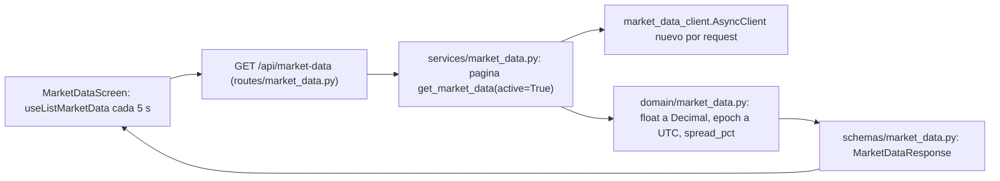

# Plan: tabla filtrable con la market data de los instrumentos suscriptos y spread bid/ask en %

> Exponer `GET /api/market-data` (todos los snapshots activos de `market-data-client`, con `Decimal` como string y `spread_pct` calculado en el dominio) y una pantalla `/market-data` con tabla filtrable que se refresca cada 5 s. Appetite: M. Risk: medium.

## Approach



Un endpoint nuevo en el backend construye un `market_data_client.AsyncClient` por request (Resolved Decision), lo inyecta como dependencia de FastAPI (`MarketDataSourceDep`) para poder reemplazarlo en tests, pagina `get_market_data(active=True)` con `limit`/`offset` hasta agotar los resultados y convierte cada `MarketDataSnapshot` con funciones puras de `app/domain/` (float → `str` → `Decimal`, epoch → `datetime` UTC, `spread_pct` sobre el precio medio con `ROUND_HALF_EVEN`). Cualquier error de la librería o de red se traduce a un `DomainError` con `status = 502` que el handler existente convierte en `ProblemDetails`. El frontend consume el hook Orval `useListMarketData` con `refetchInterval: 5000` (pausado con la pestaña oculta), filtra en memoria con los filtros en los query params y conserva los últimos datos si una actualización falla. Alternativas descartadas: un cliente singleton en `lifespan` (más eficiente con Auth0, pero la decisión resuelta fue un cliente por request); filtrar en el backend con `prefix`/`market_id` (agrega parámetros al contrato y llamadas por cada cambio de filtro sin necesidad, ya que N es chico); streaming WebSocket/SSE (fuera de alcance).

## Affected files

| File | Change |
|---|---|
| `backend/app/domain/numeric.py:18` | Nuevo tipo `MarketDecimal` (sin `ge=0` ni `max_digits`, serializado como `str`) y `Percent` (4 decimales, admite negativos) (AC-3, AC-8, AC-10) |
| `backend/app/domain/market_data.py` (nuevo) | `to_decimal`, `epoch_ms_to_utc`, `epoch_s_to_utc`, `spread_pct` puros, sin I/O (AC-3, AC-4, AC-5, AC-8, AC-9, AC-10) |
| `backend/app/domain/errors.py:6` | Nueva subclase `MarketDataUnavailableError(DomainError)` con `status = 502` (AC-20) |
| `backend/app/schemas/market_data.py` (nuevo) | `MarketDataRow` y `MarketDataResponse` (AC-2, AC-6, AC-7) |
| `backend/app/services/market_data.py` (nuevo) | `MarketDataSource` (Protocol), `open_market_data_client`, `fetch_all_snapshots`, `snapshot_to_row`, `list_market_data` (AC-1, AC-2, AC-5, AC-6, AC-20, AC-21) |
| `backend/app/api/deps.py:16` | `get_market_data_source` y `MarketDataSourceDep` (AC-1) |
| `backend/app/api/routes/market_data.py` (nuevo) | `GET /market-data`, `operation_id="listMarketData"`, `tags=["market-data"]`, `responses={502: ...}` (AC-7, AC-20) |
| `backend/app/api/router.py:5` | `api_router.include_router(market_data.router)` (AC-7) |
| `backend/app/api/errors.py:23` | Agrega `502` a un dict exportado `UPSTREAM_PROBLEM_RESPONSE` reutilizable por la ruta (AC-20) |
| `backend/tests/test_market_data_domain.py` (nuevo) | Unit + Hypothesis de conversiones y spread (AC-3, AC-4, AC-5, AC-8, AC-9, AC-10) |
| `backend/tests/test_market_data.py` (nuevo) | Endpoint con `FakeMarketDataSource` vía `dependency_overrides` (AC-1, AC-2, AC-5, AC-6, AC-20, AC-21) |
| `backend/tests/test_contract.py:17` | `APP.dependency_overrides[get_market_data_source]` con una fuente fija, para que Schemathesis no salga a la red (AC-7) |
| `backend/openapi.json` | Regenerado con `uv run python -m app.scripts.export_openapi` (AC-7) |
| `frontend/src/api/generated/market-data/` | Regenerado por Orval (`market-data.ts`, `.msw.ts`, `.faker.ts`) + modelos `marketDataRow.ts`, `marketDataResponse.ts` (AC-7) |
| `frontend/src/constants/routes.ts:1` | `marketData: "/market-data"` (AC-11) |
| `frontend/src/app/routes.tsx:18` | Ruta lazy a `MarketDataScreen` (AC-11) |
| `frontend/src/constants/marketData.ts` (nuevo) | `MARKET_DATA_POLL_INTERVAL_MS = 5_000`, `EMPTY_CELL = "—"` (AC-9, AC-23, AC-26) |
| `frontend/src/utils/format.ts:42` | `formatPercent`, `formatTime` (AC-12, AC-24, AC-25) |
| `frontend/src/utils/format.test.ts` | Tests de `formatPercent` y `formatTime` (AC-12) |
| `frontend/src/screens/MarketDataScreen/index.ts` (nuevo) | `export { MarketDataScreen }` |
| `frontend/src/screens/MarketDataScreen/MarketDataScreen.tsx` (nuevo) | Pantalla: carga, error, vacío, aviso de actualización fallida, botón "Actualizar" (AC-13, AC-14, AC-22, AC-23, AC-24, AC-25) |
| `frontend/src/screens/MarketDataScreen/MarketDataTable.tsx` (nuevo) | `Table` de AntD con columnas y celdas formateadas (AC-11, AC-12, AC-26) |
| `frontend/src/screens/MarketDataScreen/MarketDataFilters.tsx` (nuevo) | `Input` de símbolo y `Select` múltiple de mercado (AC-15, AC-16) |
| `frontend/src/screens/MarketDataScreen/useMarketDataFilters.ts` (nuevo) | Filtros ↔ `useSearchParams` (AC-18) |
| `frontend/src/screens/MarketDataScreen/filterRows.ts` (nuevo) | Filtro puro símbolo + mercado (AC-15, AC-16, AC-17) |
| `frontend/src/screens/MarketDataScreen/*.test.ts(x)` (nuevos) | Vitest + MSW (AC-11 a AC-19, AC-22 a AC-26) |
| `frontend/e2e/market-data.spec.ts` (nuevo) | Playwright con `/api/market-data` mockeado, 500 filas (AC-11, AC-15, AC-18, AC-19) |
| `frontend/e2e/a11y.spec.ts:36` | Caso axe para `/market-data` (NFR WCAG 2.2 AA) |

## Backend changes

### Dominio (`app/domain/`, sin I/O ni imports de `market_data_client`)

```python
# app/domain/numeric.py (agregado)
MarketDecimal = Annotated[Decimal, Field(allow_inf_nan=False), _as_str]
"""Valor numérico que viene de una fuente externa (precio, tamaño, volumen). Sin `ge=0`
ni `max_digits`: un precio negativo (spreads/calendarios) o con más decimales no debe
convertir la tabla entera en un 500."""
Percent = Annotated[Decimal, Field(allow_inf_nan=False, decimal_places=4), _as_str]

# app/domain/market_data.py
SPREAD_QUANT: Final = Decimal("0.0001")

def to_decimal(value: float | int | None) -> Decimal | None:
    """`None`, NaN o ±inf → `None`; si no, `Decimal(str(value))` (nunca `Decimal(float)`)."""

def epoch_ms_to_utc(value: int | None) -> datetime | None:
    """Epoch en milisegundos → `datetime` con `tzinfo=UTC`; `None` → `None`."""

def epoch_s_to_utc(value: float) -> datetime:
    """Epoch en segundos (p. ej. `received_at`) → `datetime` UTC."""

def spread_pct(bid: Decimal | None, ask: Decimal | None) -> Decimal | None:
    """`None` si falta alguno o alguno es <= 0 (AC-9). Si no:
    ((ask - bid) / ((ask + bid) / 2) * 100).quantize(SPREAD_QUANT, ROUND_HALF_EVEN)
    con `DECIMAL_CONTEXT`. Puede ser negativo con libro cruzado (AC-10)."""

# app/domain/errors.py (agregado)
class MarketDataUnavailableError(DomainError):
    status: ClassVar[int] = 502
    title: ClassVar[str] = "Market data no disponible"
```

### Esquemas (`app/schemas/market_data.py`)

```python
class MarketDataRow(BaseModel):
    symbol: str
    market_id: str | None
    bid_price: MarketDecimal | None
    bid_size: MarketDecimal | None
    ask_price: MarketDecimal | None
    ask_size: MarketDecimal | None
    last_price: MarketDecimal | None
    last_size: MarketDecimal | None
    last_at: datetime | None          # LA.date (epoch ms) en UTC
    open_price: MarketDecimal | None  # OP
    high_price: MarketDecimal | None  # HI
    low_price: MarketDecimal | None   # LO
    close_price: MarketDecimal | None # CL.price
    settlement_price: MarketDecimal | None  # SE.price
    open_interest: MarketDecimal | None     # OI.size
    volume: MarketDecimal | None            # TV
    spread_pct: Percent | None
    staleness_seconds: MarketDecimal | None
    received_at: datetime             # snapshot.received_at (epoch s) en UTC

class MarketDataResponse(BaseModel):
    items: list[MarketDataRow]        # orden: symbol ascendente
    fetched_at: datetime              # Clock.now() al terminar de paginar
```

JSON de ejemplo de una fila sin datos (AC-6):

```json
{"symbol": "GGAL", "market_id": "ROFX", "bid_price": null, "bid_size": null, "ask_price": null,
 "ask_size": null, "last_price": null, "last_size": null, "last_at": null, "open_price": null,
 "high_price": null, "low_price": null, "close_price": null, "settlement_price": null,
 "open_interest": null, "volume": null, "spread_pct": null, "staleness_seconds": null,
 "received_at": "2026-11-24T14:03:11.250000Z"}
```

### Servicio (`app/services/market_data.py`)

```python
PAGE_SIZE: Final = 500
MAX_PAGES: Final = 100  # tope defensivo contra un servicio que no corta la paginación

class MarketDataSource(Protocol):
    async def get_market_data(
        self, *, active: bool | None = None, limit: int | None = None, offset: int | None = None
    ) -> list[MarketDataSnapshot]: ...

@asynccontextmanager
async def open_market_data_client(settings: Settings) -> AsyncIterator[MarketDataSource]:
    """`market_data_client.AsyncClient(base_url=..., client_id=..., client_secret=
    settings.market_data_client_secret.get_secret_value(), audience=..., auth0_token_url=...)`,
    cerrado con `async with` al final del request."""

async def fetch_all_snapshots(source: MarketDataSource) -> list[MarketDataSnapshot]:
    """offset=0, 500, 1000…; corta cuando una página trae < PAGE_SIZE filas (AC-1)."""

def snapshot_to_row(snapshot: MarketDataSnapshot) -> MarketDataRow:
    """BI[0]/OF[0] si existen; si no, None (AC-5, AC-6). spread con domain.spread_pct (AC-8)."""

async def list_market_data(source: MarketDataSource, clock: Clock) -> MarketDataResponse:
    """Atrapa `market_data_client.MarketDataError` y `httpx.HTTPError`; loguea
    `market_data_fetch_failed` con `error_type=type(exc).__name__` y relanza
    `MarketDataUnavailableError(...) from exc` (AC-20, AC-21)."""
```

### API

```python
# app/api/deps.py
async def get_market_data_source(
    settings: Annotated[Settings, Depends(get_settings)],
) -> AsyncIterator[MarketDataSource]:
    async with open_market_data_client(settings) as source:
        yield source

MarketDataSourceDep = Annotated[MarketDataSource, Depends(get_market_data_source)]

# app/api/routes/market_data.py
router = APIRouter()

@router.get(
    "/market-data",
    operation_id="listMarketData",
    tags=["market-data"],
    responses=UPSTREAM_PROBLEM_RESPONSE,  # {502: {"model": ProblemDetails, "content": ..., "description": "Market data no disponible (RFC 9457)"}}
)
async def list_market_data_route(
    source: MarketDataSourceDep, clock: ClockDep
) -> MarketDataResponse: ...
```

Respuesta de error (AC-20):

```json
{"type": "about:blank", "title": "Market data no disponible", "status": 502,
 "detail": "No se pudo obtener la market data. Reintentá en unos segundos.",
 "instance": "/api/market-data", "correlation_id": "<uuid>", "errors": null}
```

## Frontend changes

### Contrato generado (Orval, no se edita a mano)

```ts
// src/api/generated/market-data/market-data.ts
export const useListMarketData: (options?: { query?: UseQueryOptions<...> }) => UseQueryResult<listMarketDataResponse, ApiError<ProblemDetails>>;
// src/api/generated/model/marketDataRow.ts — todos los numéricos son `string | null`
export interface MarketDataRow { symbol: string; market_id: string | null; bid_price: string | null; /* … */ spread_pct: string | null; staleness_seconds: string | null; last_at: string | null; received_at: string; }
```

### Rutas y utilidades

```ts
// src/constants/routes.ts
export const ROUTES = { home: "/", marketData: "/market-data", notFound: "*" } as const;

// src/utils/format.ts
/** "0.1234" → "0,12%" (2 decimales, ROUND_HALF_EVEN, sin pasar por number) (AC-12). */
export const formatPercent = (value: string): string => `${formatPrice(value, 2)}%`;
/** Epoch ms o ISO → "14:03:11" (es-AR, hora local) (AC-24, AC-25). */
export const formatTime = (value: number | string): string;
```

```ts
// src/constants/marketData.ts
export const MARKET_DATA_POLL_INTERVAL_MS = 5_000;
export const EMPTY_CELL = "—";
```

### Pantalla `src/screens/MarketDataScreen/`

```ts
// filterRows.ts
export interface MarketDataFilters { symbol: string; markets: string[] }
export const filterRows: (rows: MarketDataRow[], f: MarketDataFilters) => MarketDataRow[];
export const marketOptions: (rows: MarketDataRow[]) => string[]; // únicos, no null, orden alfabético

// useMarketDataFilters.ts — query params: ?symbol=al30&market=ROFX&market=BYMA
export const useMarketDataFilters: () => {
  filters: MarketDataFilters;
  setSymbol: (v: string) => void;
  setMarkets: (v: string[]) => void;
  clear: () => void;
  isActive: boolean;
};

// MarketDataScreen.tsx
const query = useListMarketData({
  query: {
    refetchInterval: MARKET_DATA_POLL_INTERVAL_MS,
    refetchIntervalInBackground: false, // pausa con la pestaña oculta (Resolved Decision)
    refetchOnWindowFocus: true,
    staleTime: 0,                       // al volver a la pestaña refresca enseguida
  },
});
```

Estados de la pantalla, en este orden de evaluación:

| Condición | UI |
|---|---|
| `isPending` | `<Spin size="large" aria-label="Cargando market data" />` (AC-13) |
| `isError && !data` | `<Alert type="error" title={error.title ?? "Error"} description={detail + "Correlation ID: …"} action={<Button>Reintentar</Button>} />` (AC-22) |
| `data.data.items.length === 0` | `<Empty description="No hay instrumentos suscriptos" />` (AC-14) |
| `isError && data` | Alert `warning` sobre la tabla: "No se pudo actualizar. Última actualización: {formatTime(dataUpdatedAt)}" + tabla con los datos previos (AC-25) |
| datos | Filtros + texto "Última actualización: {formatTime(dataUpdatedAt)}" + botón "Actualizar" (`refetch`, `loading={isFetching}`) + tabla (AC-23, AC-24) |
| filtros sin filas | `Table` con `locale.emptyText` = "Ningún instrumento coincide con los filtros" + `Button` "Limpiar filtros" → `clear()` (AC-19) |

Columnas de `MarketDataTable` (`rowKey = (r) => \`${r.market_id ?? ""}:${r.symbol}\``, `pagination={false}`, `sticky`, `scroll={{ x: "max-content" }}`, `size="small"`): Símbolo, Mercado, Bid, Cant. bid, Ask, Cant. ask, Spread %, Último, Cant. último, Hora último, Apertura, Máximo, Mínimo, Cierre, Settlement, Interés abierto, Volumen, Antigüedad (s), Recibido (AC-11). El formato de cada celda está en Key implementation details; `null` → `EMPTY_CELL` (AC-9, AC-26).

## Key implementation details

- **Paginación** (AC-1): `limit=500`, `offset` incremental, `active=True`; la librería descarta `total` del sobre, así que se corta con la primera página con menos de 500 filas. Si `N` es múltiplo exacto de 500 se hace una llamada extra que devuelve `[]` (`⌈N/500⌉ + 1`); se acepta y se registra en Open Questions frente al NFR. Más de `MAX_PAGES` páginas → `MarketDataUnavailableError` (nunca datos parciales, AC-20).
- **Deduplicación**: si dos páginas devuelven el mismo `(market_id, symbol)` (el catálogo cambió entre llamadas), se conserva la última; el resultado se ordena por `symbol` y luego `market_id`.
- **Conversión numérica** (AC-3, AC-5): toda entrada de la librería (`float`/`int`) pasa por `to_decimal`, que hace `Decimal(str(v))`; `None`, NaN e infinitos dan `None`. `BI`/`OF` vacíos → bid/ask `None`. Nunca se fabrica `0`.
- **Fechas** (AC-4): `LA.date` se asume epoch en **milisegundos** (convención de Primary/Matriz); `received_at` es epoch en segundos (`time.time()` de la librería). Ambas se serializan ISO 8601 con `Z`/`+00:00`. `fetched_at` viene de `ClockDep`.
- **Spread** (AC-8, AC-9, AC-10): se calcula después de convertir a `Decimal`, con `DECIMAL_CONTEXT` y `quantize(Decimal("0.0001"), ROUND_HALF_EVEN)`. Libro cruzado → negativo sin recortar.
- **Errores** (AC-20, AC-21): se atrapan solo `market_data_client.MarketDataError` (incluye `MarketDataAuthError`, `MarketDataAPIError` 5xx, `MarketDataRateLimitError`, `MarketDataDecodeError`) y `httpx.HTTPError` (timeouts y errores de red que la librería relanza tras sus reintentos). El log es `logger.warning("market_data_fetch_failed", error_type=..., status_code=getattr(exc, "status_code", None))` — sin `str(exc)` (puede incluir URLs o cuerpos) y sin el secreto; el `correlation_id` lo agrega `merge_contextvars`. El `detail` al cliente es un texto fijo.
- **Construcción del cliente**: un `AsyncClient` por request (Resolved Decision), `max_retries` por defecto de la librería (2). No se toca `.env.example`: las variables ya existen.
- **Formato en la tabla** (AC-12): precios, tamaños y volumen se muestran con `formatQuantity(v, 8)` (hasta 8 decimales sin ceros finales; los tick sizes varían por instrumento y no hay catálogo de ticks todavía); spread con `formatPercent` (2 decimales + `%`); antigüedad con `formatQuantity(v, 1)`; fechas con `formatTime`. Ninguna celda llama a `Number()` salvo el guard existente de `isNumericLiteral`.
- **Filtros** (AC-15–AC-18): `symbol` se compara con `row.symbol.toLowerCase().includes(filter.trim().toLowerCase())`; `market` vacío = sin filtro; ambos se combinan con AND. Los query params se escriben con `setSearchParams(..., { replace: true })` para no llenar el historial; un `market` de la URL que no está en los datos se sigue aplicando (puede dar la vista vacía de AC-19). El `Input` tiene `aria-label="Filtrar por símbolo"` y el `Select` `aria-label="Filtrar por mercado"`.
- **Polling** (AC-23): `refetchInterval` no cambia `isPending`, así que la tabla no se reemplaza por el spinner; los filtros viven en la URL y no se pierden. react-query conserva `data` cuando un refetch falla, lo que habilita AC-25.
- **Última actualización** (AC-24): se usa `dataUpdatedAt` de react-query (hora del navegador de la última respuesta exitosa); `fetched_at` del backend queda disponible pero no se muestra.
- **Navegación**: no se agrega menú; la pantalla se abre por URL. Ver Open Questions.

## Risks & rollback

| Risk | Mitigation | How to revert |
|---|---|---|
| Un cliente por request pide un token a Auth0 cada 5 s por pestaña y puede chocar con rate limits | Polling pausado con la pestaña oculta; `MarketDataRateLimitError` → 502 explícito; queda anotado para pasar a cliente compartido en `lifespan` | Revertir el commit; o cambiar `get_market_data_source` por un cliente en `app.state` sin tocar el contrato |
| `LA.date` no está en milisegundos y las horas salen corridas | Test con un valor real capturado; Open Question abierta | Cambiar `epoch_ms_to_utc` (un solo lugar) |
| Schemathesis llama a la red real si falta el override | `test_contract.py` registra `dependency_overrides[get_market_data_source]` con un fake | — |
| `size-limit` (240 kB gzip para todo `dist/assets/*.js`) se supera por `Table`/`Select`/`Empty` de AntD | Ruta lazy; medir en `vp run size`; si se pasa, justificar el aumento en el PR | Revertir la pantalla; el endpoint queda |
| Una sola fila con un valor raro (precio negativo, >8 decimales) tira toda la respuesta a 500 | `MarketDecimal` sin `ge`/`max_digits`; `to_decimal` descarta NaN/inf | — |
| La paginación nunca termina (el servicio ignora `offset`) | `MAX_PAGES = 100` → 502 | — |
| 500 filas × 19 columnas lentas al re-renderizar cada 5 s | `rowKey` estable, columnas memoizadas con `useMemo`; e2e con 500 filas | Activar `virtual` en `Table` |

Rollback general: la feature no tiene migraciones ni estado persistido; revertir el/los commits de la rama elimina endpoint, cliente generado y pantalla juntos.

## Verification

| AC | Cómo se prueba |
|---|---|
| AC-1 | `test_market_data.py`: fake con 1 201 snapshots en 3 páginas → 1 201 filas y 3 llamadas con `offset` 0/500/1000 y `active=True` |
| AC-2 | `test_market_data.py`: snapshot completo → cada campo de `MarketDataRow` mapeado desde BI/OF/LA/OP/HI/LO/CL/SE/OI/TV |
| AC-3 | `test_market_data_domain.py` (Hypothesis): `to_decimal(f) == Decimal(str(f))`; `test_market_data.py`: los numéricos del JSON son `str`; `test_domain_types.py` sigue pasando |
| AC-4 | `test_market_data_domain.py`: `epoch_ms_to_utc` devuelve `tzinfo=UTC`; JSON termina en `Z` |
| AC-5 | `test_market_data.py`: BI vacío, `OP=None`, `CL` vacío → `null`, nunca `"0"` |
| AC-6 | `test_market_data.py`: snapshot con `market_data` vacío → fila con `symbol`/`market_id` y resto `null` |
| AC-7 | `test_openapi_export.py` + `test_contract.py` (Schemathesis); `openapi.json` contiene `listMarketData` y tag `market-data` |
| AC-8 | `test_market_data_domain.py`: casos fijos (100/101 → `0.9950`) + Hypothesis: resultado con 4 decimales e igual al cálculo de referencia |
| AC-9 | `test_market_data_domain.py`: `None`, `0` y negativos → `None`; `MarketDataTable.test.tsx`: celda `—` |
| AC-10 | `test_market_data_domain.py`: ask < bid → negativo; Hypothesis: `spread_pct(b, a) == -spread_pct(a, b)` |
| AC-11 | `MarketDataScreen.test.tsx` (MSW): encabezados de las 19 columnas y una fila por item; `e2e/market-data.spec.ts` |
| AC-12 | `format.test.ts`: `formatPercent("0.1250") === "0,12%"`, `"12345678901234567.12345678"` sin pérdida; la pantalla no usa `Number()` |
| AC-13 | `MarketDataScreen.test.tsx`: handler MSW con delay → `Spin` con `aria-label` |
| AC-14 | `MarketDataScreen.test.tsx`: `items: []` → "No hay instrumentos suscriptos" |
| AC-15 | `filterRows.test.ts` + `MarketDataScreen.test.tsx`: "al3" encuentra "AL30" |
| AC-16 | `filterRows.test.ts`: filtro por mercado y `marketOptions` únicos y presentes en los datos |
| AC-17 | `filterRows.test.ts`: símbolo + mercado combinados con AND |
| AC-18 | `useMarketDataFilters.test.tsx` (MemoryRouter): escribir actualiza `?symbol=`; abrir `?symbol=x&market=y` aplica los filtros; e2e con `page.goto("/market-data?symbol=AL")` |
| AC-19 | `MarketDataScreen.test.tsx`: filtro sin coincidencias → texto + "Limpiar filtros" que deja todas las filas |
| AC-20 | `test_market_data.py` parametrizado: `MarketDataAuthError`, `MarketDataAPIError(503)`, `httpx.ReadTimeout`, `httpx.ConnectError`, error en la 2.ª página → 502, `application/problem+json`, `correlation_id`, sin `items` |
| AC-21 | `test_market_data.py` con `caplog`/`structlog.testing.capture_logs`: evento `market_data_fetch_failed` con `error_type` y `correlation_id`; el secreto de `TEST_CREDENTIALS` no aparece |
| AC-22 | `MarketDataScreen.test.tsx`: 502 en la primera carga → `Alert` con title, detail, correlationId y "Reintentar" que vuelve a pedir |
| AC-23 | `MarketDataScreen.test.tsx` con fake timers: segunda request a los 5 s, filtros intactos, sin `Spin` |
| AC-24 | `MarketDataScreen.test.tsx`: texto "Última actualización:" con la hora |
| AC-25 | `MarketDataScreen.test.tsx`: 200 y luego 502 → filas siguen visibles + aviso con la hora |
| AC-26 | `MarketDataTable.test.tsx`: `staleness_seconds` `"2.5"` → `2,5`; `null` → `—` |
| NFR | `scripts/gate.sh changed full`, `scripts/gate.sh e2e` (500 filas + axe en `/market-data`), `uv run lint-imports` (dominio sin `market_data_client`/`httpx`) |

## Tasks

### Wave 1
- [ ] T1 @backend-expert: Agregar `MarketDecimal` y `Percent` a `app/domain/numeric.py`, `MarketDataUnavailableError` a `app/domain/errors.py` y crear `app/domain/market_data.py` (`to_decimal`, `epoch_ms_to_utc`, `epoch_s_to_utc`, `spread_pct`) con `tests/test_market_data_domain.py` (Hypothesis) — _outcome: `uv run pytest tests/test_market_data_domain.py` pasa cubriendo conversión vía `str`, `None`/NaN, UTC, fórmula, redondeo `ROUND_HALF_EVEN`, `null` con precios <= 0 y negativo con libro cruzado (AC-3, AC-4, AC-5, AC-8, AC-9, AC-10)_
- [ ] T2 @frontend-expert: Agregar `formatPercent` y `formatTime` a `src/utils/format.ts`, crear `src/constants/marketData.ts` (`MARKET_DATA_POLL_INTERVAL_MS`, `EMPTY_CELL`) y extender `format.test.ts` — _outcome: `vp test run src/utils/format.test.ts` pasa con `formatPercent("0.1250") === "0,12%"` sin convertir a `number` (AC-12, AC-24)_

### Wave 2 (depends on T1)
- [ ] T3 @backend-expert: Crear `app/schemas/market_data.py` (`MarketDataRow`, `MarketDataResponse`) y `app/services/market_data.py` (`MarketDataSource`, `open_market_data_client`, `fetch_all_snapshots`, `snapshot_to_row`, `list_market_data` con manejo de errores y log) — _outcome: tests de servicio con fuente fake prueban paginación completa, mapeo de cada campo, filas sin datos y `MarketDataUnavailableError` con log sin secretos (AC-1, AC-2, AC-5, AC-6, AC-20, AC-21)_

### Wave 3 (depends on T3)
- [ ] T4 @backend-expert: Agregar `get_market_data_source`/`MarketDataSourceDep` en `app/api/deps.py`, `UPSTREAM_PROBLEM_RESPONSE` en `app/api/errors.py`, la ruta `app/api/routes/market_data.py` registrada en `app/api/router.py`, el override en `tests/test_contract.py`, `tests/test_market_data.py`, y regenerar `backend/openapi.json` — _outcome: `scripts/gate.sh backend full` pasa; `GET /api/market-data` responde 200 con filas y 502 `problem+json` con `correlation_id` ante fallos; `openapi.json` publica `listMarketData` con tag `market-data` (AC-1, AC-2, AC-7, AC-20, AC-21)_

### Wave 4 (depends on T2, T4)
- [ ] T5 @frontend-expert: Regenerar el cliente Orval y crear `filterRows.ts`, `useMarketDataFilters.ts` y `MarketDataFilters.tsx` en `src/screens/MarketDataScreen/` con sus tests — _outcome: tests de filtros pasan: símbolo sin distinguir mayúsculas, mercados presentes en los datos, AND entre ambos y sincronía con los query params (AC-15, AC-16, AC-17, AC-18)_

### Wave 5 (depends on T5)
- [ ] T6 @frontend-expert: Crear `MarketDataTable.tsx`, `MarketDataScreen.tsx`, `index.ts`, la ruta en `src/constants/routes.ts` y `src/app/routes.tsx`, y sus tests con MSW — _outcome: `scripts/gate.sh frontend full` pasa; `/market-data` muestra la tabla con las 19 columnas, spinner, vacío, filtros sin coincidencias con "Limpiar filtros", error con "Reintentar", polling cada 5 s, última actualización y aviso que conserva los datos ante un refetch fallido (AC-9, AC-11, AC-12, AC-13, AC-14, AC-19, AC-22, AC-23, AC-24, AC-25, AC-26)_

### Wave 6 (depends on T6)
- [ ] T7 @frontend-expert: Agregar `e2e/market-data.spec.ts` (500 filas mockeadas, filtro desde la URL, "Limpiar filtros") y el caso axe de `/market-data` en `e2e/a11y.spec.ts` — _outcome: `scripts/gate.sh e2e` pasa con 500 filas renderizadas y sin violaciones WCAG 2.2 AA (AC-11, AC-15, AC-18, AC-19)_

## Open Questions

- [ ] ¿`LA.date` viene en epoch **milisegundos**? Se asumió ms (convención de Primary); si son segundos, cambia solo `epoch_ms_to_utc`.
- [ ] El NFR pide como máximo `⌈N / página⌉` llamadas, pero la librería no expone `total`: cuando `N` es múltiplo exacto de 500 se hace una llamada extra vacía. ¿Se acepta, o se pide a `market-libs` que exponga `total`?
- [ ] Un cliente nuevo por request implica un token de Auth0 cada 5 s por pestaña. Si aparecen `429`, ¿pasamos a un cliente compartido en `lifespan`?
- [ ] Los precios se muestran con hasta 8 decimales sin ceros finales porque no hay tick size por instrumento. ¿Preferís un número fijo de decimales?
- [ ] No se agrega menú ni link desde la home a `/market-data`. ¿Hace falta navegación en `RootLayout` en esta feature?

## Critical Decisions

### Critical Decision — T2: Test propio para `src/constants/marketData.ts`
- **What**: se agregó `frontend/src/constants/marketData.test.ts`, que no está en Affected files.
- **Why**: hasta T6 nadie importa las constantes y knip (`vp run lint:unused`) marcaría el archivo como sin usar, rompiendo `scripts/gate.sh frontend full` entre waves.
- **Affects**: `frontend/src/constants/marketData.test.ts` (nuevo); T6 puede conservarlo o borrarlo.

### Critical Decision — T3: tests del servicio en un archivo propio
- **What**: los tests del servicio van en `backend/tests/test_market_data_service.py` (nuevo, fuera de Affected files); `tests/test_market_data.py` queda para los tests del endpoint de T4.
- **Why**: T3 exige tests de servicio con fuente fake y T4 es dueño de `test_market_data.py`; separarlos evita que dos tareas editen el mismo archivo.
- **Affects**: `backend/tests/test_market_data_service.py` (nuevo); T4 no necesita repetir los casos de paginación, mapeo y errores, solo los de HTTP (502 `problem+json`, `correlation_id` en el log).

### Critical Decision — T3: `test_domain_types.py` desenvuelve `Annotated` dentro de `Optional`
- **What**: `_unwrap_optional` de `backend/tests/test_domain_types.py` ahora quita también el `Annotated[...]` interno, así `MarketDecimal | None` se reconoce como `Decimal`.
- **Why**: pydantic deja `Optional[Annotated[Decimal, ...]]` sin desenvolver en `field.annotation`, y el test marcaba como violación cualquier campo `*_price` con un tipo `Annotated` opcional (también le pasaría a `Price | None`). Un `Annotated[float, ...]` sigue fallando.
- **Affects**: `backend/tests/test_domain_types.py` (fuera de Affected files).

### Critical Decision — T3: el log de error también cubre el tope de páginas
- **What**: si se superan `MAX_PAGES` páginas, `fetch_all_snapshots` emite `market_data_fetch_failed` con `error_type="MaxPagesExceeded"` antes de lanzar `MarketDataUnavailableError`. `open_market_data_client` le hace `rstrip("/")` a `market_data_base_url`.
- **Why**: AC-21 pide que todo fallo al obtener los datos deje un log. `HttpUrl` serializa la URL con `/` al final y la librería solo saca esa barra cuando lee la URL de las variables de entorno.
- **Affects**: `backend/app/services/market_data.py`.

### Critical Decision — T5: Polyfill de `ResizeObserver` en el setup de tests
- **What**: se agregó a `frontend/src/test/setup.ts` un stub de `window.ResizeObserver`, junto al de `matchMedia` que ya estaba.
- **Why**: el `Select` de AntD lo usa al abrir el desplegable y jsdom no lo implementa, así que el test de mercados de `useMarketDataFilters` fallaba. La `Table` de T6 también lo necesita.
- **Affects**: `frontend/src/test/setup.ts`; T6 puede usar `Select`/`Table` en los tests sin repetir el stub.

### Critical Decision — T6: Presupuesto de size-limit de 240 kB a 370 kB
- **What**: se subió `"limit"` de `size-limit` en `frontend/package.json` de `240 kB` a `370 kB` (gzip, todo `dist/assets/*.js`).
- **Why**: la `Table` y el `Select` de AntD agregan ~136 kB gzip en el chunk lazy `MarketDataScreen` (base sin la ruta: ~218 kB; con la ruta: 353,42 kB). La carga inicial no cambia porque la pantalla es lazy, y el plan exige `Table` de AntD. Es el caso previsto en Risks & rollback («justificar el aumento en el PR»).
- **Affects**: `frontend/package.json`; la descripción del PR tiene que justificar el aumento. Además se agregó `frontend/src/app/routes.test.tsx` para cubrir la ruta lazy de `/market-data`.

### Critical Decision — T7: Arreglos de accesibilidad que detectó axe en `/market-data`
- **What**: (1) `colorTextPlaceholder: "rgba(0, 0, 0, 0.55)"` en `src/app/theme.ts`; (2) `MarketDataTable` ya no usa `sticky`, `scroll.x` ni `fixed: "left"` en Símbolo: el scroll horizontal lo hace un `<section aria-label="Tabla de market data" tabIndex={0}>` con `overflowX: auto`. Además, el fixture de los e2e vive en `e2e/marketData.ts`, compartido por `market-data.spec.ts` y `a11y.spec.ts`.
- **Why**: axe fallaba con `color-contrast` (placeholder del `Select` #bfbfbf, 1.83:1) y `scrollable-region-focusable` (el `.ant-table-body` de AntD tiene scroll pero no es enfocable, así que no se puede desplazar con teclado). AntD no permite hacer enfocable su contenedor de scroll; envolverlo en una región enfocable sí lo permite, a costa del encabezado fijo y de la columna Símbolo fija.
- **Affects**: `frontend/src/app/theme.ts` (el placeholder es más oscuro en toda la app), `frontend/src/screens/MarketDataScreen/MarketDataTable.tsx` (archivo de T6) y la fila «Risks & rollback» de 500 filas (ya no hay encabezado fijo).
