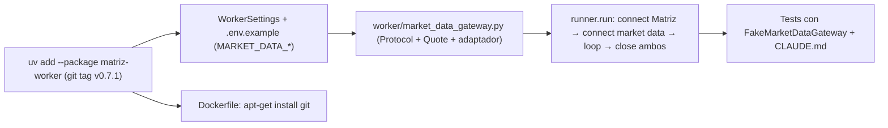

# Plan — Integrar `market-data-client` como única fuente de market data

> Instalar `market-data-client` v0.7.1 en el `worker` con `uv add` desde Git (tag), sumar un gateway tipado análogo a `matriz_gateway.py`, cablearlo en el arranque y apagado, y dejar la regla en `CLAUDE.md` — **appetite: ~1 día · riesgo: bajo-medio** (la dependencia Git exige `git` en la imagen Docker; el chequeo de arranque no valida credenciales).

## Approach



Datos verificados en esta fase (resuelven las preguntas abiertas de `requirements.md`): el paquete no vive en un repo propio sino en el monorepo **público** `gravity-quant/market-libs`, subdirectorio `packages/market-data-client`. El último tag es `market-data-client-v0.7.1`, y el paquete publica `py.typed`, tiene el módulo importable `market_data_client`, requiere Python ≥3.12 y depende de `httpx`, `python-dotenv` y `tenacity`. La estrategia calca el patrón existente de `matriz_gateway.py`: un único módulo `worker/src/worker/market_data_gateway.py` importa la librería y expone un `Protocol` sincrónico más dataclasses propias. `runner.py` lo invoca con `asyncio.to_thread`, y `__main__.py` lo construye con `WorkerSettings`. El chequeo de arranque es `Client.get_health()`, una llamada liviana que se puede hacer sin credenciales. Alternativas descartadas: **Wheel de GitHub Releases (como `matriz-client`):** se descarta porque el pedido exige `uv add` desde Git. **Deploy key SSH con `--mount=type=ssh`:** el repo es público, así que no hace falta autenticación y la decisión condicional de `requirements.md` no aplica. **Cliente async (`market_data_client.aio`):** la decisión resuelta fija un `Protocol` sincrónico, igual que `MatrizGateway`. **Autenticar con un método privado (`Client._authenticate`) para validar credenciales al arrancar:** viola el `reportPrivateUsage` de Pyright strict y acopla el worker a internals de la librería.

## Affected files

| File | Change |
|------|--------|
| `worker/pyproject.toml:5-10` | `uv add` agrega `"market-data-client"` a `[project].dependencies` (AC-1, AC-2) |
| `worker/pyproject.toml:19-21` | `uv add` agrega `market-data-client = { git = "…market-libs.git", subdirectory = "packages/market-data-client", tag = "market-data-client-v0.7.1" }` en `[tool.uv.sources]` (AC-2) |
| `uv.lock:393-406` | Nueva entrada `[[package]] name = "market-data-client"` con `source = { git = "…?subdirectory=…&tag=…#<sha40>" }` y dependencia en `matriz-worker` (AC-3) |
| `pyproject.toml:22-26` | **Sin cambios**: la dependencia no se agrega a la raíz (AC-2) |
| `worker/Dockerfile:2-4` | `RUN apt-get install git` antes del primer `uv sync` (AC-9) |
| `worker/src/worker/settings.py:12-16` | Campos `market_data_*` en `WorkerSettings` (AC-6, AC-7) |
| `.env.example:26-31` | Bloque `# --- Worker / market-data-client ---` con 5 variables (AC-6) |
| `worker/src/worker/market_data_gateway.py` (nuevo) | `MarketDataGatewayError`, `Quote`, `MarketDataGateway` (Protocol), `MarketDataClientGateway` (AC-11, AC-12) |
| `worker/src/worker/runner.py:16-53` | `run`/`serve` reciben `market_data: MarketDataGateway`; conectan, loguean y cierran (AC-13, AC-14) |
| `worker/src/worker/__main__.py:11,36` | Construye `MarketDataClientGateway(settings)` y lo pasa a `serve` (AC-13) |
| `worker/src/worker/matriz_gateway.py:1-4` | Docstring: aclarar que es solo autenticación/conexión, no market data (AC-16) |
| `worker/tests/test_runner.py:17-60+` | `make_settings` con campos `market_data_*`; `FakeMarketDataGateway`; tests de arranque OK/fallo y cierre (AC-13, AC-14, AC-15) |
| `worker/tests/test_market_data_gateway.py` (nuevo) | Traducción de errores y mapeo a `Quote` con `httpx.MockTransport` (AC-12) |
| `worker/tests/test_settings.py:9-52` | `MARKET_DATA_VARS`; mensajes de exit 2 actualizados (AC-7) |
| `CLAUDE.md:7,16-22` | Bullet `worker/` menciona `market-data-client`; regla nueva en `## Convenciones` (AC-17, AC-19) |
| `worker/CLAUDE.md:1-27` | Origen Git, módulo de acceso, variables, regla repetida, nota de autenticación (AC-5, AC-18, AC-19) |

## Root workspace & Docker changes

Comando literal (desde la raíz, equivalente a correrlo dentro de `worker/`):

```bash
uv add --package matriz-worker \
  "market-data-client @ git+https://github.com/gravity-quant/market-libs.git@market-data-client-v0.7.1#subdirectory=packages/market-data-client"
```

Resultado esperado en `worker/pyproject.toml` (lo escribe `uv`, no se edita a mano — AC-1, AC-2):

```toml
[project]
dependencies = [
    "matriz-model",
    "matriz-client==0.3.0",
    "httpx>=0.27",
    "pydantic-settings>=2.4",
    "market-data-client",
]

[tool.uv.sources]
matriz-model = { workspace = true }
matriz-client = { url = "https://github.com/gravity-quant/market-libs/releases/download/matriz-client-v0.3.0/matriz_client-0.3.0-py3-none-any.whl" }
market-data-client = { git = "https://github.com/gravity-quant/market-libs.git", subdirectory = "packages/market-data-client", tag = "market-data-client-v0.7.1" }
```

Forma esperada en `uv.lock` (AC-3):

```toml
[[package]]
name = "market-data-client"
version = "0.7.1"
source = { git = "https://github.com/gravity-quant/market-libs.git?subdirectory=packages%2Fmarket-data-client&tag=market-data-client-v0.7.1#<sha de 40 caracteres>" }
dependencies = [ { name = "httpx" }, { name = "python-dotenv" }, { name = "tenacity" } ]
```

`worker/Dockerfile`: se instala `git` en la única stage, antes de `COPY --from=…uv` (AC-9). No se instala `openssh-client` porque el repo es público y se usa HTTPS:

```dockerfile
FROM python:3.13-slim

# git: uv lo necesita para resolver la fuente Git de market-data-client (uv.lock).
RUN apt-get update \
    && apt-get install -y --no-install-recommends git ca-certificates \
    && rm -rf /var/lib/apt/lists/*

COPY --from=ghcr.io/astral-sh/uv:0.9.0 /uv /uvx /bin/
```

`docker-compose.yml:40-51`: sin cambios. El `env_file: .env` ya inyecta las nuevas variables `MARKET_DATA_*`.

`.env.example`: se agrega un bloque nuevo después del bloque de Matriz, antes de `# --- Tests de integración ---` (AC-6). Todos los valores son de ejemplo, no secretos:

```dotenv
# --- Worker / market-data-client (única fuente de market data) ---
# Obligatorias: el worker sale con código 2 si falta alguna.
# Client ID de la app Auth0 (grant client_credentials)
MARKET_DATA_CLIENT_ID=changeme
# Client secret de la app Auth0 — nunca commitear el valor real
MARKET_DATA_CLIENT_SECRET=changeme
# Audience de la API de market data en Auth0
MARKET_DATA_AUDIENCE=changeme
# Endpoint de tokens de Auth0
MARKET_DATA_AUTH0_TOKEN_URL=https://example.auth0.com/oauth/token
# Opcional: URL base de la API (default de la librería: develop)
MARKET_DATA_BASE_URL=https://market-data-develop.bbsa.com.ar/api
```

## Worker changes

### `settings.py` (AC-6, AC-7)

Los nombres coinciden con las variables que lee la librería (`_state.py` usa `os.getenv("MARKET_DATA_*")`), así que el `.env` no tiene que duplicar valores:

```python
DEFAULT_MARKET_DATA_BASE_URL = "https://market-data-develop.bbsa.com.ar/api"


class WorkerSettings(BaseSettings):
    model_config = SettingsConfigDict(env_file=root_env_file(), extra="ignore")

    matriz_base_url: str
    matriz_username: str
    matriz_password: SecretStr
    market_data_client_id: str
    market_data_client_secret: SecretStr
    market_data_audience: str
    market_data_auth0_token_url: str
    market_data_base_url: str = DEFAULT_MARKET_DATA_BASE_URL
    worker_heartbeat_seconds: float = 30.0
    log_level: str = "INFO"
```

### `market_data_gateway.py` — nuevo, único importador de `market_data_client` (AC-11, AC-12)

```python
"""Adaptador tipado sobre `market-data-client` (única fuente de market data).

Es el único módulo del repo que importa `market_data_client`. Nunca obtener
market data con `matriz-client`.
"""

from dataclasses import dataclass
from datetime import UTC, datetime
from decimal import Decimal
from typing import Protocol

import httpx
from market_data_client import Client, MarketDataError

from worker.settings import WorkerSettings


class MarketDataGatewayError(Exception):
    """Fallo al conectar u obtener market data con market-data-client."""


@dataclass(frozen=True, slots=True)
class Quote:
    symbol: str
    last_price: Decimal | None   # None si el feed no entregó LA para el símbolo
    received_at: datetime        # tz-aware UTC (estampado por el cliente)


class MarketDataGateway(Protocol):
    def connect(self) -> None:
        """Verifica conectividad con la API; lanza `MarketDataGatewayError` si falla."""
        ...

    def get_quote(self, symbol: str) -> Quote | None:
        """Último snapshot del símbolo, o None si la API no devuelve filas."""
        ...

    def close(self) -> None: ...


class MarketDataClientGateway:
    def __init__(
        self,
        settings: WorkerSettings,
        *,
        http_client: httpx.Client | None = None,
        max_retries: int = 2,
    ) -> None:
        # Todo explícito: con `None` la librería cae a `MARKET_DATA_*` de os.environ.
        self._client = Client(
            base_url=settings.market_data_base_url,
            client_id=settings.market_data_client_id,
            client_secret=settings.market_data_client_secret.get_secret_value(),
            audience=settings.market_data_audience,
            auth0_token_url=settings.market_data_auth0_token_url,
            http_client=http_client,
            max_retries=max_retries,
        )

    def connect(self) -> None:
        try:
            self._client.get_health()
        except (MarketDataError, httpx.HTTPError) as exc:
            raise MarketDataGatewayError(str(exc)) from exc

    def get_quote(self, symbol: str) -> Quote | None:
        try:
            snapshots = self._client.get_latest(symbol=symbol)
        except (MarketDataError, httpx.HTTPError) as exc:
            raise MarketDataGatewayError(str(exc)) from exc
        if not snapshots:
            return None
        snap = snapshots[0]
        price = snap.market_data.last.price
        return Quote(
            symbol=snap.symbol,
            last_price=None if price is None else Decimal(str(price)),
            received_at=datetime.fromtimestamp(snap.received_at, tz=UTC),
        )

    def close(self) -> None:
        self._client.close()
```

### `runner.py` (AC-13, AC-14)

Firmas nuevas. `market_data` va como segundo parámetro posicional:

```python
async def _close(name: str, close: Callable[[], None]) -> None: ...  # timeout CLOSE_TIMEOUT_SECONDS, loguea "<name> close failed"

async def run(
    gateway: MatrizGateway,
    market_data: MarketDataGateway,
    settings: WorkerSettings,
    stop: asyncio.Event,
) -> int: ...

async def serve(
    gateway: MatrizGateway,
    market_data: MarketDataGateway,
    settings: WorkerSettings,
) -> int: ...
```

Secuencia de `run`:

1. `await asyncio.to_thread(gateway.connect)`. Si lanza `GatewayError`, se loguea `"matriz-client initialization failed: %s"`, se cierran ambos gateways y se devuelve `1`. Es el comportamiento actual, más el cierre de `market_data`.
2. `logger.info("matriz-client initialized (base_url=%s)", settings.matriz_base_url)`
3. `await asyncio.to_thread(market_data.connect)`. Si lanza `MarketDataGatewayError`, se loguea `logger.error("market-data-client initialization failed: %s", exc)`, se cierran ambos gateways y se devuelve `1` (AC-14).
4. `logger.info("market-data-client initialized (base_url=%s)", settings.market_data_base_url)`
5. Loop de heartbeat sin cambios.
6. Ante `stop`, se cierra primero `market_data` y después `gateway`. Cada cierre usa su propio `wait_for` de 5 s y su propio `try/except`. Después se loguea `"worker stopped"` y se devuelve `0` (AC-13).

### `__main__.py` (AC-13)

```python
from worker.market_data_gateway import MarketDataClientGateway
...
    return asyncio.run(
        serve(MatrizClientGateway(settings), MarketDataClientGateway(settings), settings)
    )
```

### `matriz_gateway.py` (AC-16)

Solo cambia el docstring del módulo: `"Adaptador tipado sobre matriz-client (autenticación/conexión). Es el único módulo que importa matriz_client. No usar para market data: ver worker.market_data_gateway."` El código no cambia, porque hoy solo llama a `Client.login()` y `close()`.

### Tests (AC-7, AC-15)

```python
# worker/tests/test_runner.py
class FakeMarketDataGateway:
    def __init__(self, fail: bool = False) -> None:
        self.fail = fail
        self.connected = False
        self.closed = False

    def connect(self) -> None:
        if self.fail:
            raise MarketDataGatewayError("market data unreachable")
        self.connected = True

    def get_quote(self, symbol: str) -> Quote | None:
        return Quote(symbol=symbol, last_price=Decimal("100.5"), received_at=datetime.now(UTC))

    def close(self) -> None:
        self.closed = True
```

Tests nuevos: `test_market_data_initialized_and_closed_on_stop` (exit 0, `connected` y `closed` en `True`, log `"market-data-client initialized"`), `test_market_data_initialization_failure_returns_1` (exit 1, log `"market-data-client initialization failed: market data unreachable"`, ambos fakes con `closed is True`) y `test_matriz_failure_skips_market_data_connect` (`market_data.connected is False`). `test_signal_stops_with_zero` pasa a recibir los dos fakes.

`worker/tests/test_market_data_gateway.py` usa `httpx.Client(transport=httpx.MockTransport(handler))` y `max_retries=0`, sin red:
- `connect()` con un handler que levanta `httpx.ConnectError` debe lanzar `MarketDataGatewayError`.
- `connect()` con 200 `{"status":"ok","auth":{"configured":true,"enabled":true,"issuer":"x"}}` no lanza.

Los tests importan `worker.market_data_gateway`, no `market_data_client` (AC-11).

## Docs changes

`CLAUDE.md`, bullet `worker/` (línea 7): `` - `worker/` — proceso long-running con `matriz-client` (autenticación) y `market-data-client` (market data). Ver `worker/CLAUDE.md`. ``

`CLAUDE.md`, nuevo bullet en `## Convenciones` (después de la línea 22, AC-17):

```markdown
- El market data se obtiene siempre con `market-data-client`; nunca con `matriz-client`. Único punto de acceso: `worker/src/worker/market_data_gateway.py` (ningún otro módulo importa `market_data_client`).
```

`worker/CLAUDE.md` (AC-5, AC-18):
- Párrafo inicial: origen Git de `market-data-client` (`gravity-quant/market-libs`, tag `market-data-client-v0.7.1`, `subdirectory=packages/market-data-client`), cómo actualizar (`uv add` con un tag nuevo, nunca editando el lock) y la regla de AC-17 junto a `matriz-client`.
- `## Archivos clave`: bullet `src/worker/market_data_gateway.py`, más las variables `MARKET_DATA_*` en el bullet de `settings.py`.
- Nota de autenticación (AC-5, condicional): el repo es público y no requiere credenciales. Si pasara a ser privado, usar `git config url."git@github.com:".insteadOf "https://github.com/"` con `RUN --mount=type=ssh` en Docker y nunca poner tokens en `pyproject.toml`, `uv.lock`, `Dockerfile` ni `.env.example`.
- Actualizar el código de salida 1 en `__main__.py`: falla la conexión a Matriz **o** a market data.

## Key implementation details

- **Ref Git:** se usa el tag `market-data-client-v0.7.1`. Usar un tag y no la rama `main` es una decisión ya resuelta. El SHA lo fija `uv.lock`.
- **El URL difiere del literal de AC-1.** El paquete está en `market-libs.git` con `#subdirectory=packages/market-data-client`, no en `market-data-client.git`. Se usa el URL real; ver Open Questions.
- **Orden de `uv add`:** se corre con `--package matriz-worker` desde la raíz y nunca sin `--package`, porque eso lo agregaría al `pyproject.toml` raíz y violaría AC-2.
- **Docker y git:** `uv sync --frozen --no-install-workspace` (`worker/Dockerfile:18`) ya resuelve la fuente Git, así que `git` tiene que estar instalado antes de esa línea. `ca-certificates` se instala de forma explícita porque `--no-install-recommends` no lo garantiza para `git` sobre HTTPS.
- **Credenciales explícitas:** el constructor de `Client` cae a `os.getenv("MARKET_DATA_*")` cuando un argumento es `None`. El gateway siempre pasa los 5 valores, para que los tests no lean el entorno real.
- **Chequeo de arranque:** `get_health()` (`GET {base_url}/health`) es anónimo, así que valida conectividad y URL pero **no** credenciales Auth0. Con las credenciales `changeme` el worker arranca igual (exit 0 en loop), y el error de Auth0 recién aparece en la primera llamada autenticada. En el estado actual no existe ninguna llamada autenticada.
- **Variables obligatorias:** `MARKET_DATA_CLIENT_ID`, `MARKET_DATA_CLIENT_SECRET`, `MARKET_DATA_AUDIENCE` y `MARKET_DATA_AUTH0_TOKEN_URL`. `MARKET_DATA_BASE_URL` es opcional. `missing_env_vars` las lista en mayúsculas y ordenadas, por ejemplo: `"Missing required environment variables: MARKET_DATA_AUDIENCE, MARKET_DATA_AUTH0_TOKEN_URL, MARKET_DATA_CLIENT_ID, MARKET_DATA_CLIENT_SECRET, MATRIZ_BASE_URL, MATRIZ_PASSWORD, MATRIZ_USERNAME"`. Antes de escribir el assert, verificar el orden real que produce `model.missing_env_vars`.
- **Secretos:** `market_data_client_secret` es `SecretStr`, así que no aparece en `repr(settings)` ni en los logs. Los logs de arranque solo muestran `base_url`.
- **Conversión de tipos:** el `float` de la librería pasa a `Decimal(str(price))`, para evitar artefactos binarios. `received_at` (epoch en segundos, `float`) pasa a `datetime.fromtimestamp(..., tz=UTC)`.
- **Cierre:** `Client.close()` es idempotente y no hace I/O de red, así que se puede llamar aunque `connect()` haya fallado.
- **Pyright:** la librería trae `py.typed` y no hacen falta stubs (AC-8). Si aparecen `reportUnknownMemberType` por `Any` internos, se agrega un ignore puntual con regla en la línea afectada, nunca uno global.

## Risks & rollback

| Risk | Mitigation | How to revert |
|------|------------|---------------|
| `docker compose build worker` falla porque falta `git` o hay un problema de TLS en la resolución Git | Instalar `git` y `ca-certificates` antes del primer `uv sync` y verificar con T10 | Revertir el diff de `worker/Dockerfile` y quitar la dependencia (ver la última fila) |
| El tag se mueve o se borra en `market-libs` | `uv.lock` fija el SHA y `--frozen` lo respeta. Si el tag desaparece, fijar `rev = "<sha>"` | `uv add` con el SHA o con otro tag |
| El worker arranca "OK" con credenciales Auth0 inválidas, porque `get_health` es anónimo | Documentarlo en `worker/CLAUDE.md` y dejarlo en Open Questions | n/a (comportamiento documentado) |
| Pyright strict marca tipos parcialmente desconocidos de la librería | Ignore puntual con regla. Como último recurso, un stub mínimo en `stubs/market_data_client/` | Quitar ignores o stubs junto con el módulo |
| Romper los tests existentes por las firmas nuevas de `run`/`serve` | T10 actualiza todas las llamadas (`test_runner.py:46, 63, 72, 80`) | `git revert` del commit de runner y tests |
| Integración en general | Todo queda en `worker/` + docs + `.env.example` | `uv remove --package matriz-worker market-data-client`, borrar `market_data_gateway.py` y revertir el resto del commit |

## Verification

| AC | Cómo se prueba |
|----|----------------|
| AC-1 | El commit de T1 contiene el comando exacto en el mensaje. `git diff worker/pyproject.toml uv.lock` muestra solo cambios generados por `uv` |
| AC-2 | `grep -n market-data-client worker/pyproject.toml` da 2 líneas (dependency + source). `grep -c market-data-client pyproject.toml` da `0` |
| AC-3 | `grep -A3 'name = "market-data-client"' uv.lock` muestra `#[0-9a-f]{40}` en `source` |
| AC-4 | `uv sync --frozen && uv run python -c "import market_data_client; print(market_data_client.__version__)"` imprime `0.7.1` y sale con 0 |
| AC-5 | Repo público verificado con `gh api repos/gravity-quant/market-libs` (`visibility: public`). La nota condicional queda en `worker/CLAUDE.md`. `grep -rniE 'ghp_\|github_pat_\|x-access-token' worker pyproject.toml uv.lock .env.example` da 0 resultados |
| AC-6 | `test_reads_market_data_env` en `test_settings.py`. `.env.example` tiene las 5 variables, cada una con su comentario |
| AC-7 | `test_missing_env_exits_2_naming_vars` y `test_missing_market_data_env_exits_2` (`main(env_file=None) == 2`) |
| AC-8 | `uv run pyright` sin argumentos da `0 errors`. No hay `# type: ignore` nuevos (`git diff \| grep 'type: ignore'` vacío) |
| AC-9 | `docker compose build worker` sale con 0 |
| AC-10 | `scripts/check.sh` sale con 0 |
| AC-11 | `grep -rln "market_data_client" --include='*.py' model backend worker e2e` lista solo `worker/src/worker/market_data_gateway.py` |
| AC-12 | Inspección de `market_data_gateway.py` (`MarketDataGateway(Protocol)`, `MarketDataClientGateway`, `MarketDataGatewayError`) y `test_market_data_gateway.py` (traducción de `httpx.ConnectError`) |
| AC-13 | `test_market_data_initialized_and_closed_on_stop` y `test_signal_stops_with_zero[SIGINT/SIGTERM]` con los dos fakes |
| AC-14 | `test_market_data_initialization_failure_returns_1` |
| AC-15 | `cd worker && uv run pytest` usa `FakeMarketDataGateway`, sin red |
| AC-16 | `grep -nE "\.(get_|subscribe|market)" worker/src/worker/matriz_gateway.py` da 0 resultados. Solo usa `login()` y `close()` |
| AC-17 | `grep -n "nunca con \`matriz-client\`" CLAUDE.md` encuentra el bullet dentro de `## Convenciones` |
| AC-18 | Revisión de `worker/CLAUDE.md`: origen Git, `market_data_gateway.py`, `MARKET_DATA_*` y regla repetida |
| AC-19 | `grep -ni "market data" CLAUDE.md worker/CLAUDE.md`: revisión manual de que ninguna línea atribuye market data a `matriz-client` |

## Tasks

### Wave 1

- [ ] T1: Ejecutar `uv add --package matriz-worker "market-data-client @ git+https://github.com/gravity-quant/market-libs.git@market-data-client-v0.7.1#subdirectory=packages/market-data-client"` (toca solo `worker/pyproject.toml` y `uv.lock`) — _outcome: `uv run python -c "import market_data_client"` sale con 0 y `uv.lock` fija un SHA de 40 caracteres (AC-1, AC-2, AC-3, AC-4)_
- [ ] T2: Instalar `git` y `ca-certificates` en `worker/Dockerfile` antes del primer `uv sync`, limpiando `/var/lib/apt/lists` — _outcome: el Dockerfile tiene el `RUN apt-get … git` antes de la línea `uv sync --frozen --no-install-workspace` (AC-9)_
- [ ] T3: Agregar los campos `market_data_*` a `WorkerSettings` y el bloque `MARKET_DATA_*` comentado a `.env.example` — _outcome: `WorkerSettings` lee las 5 variables del `.env` raíz y `.env.example` las documenta con valores no secretos (AC-6)_
- [ ] T4: Agregar la regla de market data en `## Convenciones` de `CLAUDE.md` y actualizar el bullet `worker/` — _outcome: `CLAUDE.md` contiene "El market data se obtiene siempre con `market-data-client`; nunca con `matriz-client`" con el módulo de acceso (AC-17, AC-19)_

### Wave 2 (depends on T1, T3)

- [ ] T5: Crear `worker/src/worker/market_data_gateway.py` con `MarketDataGatewayError`, `Quote`, el `MarketDataGateway` Protocol y `MarketDataClientGateway`, y actualizar el docstring de `matriz_gateway.py` — _outcome: `uv run pyright` da 0 errores y es el único módulo que importa `market_data_client` (AC-8, AC-11, AC-12, AC-16)_
- [ ] T6: Actualizar `worker/tests/test_settings.py` (limpieza de `MARKET_DATA_*`, mensajes de variables faltantes, test de lectura y test de exit 2 por variables de market data) — _outcome: `cd worker && uv run pytest tests/test_settings.py` pasa, incluido el caso de exit 2 por `MARKET_DATA_*` faltantes (AC-6, AC-7)_

### Wave 3 (depends on T5)

- [ ] T7: Cablear `market_data` en `runner.run`/`serve` (connect, log, fallo → 1, cierre de ambos) y en `__main__.main` — _outcome: `uv run python -m worker` con `.env` válido loguea "market-data-client initialized" y sale con 0 con Ctrl+C (AC-13, AC-14)_
- [ ] T8: Crear `worker/tests/test_market_data_gateway.py` con `httpx.MockTransport` y `max_retries=0` — _outcome: el test verifica que `httpx.ConnectError` se traduce a `MarketDataGatewayError` y que un health 200 no lanza (AC-12)_
- [ ] T9: Documentar `market-data-client` en `worker/CLAUDE.md` (origen Git, actualización por tag, módulo, variables, regla, nota de repo privado, códigos de salida) — _outcome: `worker/CLAUDE.md` describe la librería y repite la regla junto a `matriz-client` (AC-5, AC-18, AC-19)_

### Wave 4 (depends on T7)

- [ ] T10: Actualizar `worker/tests/test_runner.py` con `FakeMarketDataGateway`, las firmas nuevas y los tests de arranque OK, de fallo de market data y de fallo de Matriz sin conectar market data — _outcome: `cd worker && uv run pytest` pasa sin red y cubre el arranque exitoso y el fallo de inicialización con el fake (AC-13, AC-14, AC-15)_

### Wave 5 (depends on T2, T4, T6, T8, T9, T10)

- [ ] T11: Correr `scripts/check.sh`, `docker compose build worker` y los greps de AC-2, AC-5, AC-11, AC-16 y AC-19 — _outcome: todos los gates salen con 0 y los greps dan los resultados esperados de `## Verification` (AC-2, AC-4, AC-5, AC-8, AC-9, AC-10, AC-11, AC-16, AC-19)_

## Open Questions

1. **URL de AC-1:** el literal pide `git+https://github.com/<org>/market-data-client.git`, pero la librería vive en `gravity-quant/market-libs.git` con `#subdirectory=packages/market-data-client`. El plan usa el URL real, que es el mismo que recomienda el README de la librería. Confirmar que AC-1 se da por cumplido con esta forma.
2. **Autenticación de Docker (decisión resuelta sobre la deploy key SSH):** quedaba condicionada a que el repo fuera privado, pero el repo es **público**. Por eso no se aplica: no se instala `openssh-client` y no se usa `--mount=type=ssh`. Revisar si `market-libs` va a pasar a privado.
3. **Chequeo de arranque sin validar credenciales:** `get_health()` es anónimo. Si se quiere fallar con exit 1 ante credenciales Auth0 inválidas, hace falta una llamada autenticada barata. Una opción es `get_market_data(limit=1)`, pero contradice "no consulta precios". Otra es pedir que la librería exponga un `authenticate()` público.
4. **Campos de `Quote`:** hoy solo trae `symbol`, `last_price` y `received_at`. Ampliarlo (bids, offers, settlement) cuando haya un caso de uso.
5. **`MARKET_DATA_BASE_URL` por defecto apunta a develop.** Confirmar la URL de producción antes de desplegar.

## Critical Decisions

### Critical Decision — T1: `uv` declara la ref como `rev`, no como `tag`
- **Qué:** se aceptó la salida de `uv add` sin editarla: `market-data-client = { git = "https://github.com/gravity-quant/market-libs.git", subdirectory = "packages/market-data-client", rev = "market-data-client-v0.7.1" }`. En `uv.lock` la fuente queda como `…&rev=market-data-client-v0.7.1#3bff927ea1e98dfb353af0f84ef8770a5f7c1039`.
- **Por qué:** con la sintaxis `@<ref>` en la URL, `uv` no puede saber si la ref es un tag o una rama, así que la guarda como `rev`. AC-1 prohíbe editar `pyproject.toml` a mano, y el resultado es el mismo: el SHA queda fijado en el lock (AC-3, NFR-1).
- **Qué afecta:** `worker/pyproject.toml` y `uv.lock`. T9 (`worker/CLAUDE.md`) debe documentar que el campo se llama `rev` y que para actualizar se corre `uv add` con el tag nuevo.

### Critical Decision — T5: el último precio se lee de `market_data.LA`, no de `market_data.last`
- **Qué:** `MarketDataClientGateway.get_quote` toma el último precio de `snap.market_data.LA.price` (un `EntryValue` con `price: float | None`).
- **Por qué:** en `market-data-client` v0.7.1, `MarketDataEntries` declara los campos con los códigos del wire (`LA`, `BI`, `OF`, `CL`, …); el atributo `last` que figura en el snippet del plan no existe y Pyright strict lo rechaza.
- **Qué afecta:** `worker/src/worker/market_data_gateway.py`; T8, si arma un payload de `/marketdata/latest`, debe usar la clave `LA`.

### Critical Decision — T11: greps de AC-11 y AC-16 acotados a imports y llamadas
- **Qué:** AC-11 se verificó con `grep -rnE "^\s*(import|from)\s+market_data_client" --include='*.py' model backend worker e2e` (único resultado: `worker/src/worker/market_data_gateway.py:13`) y AC-16 con `grep -nE "_client\.\w+\(" worker/src/worker/matriz_gateway.py` (solo `login()` y `close()`). Para `docker compose build worker` se usó un `.env` temporal copiado de `.env.example`, que se borró al terminar.
- **Por qué:** los greps literales de `## Verification` dan falsos positivos. `market_data_client` es substring de `market_data_client_id`/`_secret` (settings y tests), y `\.(get_|…)` matchea `.get_secret_value()` y el docstring `worker.market_data_gateway`. Por otro lado, compose exige el `.env` raíz (`env_file`) aun para el build.
- **Qué afecta:** solo la tabla de `## Verification` (AC-11, AC-16, AC-9). No cambia código.
